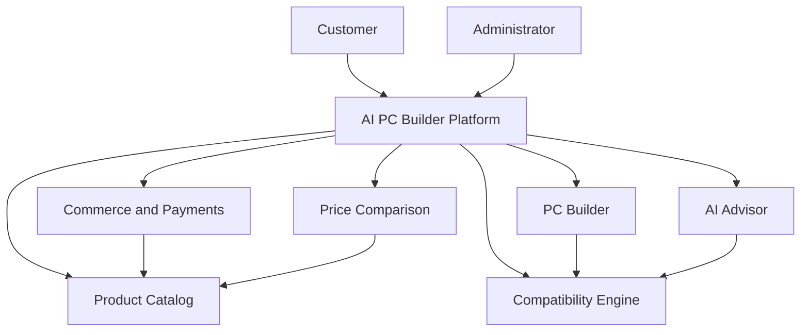

# AI PC Builder — Product Vision

**Document ID:** PRD-001  
**Version:** 1.0 Draft  
**Status:** Proposed  
**Project Type:** Educational / Portfolio Project  
**Target Market:** Vietnam  
**Product Owner:** Project Maintainer

---

## 1. Executive Summary

AI PC Builder is a fullstack PC configuration and e-commerce learning platform designed to help Vietnamese users discover computer components, build compatible PC configurations, compare reference prices, and receive AI-assisted recommendations.

The project also implements a simulated online store with product inventory, shopping carts, checkout, orders, sandbox payments, and webhook processing.

The primary purpose is to demonstrate end-to-end software engineering capabilities, including Product Management, Business Analysis, System Design, Data Engineering, Frontend Engineering, Backend Engineering, AI Engineering, Testing, and DevOps.

The project does not initially target commercial production.

## 2. Problem Statement

Users who want to build a PC may encounter several challenges:

- Limited understanding of PC hardware specifications.
- Difficulty identifying compatible components.
- Uncertainty about which configuration suits their budget and workload.
- Time spent comparing component information and prices across multiple retailers.
- Difficulty understanding why a particular configuration is recommended.

These are **assumed user problems for the learning project**, not findings from validated user interviews.

## 3. Product Vision

> To provide a unified, beginner-friendly PC building platform that helps Vietnamese users discover, configure, evaluate, and purchase simulated PC builds with transparent compatibility checks, price information, and AI-assisted guidance.

## 4. Target Users

### Primary Persona — Beginner PC Builder

A Vietnamese user with limited PC hardware knowledge who wants to build a computer for gaming, studying, or working within a fixed budget.

**Primary needs:**
- Understand available component choices.
- Avoid incompatible hardware.
- Stay within a specified budget.
- Receive clear recommendations and explanations.

### Secondary Persona — Experienced PC Enthusiast

A user who understands PC hardware and wants to compare components, optimize configurations, evaluate pricing, and quickly build alternative setups.

### Administrative Persona

A store administrator responsible for managing products, specifications, pricing, inventory, orders, and reference data.

## 5. Product Value Proposition

AI PC Builder aims to combine the following capabilities in a single experience:

1. **Guided PC Configuration:** Build a PC manually or with AI assistance.
2. **Compatibility Validation:** Identify incompatible or potentially incompatible hardware combinations.
3. **AI Recommendations:** Suggest and explain configurations based on budget and intended usage.
4. **Product Discovery:** Search and compare hardware specifications.
5. **Price Visibility:** Display simulated internal store prices and reference prices from external sellers.
6. **Simulated Commerce:** Practice cart, checkout, payment, order, and inventory workflows.

These capabilities represent the planned product value, not a claim of competitive superiority.

## 6. Product Context

This diagram is a product capability map, not a deployment architecture.

## 7. Product Scope

### In Scope

- User accounts and role-based access.
- Hardware product catalog and specifications.
- Manual PC configuration.
- Hardware compatibility validation.
- AI-assisted PC recommendations.
- Product comparison and price references.
- Shopping cart and checkout.
- Order and inventory management.
- Sandbox payment processing.
- Payment webhook verification and processing.
- Administrative dashboard.
- Data import, normalization, and validation.
- Automated testing and deployment practice.

### Out of Scope — Initial Releases

- Real-money transactions.
- Real supplier inventory synchronization.
- Fulfillment and shipping integrations.
- Commercial affiliate agreements.
- Production-grade hardware performance benchmarking.
- Guaranteed real-time external retailer pricing.
- Native mobile applications.

Out-of-scope features may be reconsidered in later releases.

## 8. Commerce Model

The project supports two distinct commerce concepts.

### Internal Simulated Store

Products have internal prices and inventory quantities. Users can add products to a cart, create orders, and complete payments through a sandbox provider.

The backend manages payment status, order status, inventory consistency, and webhook processing.

### External Reference Offers

A product may have reference offers from multiple external sellers.

Each offer may include:
- Seller name.
- Product URL.
- Reference price.
- Currency.
- Last updated timestamp.
- Availability status, when known.
- Affiliate URL, when legitimately available.

External reference offers are not automatically part of the internal checkout.

## 9. AI Principles

- AI recommendations must use available product and configuration data.
- Compatibility rules must be independently validated by deterministic application logic.
- AI-generated output must be validated before being used by application workflows.
- The system must distinguish verified specifications from missing or uncertain information.
- AI failures must not prevent users from using the manual PC Builder.

## 10. Technology Constraints

| Layer | Decision |
|---|---|
| Frontend | Next.js + TypeScript |
| Backend | NestJS + TypeScript |
| Architecture | Modular Monolith |
| Database | PostgreSQL |
| Documentation | Markdown + Mermaid |
| Payments | Sandbox environment |
| Version Control | Git + GitHub |
| Development Model | Solo development with AI assistance |

Additional technology choices will be recorded through Architecture Decision Records.

## 11. Learning Success Criteria

The project is considered successful when the developer can:

- Explain the product's goals, users, and business requirements.
- Trace requirements to implementation and automated tests.
- Design and explain the system architecture.
- Model products, compatibility rules, orders, payments, and pricing data.
- Implement functional Next.js and NestJS applications.
- Demonstrate reliable sandbox payment and webhook handling.
- Explain the data pipeline and AI recommendation workflow.
- Run and verify the application locally.
- Present technical decisions, limitations, and trade-offs through GitHub documentation.

## 12. Assumptions and Risks

| Assumption / Risk | Planned Mitigation |
|---|---|
| External price data may be unavailable | Use clearly labeled fixtures and simulated data |
| Product specifications may be incomplete | Track missing fields and source provenance |
| AI recommendations may be incorrect | Apply deterministic validation |
| Sandbox payment events may be duplicated | Use idempotent webhook processing |
| Project scope may become excessive | Develop through staged releases |
| Solo development may create knowledge gaps | Use checkpoints, reviews, and architecture records |

## 13. Product Principles

1. Learning outcomes take priority over commercial complexity.
2. Correctness takes priority over feature quantity.
3. The product must remain usable without AI.
4. External prices must be distinguishable from internal prices.
5. Every critical business workflow must be testable.
6. Important design decisions must be documented.
7. Features should be implemented incrementally and demonstrated end-to-end.

---

**Document Status:** Awaiting Product Owner approval.