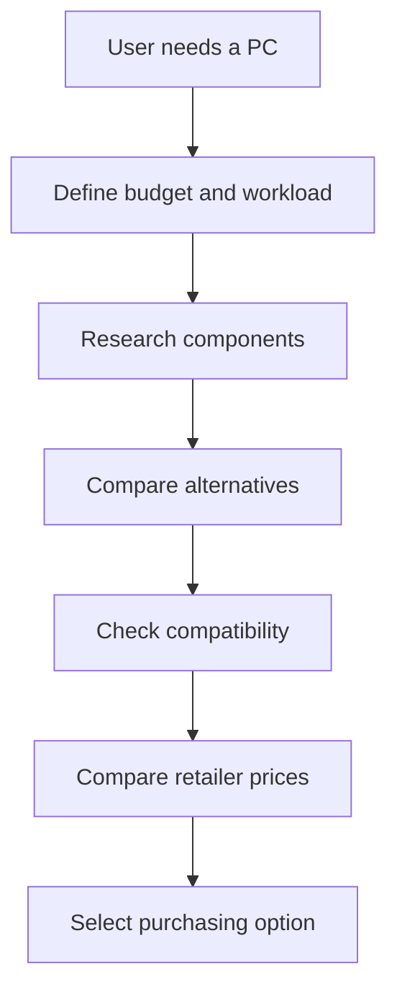
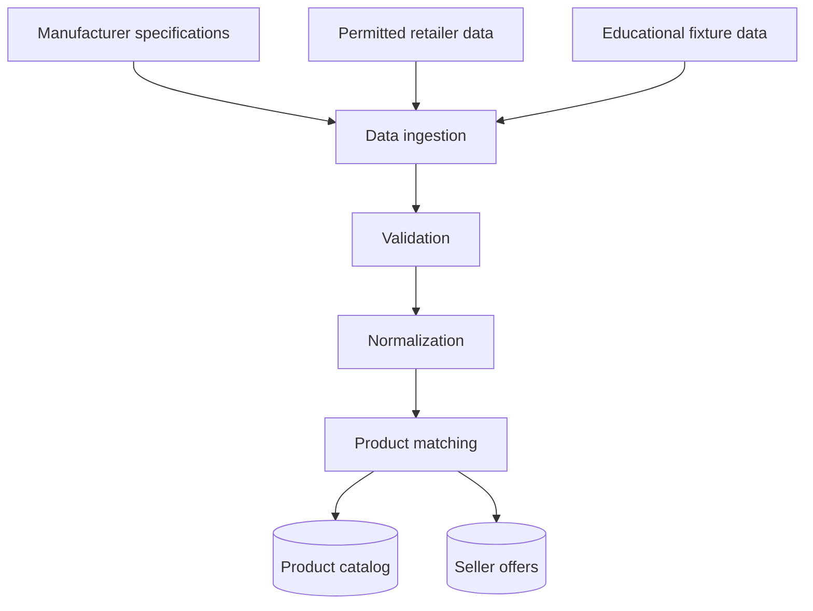
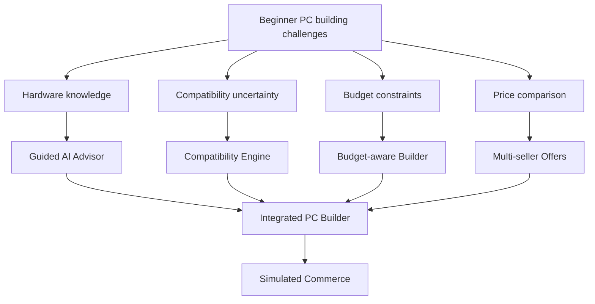

# AI PC Builder — Competitor Analysis

**Document ID:** PRD-002  
**Version:** 1.0 Draft  
**Status:** Proposed  
**Research Date:** 2026-10-23  
**Project Type:** Educational / Portfolio Project  
**Related Document:** PRD-001 — Product Vision

---

## 1. Purpose

This document analyzes existing PC configuration and computer hardware commerce platforms to inform the scope, user experience, data requirements, and engineering priorities of AI PC Builder.

The research supports an educational project and is not intended to establish commercial market viability.

## 2. Research Methodology

The analysis uses publicly available product pages, documentation, and secondary descriptions.

Evidence classifications:

- **Verified:** Supported by an identified public source.
- **Assumed:** A reasonable hypothesis used for educational product planning.
- **Proposed:** A feature or design decision for AI PC Builder.
- **Unknown:** Insufficient evidence to make a reliable determination.

Limitations:

- No real user interviews were conducted.
- No controlled usability tests were performed.
- Competitor backend architecture and private data pipelines were not inspected.
- Current prices, availability, and product functionality may change.

## 3. Competitor Profiles

### 3.1 PCPartPicker

**Category:** PC configuration and parts planning platform.

**Observed capabilities:**
- Component selection.
- Compatibility guidance.
- Retailer price comparison.
- Saved and shareable configurations.

**Engineering opportunities:**
- Product specification modeling.
- Compatibility rule evaluation.
- Multi-retailer offer modeling.
- Configuration persistence.

**Source:** https://pcpartpicker.com/

**Evidence note:** Feature descriptions are supported by publicly available third-party walkthroughs. A complete direct usability audit has not been performed.

### 3.2 Newegg

**Category:** E-commerce platform with PC building tools.

**Verified capabilities:**
- Custom PC Builder.
- Component selection by category.
- Suggested configurations.
- AI-assisted PC building (Beta).
- Integration with a retail shopping experience.

**Engineering opportunities:**
- Catalog-to-cart integration.
- Guided configuration workflows.
- AI recommendation integration.
- Commerce and order processing.

**Source:** https://www.newegg.com/tools/custom-pc-builder

**Important finding:** AI-assisted building is not a unique feature of the proposed AI PC Builder.

### 3.3 GearVN

**Category:** Vietnamese computer hardware retailer.

**Verified capabilities:**
- Computer component catalog.
- PC configuration interface.
- Pricing in Vietnamese dong.
- Prebuilt PC catalog.
- Product filtering by specifications and price.

**Engineering opportunities:**
- Vietnamese hardware product taxonomy.
- Localized pricing.
- Product filtering.
- PC component selection.
- Local market reference data.

**Sources:**
- https://gearvn.com/
- https://buildpc.gearvn.com/

**Limitations:** The complete compatibility validation behavior has not been verified.

## 4. User Experience Analysis

### 4.1 Assumed User Journey

This journey is a planning assumption rather than a measured representation of actual competitor users.

### 4.2 Potential User Friction

| Hypothesis | Proposed Product Response |
|---|---|
| Technical specifications may confuse beginners | Explain specifications in accessible language |
| Users may struggle to balance budget and performance | Offer budget-aware recommendations |
| Compatibility warnings may be difficult to interpret | Provide explanations and alternatives |
| Comparing multiple retailer offers may require extra work | Consolidate reference offers |
| Users may not trust AI-generated builds | Validate recommendations using deterministic rules |

These hypotheses will be used to design testable acceptance criteria.

## 5. Data and Pricing Analysis

AI PC Builder will distinguish three major data concepts.

### 5.1 Product Data

Represents canonical hardware information.

Examples:
- Manufacturer.
- Product model.
- Component category.
- Technical specifications.
- Physical dimensions.
- Compatibility attributes.

### 5.2 Internal Store Data

Represents the simulated e-commerce store.

Examples:
- Internal SKU.
- Selling price.
- Inventory quantity.
- Product availability.
- Order line items.

### 5.3 External Seller Offers

Represents reference offers from other retailers.

Examples:
- Seller identifier.
- Product identifier.
- External listing URL.
- Reference price.
- Currency.
- Last observed timestamp.
- Source and confidence metadata.

An external reference price must not automatically become the internal checkout price.

### 5.4 Data Flow — Proposed

Initial implementation will use a small, controlled dataset. Automated collection from external websites is optional and subject to access and usage permissions.

## 6. Opportunity Analysis

| Opportunity | User Value | Learning Value | Priority |
|---|---|---|---|
| Manual PC Builder | Configure a custom PC | State management, domain modeling | P0 |
| Compatibility Engine | Reduce selection errors | Rules, validation, testing | P0 |
| Product Catalog | Discover hardware | Database, search, API | P0 |
| Internal Checkout | Simulate purchasing | Transactions, order lifecycle | P1 |
| Payment Webhooks | Track payment outcomes | Security, idempotency, reliability | P1 |
| AI Recommendations | Receive guided advice | LLM, tool calling, evaluation | P1 |
| Multi-Seller Pricing | Compare reference offers | Data modeling, ETL, matching | P1 |
| Price History | Understand price changes | Time-series data, analytics | P2 |

Priorities are proposed for the learning roadmap, not based on validated commercial demand.

## 7. Proposed Differentiation

AI PC Builder will focus on an integrated educational implementation of:

1. Vietnamese-language guided PC configuration.
2. Deterministic compatibility validation.
3. Explainable AI recommendations.
4. Internal and external pricing models.
5. Simulated e-commerce checkout.
6. Sandbox payment and webhook workflows.
7. Documented data pipelines.
8. Traceable business rules, architecture decisions, and automated tests.

This is a proposed combination of capabilities, not a claim that competitors lack them.

## 8. Product Opportunity Map

The map connects assumed user problems to proposed product capabilities.

## 9. Engineering Implications

### Frontend Engineering
- Guided and manual building experiences.
- Product filtering and comparison.
- Persistent configuration state.
- Checkout and payment status interfaces.

### Backend Engineering
- Catalog and build APIs.
- Compatibility domain logic.
- Order and inventory transactions.
- Payment provider adapters.
- Secure and idempotent webhook processing.

### Data Engineering
- Canonical product identification.
- Specification normalization.
- Retailer offer matching.
- Data quality validation.
- Price history storage.

### AI Engineering
- Retrieval of product data.
- Structured recommendation generation.
- Tool-assisted compatibility checks.
- Evaluation using known test scenarios.

### System Design
- Modular monolith boundaries.
- Background processing.
- Database consistency.
- Integration failure handling.
- Observability and reliability.

## 10. Research Conclusions

1. PC configuration and compatibility checking are established product capabilities.
2. AI-assisted PC building already exists in competing products.
3. Vietnamese localization alone is not a sufficient claim of unique value.
4. The learning project should prioritize correctness and end-to-end workflow integration.
5. Product specifications, internal store pricing, and external retailer offers should be modeled separately.
6. The project should document limitations rather than claim guaranteed compatibility or real-time price accuracy.

## 11. References

- PCPartPicker: https://pcpartpicker.com/
- Newegg PC Builder: https://www.newegg.com/tools/custom-pc-builder
- Newegg PC Builder Guide: https://www.newegg.com/insider/how-to-use-newegg-custom-pc-builder-step-by-step
- GearVN: https://gearvn.com/
- GearVN Build PC: https://buildpc.gearvn.com/
- PCPartPicker walkthrough: https://www.itechguides.com/how-to-use-pcpartpicker-to-build-a-pc-a-step-by-step-guide/

---
