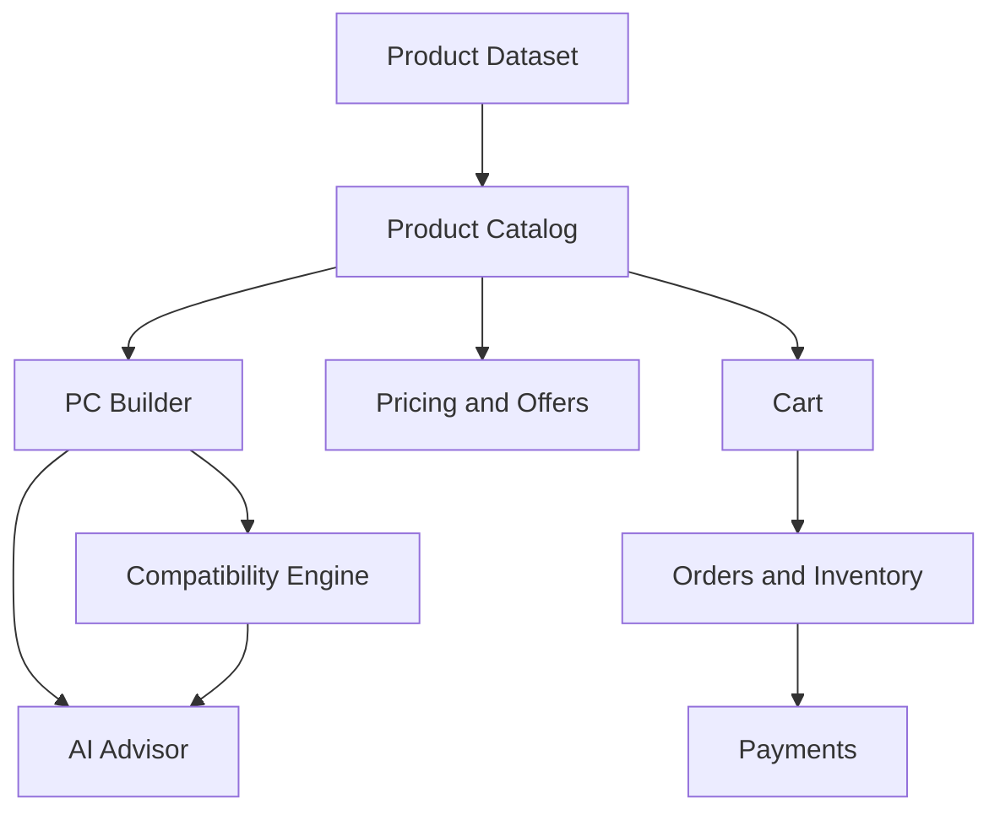

# AI PC Builder — Feature Inventory

**Document ID:** PRD-003  
**Version:** 1.0 Draft  
**Status:** Proposed  
**Project Type:** Educational / Portfolio Project  
**Related Documents:** PRD-001 Product Vision, PRD-002 Competitor Analysis

---

## 1. Purpose

This document defines the planned product capabilities of AI PC Builder, their priorities, release assignments, dependencies, and learning objectives.

It provides the foundation for subsequent Business Analysis, User Stories, Acceptance Criteria, and technical design.

This is a product-level feature inventory. Detailed implementation behavior will be specified separately.

## 2. Feature Hierarchy

The project uses the following hierarchy:

**Epic → Feature → User Story → Acceptance Criteria**

- **Epic:** A major business capability or functional area.
- **Feature:** A specific product capability within an Epic.
- **User Story:** A user-centered requirement describing a desired outcome.
- **Acceptance Criteria:** Testable conditions that determine whether a story is complete.

At this stage, Epics and Features are defined. Detailed User Stories and Acceptance Criteria will be created during Business Analysis.

## 3. Feature Inventory

### EPIC-01 — Identity & User Management

**Goal:** Allow users to manage their accounts and access authorized functionality.

| Feature ID | Feature | Priority | Release |
|---|---|---|---|
| F-001 | User Registration | P0 | R1 |
| F-002 | User Login / Logout | P0 | R1 |
| F-003 | User Profile | P1 | R2 |
| F-004 | Role-Based Access Control | P0 | R1 |
| F-005 | Password Reset | P1 | R3 |

### EPIC-02 — Product Catalog

**Goal:** Allow users to discover and evaluate PC components.

| Feature ID | Feature | Priority | Release |
|---|---|---|---|
| F-006 | Product Listing | P0 | R1 |
| F-007 | Product Detail | P0 | R1 |
| F-008 | Product Search | P0 | R1 |
| F-009 | Category and Specification Filters | P0 | R1 |
| F-010 | Product Comparison | P1 | R2 |
| F-011 | Product Specification Management | P0 | R1 |

### EPIC-03 — PC Builder

**Goal:** Enable users to create and manage custom PC configurations.

| Feature ID | Feature | Priority | Release |
|---|---|---|---|
| F-012 | Manual Component Selection | P0 | R2 |
| F-013 | Build Price Calculation | P0 | R2 |
| F-014 | Save PC Configuration | P0 | R2 |
| F-015 | Edit Saved Configuration | P0 | R2 |
| F-016 | Share Configuration | P1 | R2 |
| F-017 | Duplicate Configuration | P1 | R2 |

### EPIC-04 — Compatibility Engine

**Goal:** Detect incompatible component combinations and explain compatibility risks.

| Feature ID | Feature | Priority | Release |
|---|---|---|---|
| F-018 | CPU–Motherboard Socket Validation | P0 | R2 |
| F-019 | RAM–Motherboard Compatibility | P0 | R2 |
| F-020 | PSU Power Budget Validation | P0 | R2 |
| F-021 | Case–Motherboard Form Factor Validation | P0 | R2 |
| F-022 | GPU and Case Clearance Validation | P1 | R2 |
| F-023 | Compatibility Explanations | P0 | R2 |
| F-024 | Alternative Component Suggestions | P1 | R5 |

### EPIC-05 — AI Advisor

**Goal:** Help users select and optimize PC configurations using AI-assisted guidance.

| Feature ID | Feature | Priority | Release |
|---|---|---|---|
| F-025 | Budget-Based Recommendations | P1 | R5 |
| F-026 | Workload-Based Recommendations | P1 | R5 |
| F-027 | AI Chat Assistant | P1 | R5 |
| F-028 | Build Optimization Suggestions | P1 | R5 |
| F-029 | AI Recommendation Explanations | P1 | R5 |
| F-030 | Recommendation Evaluation | P1 | R5 |

### EPIC-06 — Pricing & Seller Offers

**Goal:** Provide internal store prices and external seller reference offers.

| Feature ID | Feature | Priority | Release |
|---|---|---|---|
| F-031 | Internal Store Pricing | P0 | R1 |
| F-032 | External Seller Offers | P1 | R6 |
| F-033 | Multi-Seller Price Comparison | P1 | R6 |
| F-034 | Price History | P2 | R6 |
| F-035 | External Product Links | P1 | R6 |
| F-036 | Price Freshness Information | P1 | R6 |

### EPIC-07 — Cart & Checkout

**Goal:** Support simulated purchasing workflows.

| Feature ID | Feature | Priority | Release |
|---|---|---|---|
| F-037 | Add Products to Cart | P0 | R3 |
| F-038 | Update Cart Items | P0 | R3 |
| F-039 | Remove Cart Items | P0 | R3 |
| F-040 | Checkout | P0 | R3 |
| F-041 | Order Creation | P0 | R3 |
| F-042 | Order History | P0 | R3 |

### EPIC-08 — Payments

**Goal:** Process sandbox payments and maintain consistent payment and order states.

| Feature ID | Feature | Priority | Release |
|---|---|---|---|
| F-043 | Create Payment Session | P0 | R4 |
| F-044 | Payment Status Tracking | P0 | R4 |
| F-045 | Webhook Signature Verification | P0 | R4 |
| F-046 | Idempotent Webhook Processing | P0 | R4 |
| F-047 | Payment Failure Handling | P0 | R4 |
| F-048 | Sandbox Refund Processing | P1 | R4 |

### EPIC-09 — Inventory & Order Management

**Goal:** Maintain simulated stock and order lifecycle consistency.

| Feature ID | Feature | Priority | Release |
|---|---|---|---|
| F-049 | Inventory Management | P0 | R3 |
| F-050 | Inventory Reservation | P0 | R3 |
| F-051 | Order Status Management | P0 | R3 |
| F-052 | Inventory Release on Failure | P0 | R4 |
| F-053 | Administrative Order Management | P1 | R3 |

### EPIC-10 — Administration

**Goal:** Allow administrators to manage operational data.

| Feature ID | Feature | Priority | Release |
|---|---|---|---|
| F-054 | Admin Dashboard | P1 | R3 |
| F-055 | Product CRUD | P0 | R1 |
| F-056 | Specification Management | P0 | R1 |
| F-057 | Pricing Management | P0 | R1 |
| F-058 | Inventory Administration | P0 | R3 |
| F-059 | Audit Logs | P1 | R4 |

### EPIC-11 — Data Engineering

**Goal:** Establish reliable and traceable product and pricing data.

| Feature ID | Feature | Priority | Release |
|---|---|---|---|
| F-060 | Initial Product Dataset | P0 | R1 |
| F-061 | Data Import Pipeline | P1 | R6 |
| F-062 | Specification Normalization | P1 | R6 |
| F-063 | Duplicate Product Detection | P1 | R6 |
| F-064 | Data Quality Validation | P1 | R6 |
| F-065 | Seller Offer Matching | P1 | R6 |
| F-066 | Scheduled Price Updates | P2 | R6 |

### EPIC-12 — Engineering & Operations

**Goal:** Ensure the system is testable, maintainable, secure, and demonstrable.

| Feature ID | Feature | Priority | Release |
|---|---|---|---|
| F-067 | Repository and Project Setup | P0 | R0 |
| F-068 | Automated Unit Testing | P0 | R1–R7 |
| F-069 | Integration Testing | P0 | R1–R7 |
| F-070 | End-to-End Testing | P1 | R2–R7 |
| F-071 | CI Pipeline | P0 | R0 |
| F-072 | Containerized Local Environment | P1 | R0 |
| F-073 | Structured Logging | P0 | R1 |
| F-074 | Monitoring and Health Checks | P1 | R7 |
| F-075 | Performance Testing | P1 | R7 |
| F-076 | Architecture Documentation | P0 | R0–R7 |

## 4. Capability Dependency Map

The diagram represents major functional dependencies, not runtime network communication.

## 5. Release Strategy

### R0 — Foundation
Establish the repository, product documentation, development standards, and initial architecture.

### R1 — Catalog
Implement a usable product catalog with specifications, search, administration, and internal prices.

### R2 — PC Builder
Implement manual configuration, compatibility checks, and saved builds.

### R3 — Commerce
Implement cart, checkout, order creation, inventory, and order management.

### R4 — Payments
Implement sandbox payments, webhook verification, idempotency, and failure handling.

### R5 — AI
Implement AI-assisted recommendations, explanations, and evaluation.

### R6 — Data
Implement data ingestion, normalization, seller offers, and price comparison.

### R7 — Production Readiness
Complete operational documentation, performance evaluation, monitoring, and deployment practice.

## 6. Scope Control

New features must be evaluated based on:

1. Alignment with the Product Vision.
2. Learning value.
3. Functional dependencies.
4. Implementation complexity.
5. Impact on release objectives.

Features should not be added merely because a competitor provides them.

## 7. Definition of Done — Feature Level

A feature is considered complete when:

- Business requirements and acceptance criteria are documented.
- Relevant architecture and data contracts are defined.
- Implementation meets the accepted requirements.
- Appropriate automated tests pass.
- Errors and important edge cases are handled.
- Documentation is updated.
- The feature can be demonstrated locally.

## 8. Open Questions

- Should anonymous users be allowed to save PC builds locally?
- How should incomplete configurations be represented?
- Which compatibility checks are mandatory for the first release?
- Which payment sandbox provider will be used?
- How should internal product variants and external seller offers be matched?
- What evaluation dataset will be used for AI recommendations?

These questions will be resolved during Business Analysis and System Design.

---