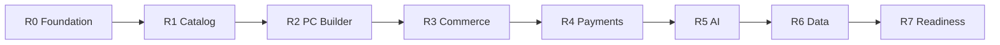
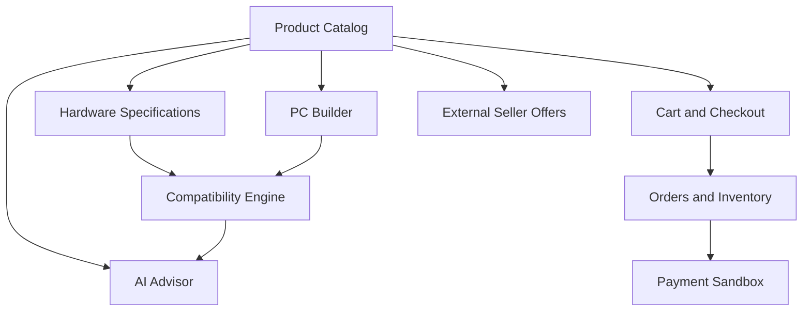

# AI PC Builder — Product Roadmap

**Document ID:** PRD-004  
**Version:** 1.0 Draft  
**Status:** Proposed  
**Project Type:** Educational / Portfolio Project

**Related Documents:**
- PRD-001 — Product Vision
- PRD-002 — Competitor Analysis
- PRD-003 — Feature Inventory

---

## 1. Purpose

This document defines the planned development releases for AI PC Builder, including product capabilities, milestones, dependencies, and release acceptance criteria.

The roadmap is organized around demonstrable learning outcomes rather than commercial launch dates.

## 2. Roadmap Principles

1. Build a functional vertical slice before adding unnecessary complexity.
2. Prioritize product and domain correctness.
3. Use a modular monolith architecture initially.
4. Keep AI optional for core PC building functionality.
5. Separate internal store prices from external seller offers.
6. Implement payment workflows using sandbox environments.
7. Maintain documentation and automated tests throughout development.

## 3. Release Overview

## 4. Release Definitions

### R0 — Engineering Foundation

**Goal:** Establish a maintainable project foundation.

**Scope:**
- Product documentation.
- Business Analysis preparation.
- System architecture.
- GitHub repository.
- Next.js frontend setup.
- NestJS backend setup.
- PostgreSQL development environment.
- Basic CI pipeline.

**Definition of Done:**
- Repository structure is documented.
- Frontend and backend start successfully.
- Database connection is verified.
- Basic automated checks pass.
- Architecture decisions are recorded.

### R1 — Product Catalog

**Goal:** Deliver a functional PC hardware catalog.

**Scope:**
- Product categories.
- Product specifications.
- Product listing and details.
- Search and filtering.
- Internal store pricing.
- Administrative product management.
- Initial fixture dataset.

**Definition of Done:**
- Users can browse hardware components.
- Users can search and filter products.
- Administrators can manage product records.
- Product specifications are validated.
- Core API and database tests pass.

### R2 — PC Builder & Compatibility

**Goal:** Enable manual PC configuration with compatibility feedback.

**Scope:**
- Component selection.
- Configuration editing.
- Build total calculation.
- Saved configurations.
- Compatibility rules.
- Compatibility explanations.
- Configuration sharing.

**Definition of Done:**
- Users can create a PC configuration.
- Users can change selected components.
- Incompatible combinations are identified.
- Missing compatibility data is handled explicitly.
- Saved configurations can be retrieved.
- Core compatibility rules have automated tests.

### R3 — Commerce & Orders

**Goal:** Support a simulated purchasing workflow.

**Scope:**
- Shopping cart.
- Checkout.
- Order creation.
- Inventory management.
- Inventory reservation.
- Order history.
- Administrative order management.

**Definition of Done:**
- Users can create a cart.
- Checkout validates current prices and stock.
- Orders are created with consistent totals.
- Inventory reservations are recorded.
- Order history is available.
- Critical transactional behaviors are tested.

### R4 — Sandbox Payments

**Goal:** Demonstrate reliable payment integration.

**Scope:**
- Payment provider adapter.
- Sandbox payment sessions.
- Payment status tracking.
- Webhook signature verification.
- Webhook idempotency.
- Payment failure handling.
- Inventory release on failed or expired payments.
- Sandbox refund workflow.

**Definition of Done:**
- A user can complete a sandbox payment.
- Verified webhook events update payment state.
- Duplicate webhook events do not duplicate business effects.
- Failed payments are handled consistently.
- Orders cannot become paid solely because the frontend redirects successfully.
- Important failure scenarios have automated tests.

### R5 — AI Advisor

**Goal:** Provide AI-assisted PC recommendations.

**Scope:**
- Budget-based recommendations.
- Workload-based recommendations.
- AI conversation interface.
- Configuration improvement suggestions.
- Recommendation explanations.
- Recommendation evaluation.

**Definition of Done:**
- Users can request recommendations.
- AI suggestions reference available catalog products.
- Recommendations pass deterministic compatibility checks.
- Invalid AI output is rejected or corrected safely.
- Users can continue using the manual builder if AI is unavailable.

### R6 — Data Engineering & Pricing

**Goal:** Build a traceable product and seller pricing data pipeline.

**Scope:**
- Data ingestion.
- Data normalization.
- Product matching.
- Data quality validation.
- External seller offers.
- Price comparison.
- Price history.
- Scheduled data updates.

**Definition of Done:**
- Fixture data can be imported repeatedly.
- Duplicate product records are handled.
- Invalid records are reported.
- External offers are associated with canonical products.
- Users can compare reference prices.
- Prices include source and freshness information.

### R7 — Production Readiness

**Goal:** Demonstrate engineering quality and operational understanding.

**Scope:**
- End-to-end tests.
- Security review.
- Performance testing.
- Structured logging.
- Monitoring.
- Deployment documentation.
- Portfolio demonstrations.
- Architecture and trade-off documentation.

**Definition of Done:**
- Critical workflows have automated coverage.
- The application can be deployed to a learning environment.
- Health checks and logs support troubleshooting.
- Basic performance limitations are documented.
- The repository contains reproducible setup instructions.
- The project can be demonstrated end-to-end.

## 5. Cross-Release Dependencies

## 6. Milestone Acceptance

Each release should provide:

- A working demonstration.
- Updated requirements.
- Updated diagrams where applicable.
- Relevant automated tests.
- Known limitations.
- A GitHub commit or pull request summarizing the implementation.

## 7. Risks

| Risk | Mitigation |
|---|---|
| Excessive project scope | Keep releases independently demonstrable |
| Incorrect compatibility rules | Use explicit rule definitions and test fixtures |
| Payment integration complexity | Start with a sandbox and adapter abstraction |
| AI hallucinations | Validate against catalog data and deterministic rules |
| Unavailable external pricing data | Use labeled educational fixtures |
| Documentation becoming outdated | Update documentation within each release |

## 8. Success Criteria

The roadmap is successful when the project progresses from documented requirements to a working, testable fullstack application with PC configuration, simulated commerce, sandbox payments, AI recommendations, and pricing data workflows.

---

**Document Status:** Awaiting Product Owner approval.