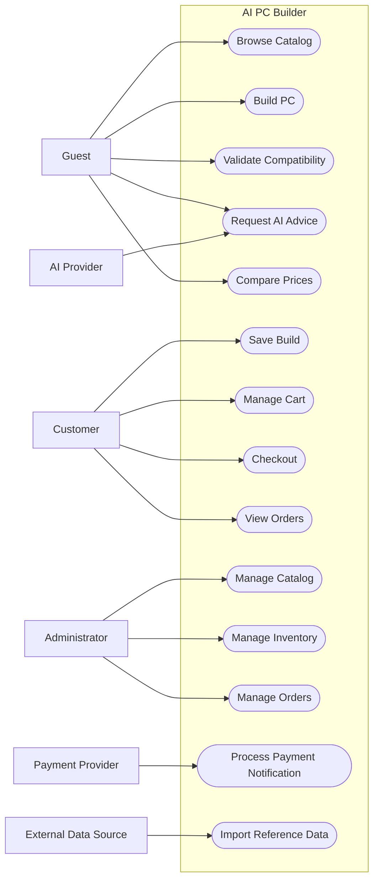

# AI PC Builder — Actors & Use Case Overview

**Document ID:** BA-001  
**Version:** 1.0 Draft  
**Status:** Proposed  
**Related Documents:** PRD-001, PRD-003, PRD-004

---

## 1. Purpose

This document identifies the external actors and primary user goals supported by AI PC Builder.

It establishes the functional boundary of the system and provides input for detailed Use Case Specifications, Business Rules, User Stories, and Acceptance Criteria.

## 2. System Boundary

AI PC Builder is responsible for:

- User identity and authorization.
- Product catalog and internal pricing.
- PC configuration management.
- Compatibility evaluation.
- AI recommendation orchestration.
- Shopping cart and checkout.
- Order and inventory management.
- Payment state management.
- External reference offer management.

External AI services, payment providers, and retailer data sources remain outside the system boundary.

## 3. Actors

| Actor ID | Actor | Description |
|---|---|---|
| ACT-001 | Guest | Unauthenticated user exploring products and PC builds |
| ACT-002 | Customer | Authenticated user managing builds and purchases |
| ACT-003 | Administrator | Authorized user managing operational data |
| ACT-004 | Payment Provider | External service processing sandbox payments |
| ACT-005 | AI Provider | External service generating AI responses |
| ACT-006 | External Data Source | External system providing reference data |

## 4. Primary Use Cases

| Use Case ID | Name | Primary Actor | Related Epic |
|---|---|---|---|
| UC-001 | Browse Products | Guest | EPIC-02 |
| UC-002 | Search and Filter Products | Guest | EPIC-02 |
| UC-003 | View Product Details | Guest | EPIC-02 |
| UC-004 | Create PC Configuration | Guest | EPIC-03 |
| UC-005 | Validate Compatibility | Guest | EPIC-04 |
| UC-006 | Save PC Configuration | Customer | EPIC-03 |
| UC-007 | Request AI Recommendation | Guest | EPIC-05 |
| UC-008 | Compare Reference Prices | Guest | EPIC-06 |
| UC-009 | Manage Shopping Cart | Customer | EPIC-07 |
| UC-010 | Checkout | Customer | EPIC-07 |
| UC-011 | View Order History | Customer | EPIC-07 |
| UC-012 | Manage Products | Administrator | EPIC-10 |
| UC-013 | Manage Inventory | Administrator | EPIC-09 |
| UC-014 | Manage Orders | Administrator | EPIC-09 |
| UC-015 | Process Payment Notification | Payment Provider | EPIC-08 |
| UC-016 | Import Reference Data | External Data Source | EPIC-11 |

## 5. Use Case Overview Diagram

## 6. Example Use Case — Create PC Configuration

**Use Case ID:** UC-004  
**Primary Actor:** Guest  
**Goal:** Create a custom PC configuration.

### Preconditions

- The product catalog is accessible.
- Relevant product data is available.

### Main Flow

1. The user opens the PC Builder.
2. The system displays available component categories.
3. The user selects a component.
4. The system adds the component to the current configuration.
5. The system calculates the updated build total.
6. The system evaluates relevant compatibility rules.
7. The system displays the updated configuration and compatibility results.
8. The user continues editing or finishes the configuration.

### Alternative Flows

- No products are available in a category.
- A selected component conflicts with another component.
- Required specifications are missing.
- A selected product becomes unavailable.

### Postconditions

- The current configuration is available within the active user session.
- Compatibility results reflect the selected components.
- The displayed total is calculated from current internal store prices.

Persisting a configuration to an authenticated account is covered by UC-006.

## 7. Initial Business Assumptions

- Guests can browse products and create temporary PC configurations.
- Authentication is required to save builds to an account.
- Authentication is required for checkout in the initial implementation.
- External reference offers cannot be purchased through internal checkout.
- AI recommendations must be validated against catalog and compatibility data.
- Payment status is determined by verified backend payment events.

These assumptions require confirmation during Business Rules analysis.

## 8. Open Questions

1. Should guest carts be supported?
2. Can a configuration contain multiple products of the same category?
3. Can incomplete configurations be saved?
4. What happens when a product price changes during checkout?
5. How should unknown compatibility be displayed?
6. Which external data import methods are permitted?

## 9. Acceptance Criteria — Document Level

- Primary actors are identified.
- System boundaries are explicit.
- Primary user goals are represented.
- Use cases can be traced to Product Epics.
- External systems are not confused with internal modules.
- Open business questions are recorded.

---

**Document Status:** Awaiting Product Owner approval.