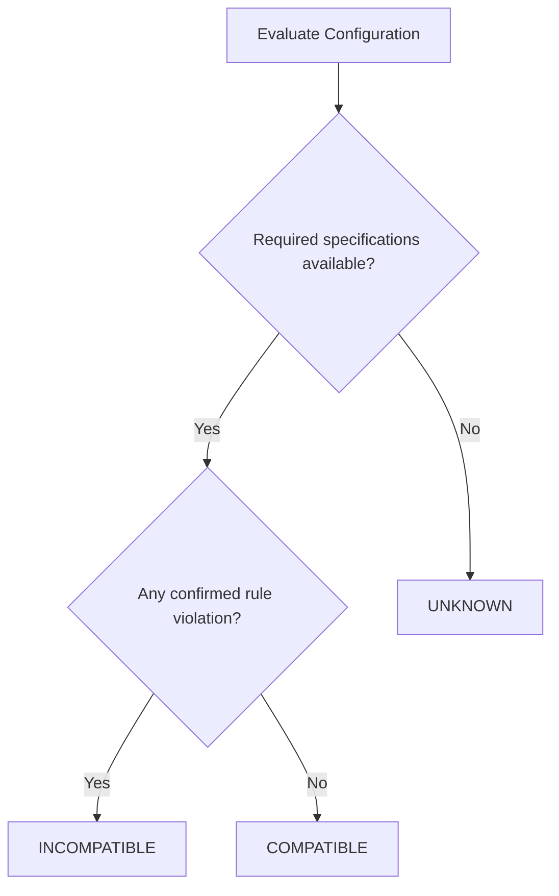
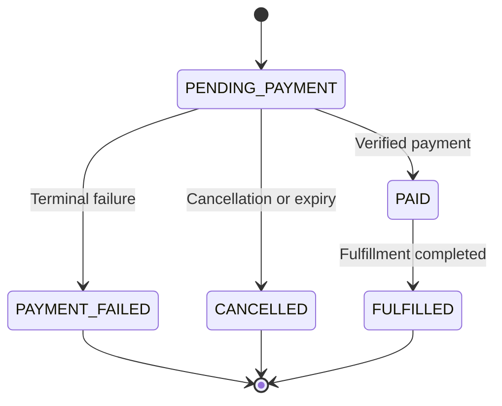

# AI PC Builder — Business Rules Specification

**Document ID:** BA-002  
**Version:** 1.0 Draft  
**Status:** Proposed  
**Project Type:** Educational / Portfolio  
**Related Documents:** PRD-001, PRD-003, BA-001

---

## 1. Purpose

This document defines the business constraints, invariants, and operational policies governing AI PC Builder.

Business Rules describe required system behavior independently of implementation technologies.

Each rule is assigned a unique identifier to support traceability to Use Cases, Acceptance Criteria, implementation, and automated tests.

## 2. Rule Classification

| Classification | Meaning |
|---|---|
| Authorization | Determines permitted actions |
| Validation | Determines acceptable input or state |
| Calculation | Defines how values are computed |
| Invariant | Must remain true across operations |
| Lifecycle | Governs permitted state transitions |
| Integration | Governs interactions with external services |
| Data Quality | Governs data correctness and provenance |

## 3. Identity & Authorization

| Rule ID | Business Rule | Classification |
|---|---|---|
| BR-AUTH-001 | Guests may browse the product catalog without authentication. | Authorization |
| BR-AUTH-002 | Guests may create temporary PC configurations. | Authorization |
| BR-AUTH-003 | Saving configurations to an account requires authentication. | Authorization |
| BR-AUTH-004 | Checkout requires an authenticated customer in the initial release. | Authorization |
| BR-AUTH-005 | Administrative operations require appropriate permissions. | Authorization |
| BR-AUTH-006 | Customers may access only their own private configurations and orders. | Authorization |

## 4. Product Catalog & Pricing

| Rule ID | Business Rule | Classification |
|---|---|---|
| BR-CAT-001 | Every sellable product must belong to a supported product category. | Validation |
| BR-CAT-002 | Product specifications must satisfy category-specific validation rules. | Validation |
| BR-CAT-003 | Internal store prices must be non-negative and denominated in VND. | Validation |
| BR-CAT-004 | Only active and sellable products may be added to checkout. | Authorization |
| BR-CAT-005 | External seller offers must remain separate from internal store prices. | Invariant |
| BR-CAT-006 | Checkout totals must be calculated using authoritative backend prices. | Calculation |
| BR-CAT-007 | Historical order item prices must not change when catalog prices change. | Invariant |

## 5. PC Configuration

| Rule ID | Business Rule | Classification |
|---|---|---|
| BR-PC-001 | A configuration may be incomplete during editing. | Validation |
| BR-PC-002 | Selected components must reference valid catalog products. | Validation |
| BR-PC-003 | The system must recalculate build totals after component changes. | Calculation |
| BR-PC-004 | Build totals must not be treated as guaranteed checkout prices. | Invariant |
| BR-PC-005 | Users may save incomplete configurations. | Authorization |
| BR-PC-006 | Only the owner may modify a private saved configuration. | Authorization |

### Initial Component Quantity Policy

| Component | Initial Quantity Rule |
|---|---|
| CPU | Maximum 1 |
| Motherboard | Maximum 1 |
| GPU | Maximum 1 |
| PSU | Maximum 1 |
| Case | Maximum 1 |
| RAM | Multiple modules or kits permitted, subject to compatibility |
| Storage | Multiple drives permitted |
| CPU Cooler | Maximum 1 |

These are initial product-scope policies, not universal hardware limitations.

## 6. Compatibility Engine

| Rule ID | Business Rule | Classification |
|---|---|---|
| BR-COMP-001 | Compatibility must be evaluated using structured hardware specifications. | Validation |
| BR-COMP-002 | CPU and motherboard sockets must be compatible. | Validation |
| BR-COMP-003 | RAM technology must be supported by the motherboard. | Validation |
| BR-COMP-004 | Case form factor must support the motherboard. | Validation |
| BR-COMP-005 | GPU physical dimensions must fit supported case clearance. | Validation |
| BR-COMP-006 | PSU capacity must satisfy the configured power requirement and defined safety margin. | Calculation |
| BR-COMP-007 | Missing required specification data must produce an unknown or warning result, not an unsupported compatibility claim. | Invariant |
| BR-COMP-008 | AI output must not override deterministic compatibility rules. | Invariant |

### Compatibility Status

**Note:** This is a simplified decision diagram. The detailed engine must aggregate rule-level results so that a confirmed incompatibility is not hidden by missing data in another rule.

## 7. Cart & Checkout

| Rule ID | Business Rule | Classification |
|---|---|---|
| BR-CHECK-001 | Cart quantities must be positive integers. | Validation |
| BR-CHECK-002 | Checkout must revalidate product availability, prices, and stock. | Validation |
| BR-CHECK-003 | The backend is authoritative for order totals. | Invariant |
| BR-CHECK-004 | Order creation and inventory reservation must preserve consistency. | Invariant |
| BR-CHECK-005 | Checkout must reject insufficient available inventory. | Validation |
| BR-CHECK-006 | Repeated checkout submissions must not unintentionally create duplicate orders. | Invariant |
| BR-CHECK-007 | An order must retain the purchased product identifiers, quantities, and price snapshots. | Invariant |

## 8. Inventory

| Rule ID | Business Rule | Classification |
|---|---|---|
| BR-INV-001 | Available inventory must never become negative. | Invariant |
| BR-INV-002 | Reserved inventory must not be sold to another customer. | Invariant |
| BR-INV-003 | Expired unpaid reservations must be released according to the reservation policy. | Lifecycle |
| BR-INV-004 | Inventory release must not be applied twice to the same reservation. | Invariant |
| BR-INV-005 | Successful payment must not automatically increase or restore inventory. | Invariant |

## 9. Orders & Payment Lifecycle

### Proposed Order States

- `PENDING_PAYMENT`
- `PAID`
- `PAYMENT_FAILED`
- `CANCELLED`
- `FULFILLED`

### Proposed Payment States

- `PENDING`
- `SUCCEEDED`
- `FAILED`
- `CANCELLED`
- `REFUNDED`

Order and payment states are separate because an order represents the purchase lifecycle while a payment represents a financial transaction attempt.

**Important:** Refunds, payment retries, late payment notifications, and fulfillment exceptions require a more detailed state model in a later checkpoint. This simplified diagram is not yet an implementation-ready state machine.

## 10. Payment & Webhook Rules

| Rule ID | Business Rule | Classification |
|---|---|---|
| BR-PAY-001 | Payments must be processed through a configured sandbox provider. | Integration |
| BR-PAY-002 | Payment success must be confirmed through a trusted backend verification path. | Integration |
| BR-PAY-003 | Incoming webhooks must pass provider-specific authenticity verification. | Integration |
| BR-PAY-004 | Duplicate webhook events must not duplicate business effects. | Invariant |
| BR-PAY-005 | Webhook processing must tolerate out-of-order delivery. | Integration |
| BR-PAY-006 | Invalid webhook signatures must be rejected. | Validation |
| BR-PAY-007 | Payment amounts and currencies must match the expected payment record. | Validation |
| BR-PAY-008 | A successful payment must not silently transition to failure because of an older event. | Invariant |
| BR-PAY-009 | Payment failures and reservation expiry must follow a defined inventory release policy. | Lifecycle |
| BR-PAY-010 | Refunds must be recorded separately from the original successful payment. | Invariant |

## 11. AI Recommendation Rules

| Rule ID | Business Rule | Classification |
|---|---|---|
| BR-AI-001 | AI recommendations must use identifiable catalog products. | Validation |
| BR-AI-002 | Recommendations must respect the user's stated budget constraints or explicitly disclose deviations. | Validation |
| BR-AI-003 | Recommended configurations must pass deterministic compatibility validation before being presented as compatible. | Invariant |
| BR-AI-004 | AI-generated structured output must be validated before use. | Validation |
| BR-AI-005 | AI provider failure must not prevent manual PC building. | Invariant |
| BR-AI-006 | AI recommendations must not directly change order or payment state. | Authorization |

## 12. External Data & Seller Offers

| Rule ID | Business Rule | Classification |
|---|---|---|
| BR-DATA-001 | External offers must identify their source. | Data Quality |
| BR-DATA-002 | External prices must include collection timestamps. | Data Quality |
| BR-DATA-003 | Imported specifications must pass validation before publication. | Data Quality |
| BR-DATA-004 | Product matching must not silently merge ambiguous products. | Data Quality |
| BR-DATA-005 | External seller offers are reference information and cannot be purchased through internal checkout. | Invariant |
| BR-DATA-006 | Data collection must respect applicable access permissions and source terms. | Integration |

## 13. Open Decisions

The following require detailed analysis before implementation:

1. Inventory reservation timeout and expiration behavior.
2. Checkout idempotency key policy.
3. Payment provider selection.
4. Payment retry and refund lifecycle.
5. Compatibility rule severity and aggregation.
6. PSU safety-margin calculation.
7. Guest cart persistence.
8. Shipping, tax, and discount scope for the simulated store.

## 14. Document Definition of Done

- Business rules have unique identifiers.
- Rules are understandable independently of implementation code.
- Rules are traceable to related features and use cases.
- Conflicting rules have been identified and resolved.
- Open decisions are documented.
- Critical invariants can be translated into automated tests.

---

**Status:** Awaiting Product Owner approval.