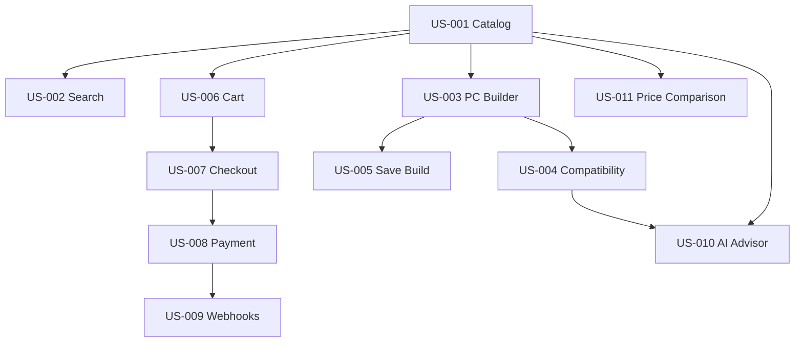

# AI PC Builder — User Stories & Acceptance Criteria

**Document ID:** BA-003  
**Version:** 1.0 Draft  
**Status:** Proposed  
**Project:** AI PC Builder  
**Related Documents:** PRD-003, PRD-004, BA-001, BA-002

---

## 1. Purpose

This document translates prioritized product capabilities and business rules into user-centered, testable requirements.

It defines representative user stories for critical workflows and establishes a standard for creating implementation-ready stories during release planning.

The document is not intended to exhaustively describe every feature in the Product Feature Inventory.

## 2. Story Format

Each user story contains:

- Story ID
- Related Epic and Feature
- User Story
- Priority and Target Release
- Preconditions
- Acceptance Criteria
- Related Business Rules
- Open Questions, where applicable

### Acceptance Criteria Standard

Acceptance criteria should:

1. Describe observable system behavior.
2. Avoid prescribing unnecessary implementation details.
3. Include important failure and boundary scenarios.
4. Be independently testable.
5. Reference applicable business rules.

## 3. Critical User Stories

### US-001 — Browse Product Catalog

**Epic:** EPIC-02 — Product Catalog  
**Features:** F-006, F-007  
**Priority:** P0  
**Target Release:** R1  
**Actor:** Guest  
**Related Rules:** BR-AUTH-001, BR-CAT-001

**User Story**

As a guest, I want to browse PC components by category so that I can discover products suitable for my build.

**Acceptance Criteria**

**AC-001 — Browse active products**

- Given the catalog contains active products
- When the guest opens a supported category
- Then the system displays the active products in that category.

**AC-002 — View product details**

- Given a product is available in the catalog
- When the guest selects that product
- Then the system displays its name, category, specifications, and current internal store price.

**AC-003 — Empty category**

- Given a category contains no visible products
- When the guest opens the category
- Then the system displays an empty state rather than an error.

**AC-004 — Authentication**

- Given the guest is not authenticated
- When the guest browses public products
- Then authentication is not required.

---

### US-002 — Search and Filter Products

**Epic:** EPIC-02  
**Features:** F-008, F-009  
**Priority:** P0  
**Target Release:** R1  
**Actor:** Guest

**User Story**

As a guest, I want to search and filter PC components so that I can narrow down the products matching my requirements.

**Acceptance Criteria**

**AC-001 — Search**

- Given the catalog contains matching products
- When the guest submits a search query
- Then the system returns matching visible products.

**AC-002 — Filter**

- Given the guest selects supported filters
- When the filters are applied
- Then the results satisfy the selected filter conditions.

**AC-003 — No results**

- Given no visible products match the search and filters
- When the query is executed
- Then the system returns an empty result with an appropriate message.

---

### US-003 — Create PC Configuration

**Epic:** EPIC-03 — PC Builder  
**Feature:** F-012  
**Priority:** P0  
**Target Release:** R2  
**Actor:** Guest  
**Related Rules:** BR-PC-001, BR-PC-002, BR-PC-003

**User Story**

As a PC builder, I want to select components for my configuration so that I can plan a complete PC before purchasing.

**Acceptance Criteria**

**AC-001 — Add component**

- Given the user is editing a configuration
- When the user selects a valid catalog product
- Then the product is added to the appropriate component category.

**AC-002 — Replace single-slot component**

- Given a CPU is already selected
- When the user selects another CPU
- Then the previous CPU is replaced according to the single-CPU policy.

**AC-003 — Incomplete configuration**

- Given the user has selected only some components
- When the configuration is displayed
- Then the system permits continued editing and identifies missing required categories.

**AC-004 — Update build total**

- Given a configuration contains selected products
- When the user changes a component
- Then the displayed build total is recalculated.

---

### US-004 — Validate Hardware Compatibility

**Epic:** EPIC-04 — Compatibility Engine  
**Features:** F-018 through F-023  
**Priority:** P0  
**Target Release:** R2  
**Actor:** Guest  
**Related Rules:** BR-COMP-001 through BR-COMP-008

**User Story**

As a PC builder, I want compatibility feedback so that I can avoid selecting hardware that cannot work together.

**Acceptance Criteria**

**AC-001 — Compatible CPU socket**

- Given the CPU requires socket AM5
- And the motherboard supports socket AM5
- When compatibility is evaluated
- Then the CPU–motherboard socket rule returns `COMPATIBLE`.

**AC-002 — Incompatible CPU socket**

- Given the CPU requires socket AM5
- And the motherboard supports socket LGA1700
- When compatibility is evaluated
- Then the CPU–motherboard socket rule returns `INCOMPATIBLE` with an explanation.

**AC-003 — Missing specifications**

- Given the socket specification is unavailable for one component
- When the socket compatibility rule is evaluated
- Then the rule returns `UNKNOWN` rather than asserting compatibility.

**AC-004 — Multiple rule results**

- Given a configuration has a confirmed incompatibility and another rule has missing data
- When the overall compatibility result is calculated
- Then the confirmed incompatibility remains visible and the missing-data warning is preserved.

**AC-005 — Rule independence**

- Given the AI provider is unavailable
- When deterministic compatibility checks are executed
- Then the checks remain operational.

---

### US-005 — Save PC Configuration

**Epic:** EPIC-03  
**Feature:** F-014  
**Priority:** P0  
**Target Release:** R2  
**Actor:** Customer  
**Related Rules:** BR-AUTH-003, BR-PC-005, BR-PC-006

**User Story**

As a customer, I want to save my PC configuration so that I can continue working on it later.

**Acceptance Criteria**

**AC-001 — Save configuration**

- Given the customer is authenticated
- And the configuration contains valid product references
- When the customer saves the configuration
- Then the system persists it under that customer's account.

**AC-002 — Save incomplete configuration**

- Given the customer has an incomplete configuration
- When the customer saves it
- Then the system allows the save operation.

**AC-003 — Unauthorized access**

- Given a configuration belongs to another customer
- When an unauthorized customer attempts to modify it
- Then the system rejects the operation.

---

### US-006 — Add Product to Cart

**Epic:** EPIC-07 — Cart & Checkout  
**Feature:** F-037  
**Priority:** P0  
**Target Release:** R3  
**Actor:** Customer  
**Related Rules:** BR-CHECK-001, BR-CAT-004

**User Story**

As a customer, I want to add products to my shopping cart so that I can purchase multiple components together.

**Acceptance Criteria**

**AC-001 — Add available product**

- Given an active sellable product exists
- When the customer adds a positive quantity
- Then the cart reflects the requested quantity.

**AC-002 — Invalid quantity**

- Given the requested quantity is zero or negative
- When the customer attempts to add the product
- Then the system rejects the request.

**AC-003 — Unavailable product**

- Given the product is not sellable
- When the customer attempts to add it
- Then the system rejects the request with a meaningful error.

---

### US-007 — Checkout and Create Order

**Epic:** EPIC-07  
**Features:** F-040, F-041  
**Priority:** P0  
**Target Release:** R3  
**Actor:** Customer  
**Related Rules:** BR-CHECK-002 through BR-CHECK-007

**User Story**

As a customer, I want to checkout my shopping cart so that I can place an order using the internal store.

**Acceptance Criteria**

**AC-001 — Successful order creation**

- Given the customer is authenticated
- And all cart items are sellable
- And sufficient inventory is available
- When checkout is submitted
- Then the system creates an order with authoritative price snapshots and reserves the required inventory.

**AC-002 — Insufficient stock**

- Given the requested quantity exceeds available inventory
- When checkout is submitted
- Then order creation is rejected without overselling inventory.

**AC-003 — Price changes**

- Given the catalog price has changed since the cart was last displayed
- When checkout is validated
- Then the customer is shown the updated total and must confirm it before order placement.

**AC-004 — Duplicate checkout submission**

- Given a checkout request has already been processed successfully
- When the same request is retried with the same idempotency identity
- Then the system returns the existing outcome without creating another order.

---

### US-008 — Complete Sandbox Payment

**Epic:** EPIC-08 — Payments  
**Features:** F-043, F-044  
**Priority:** P0  
**Target Release:** R4  
**Actor:** Customer  
**Related Rules:** BR-PAY-001, BR-PAY-002, BR-PAY-007

**User Story**

As a customer, I want to complete a sandbox payment so that I can simulate purchasing my PC components.

**Acceptance Criteria**

**AC-001 — Create payment session**

- Given an eligible unpaid order exists
- When the customer starts payment
- Then the system creates a payment attempt associated with that order.

**AC-002 — Verified payment success**

- Given the payment provider confirms a successful payment through a trusted backend verification path
- And the amount and currency match the expected payment
- When the confirmation is processed
- Then the payment is recorded as successful and the order becomes eligible for the `PAID` state.

**AC-003 — Untrusted frontend redirect**

- Given the browser reaches a payment success URL
- But the backend has not verified the payment
- When the customer views the order
- Then the system does not mark the order as paid solely because of the redirect.

---

### US-009 — Process Payment Webhook Safely

**Epic:** EPIC-08  
**Features:** F-045, F-046, F-047  
**Priority:** P0  
**Target Release:** R4  
**Actor:** Payment Provider  
**Related Rules:** BR-PAY-003 through BR-PAY-010

**User Story**

As the payment integration service, I need to process authentic payment notifications safely so that payment and order states remain consistent.

**Acceptance Criteria**

**AC-001 — Valid webhook**

- Given the provider sends an authentic supported event
- When the backend verifies and processes the event
- Then the appropriate payment state transition is applied.

**AC-002 — Invalid signature**

- Given the incoming webhook fails authenticity verification
- When the backend receives it
- Then the event is rejected without changing payment or order state.

**AC-003 — Duplicate event**

- Given a webhook event has already been successfully processed
- When the same event is delivered again
- Then no duplicate business effect occurs.

**AC-004 — Out-of-order event**

- Given a payment is already confirmed successful
- When an older failure event arrives
- Then the older event does not reverse the successful payment.

**AC-005 — Incorrect payment amount**

- Given the webhook refers to a payment amount different from the expected amount
- When the event is validated
- Then the system does not mark the order as paid and records the discrepancy for investigation.

---

### US-010 — Request AI PC Recommendation

**Epic:** EPIC-05 — AI Advisor  
**Features:** F-025, F-026, F-029  
**Priority:** P1  
**Target Release:** R5  
**Actor:** Guest  
**Related Rules:** BR-AI-001 through BR-AI-005

**User Story**

As a PC buyer, I want an AI-generated configuration based on my budget and intended workload so that I can start with a suitable build.

**Acceptance Criteria**

**AC-001 — Budget recommendation**

- Given the user provides a valid budget and workload
- When the recommendation is requested
- Then the system returns an explanation and identifiable catalog products when a valid recommendation is available.

**AC-002 — Compatibility validation**

- Given the AI proposes a configuration
- When the backend evaluates the recommendation
- Then the configuration is validated against deterministic compatibility rules before being described as compatible.

**AC-003 — Invalid AI output**

- Given the AI provider returns malformed or unsupported product data
- When the response is processed
- Then the system rejects the invalid recommendation and returns a controlled error or fallback.

**AC-004 — Provider unavailable**

- Given the AI provider is unavailable
- When the user requests advice
- Then the system handles the failure without disabling manual PC building.

---

### US-011 — Compare External Seller Prices

**Epic:** EPIC-06 — Pricing & Seller Offers  
**Features:** F-032, F-033, F-035, F-036  
**Priority:** P1  
**Target Release:** R6  
**Actor:** Guest  
**Related Rules:** BR-CAT-005, BR-DATA-001 through BR-DATA-005

**User Story**

As a PC buyer, I want to compare prices from external sellers so that I can evaluate alternative purchasing options.

**Acceptance Criteria**

**AC-001 — Display reference offers**

- Given a catalog product has matched external offers
- When the user views price comparisons
- Then the system displays the seller, reference price, source link, and data freshness information.

**AC-002 — Missing offers**

- Given no external offers are available
- When the user views the product
- Then the system displays an appropriate unavailable-data state.

**AC-003 — Internal checkout separation**

- Given an external seller offer is displayed
- When the user chooses that offer
- Then the system directs the user to the external seller rather than adding the external offer to the internal store checkout.

---

## 4. Story Dependency Overview

These edges represent major delivery dependencies, not exhaustive technical dependencies.

## 5. Traceability Example

| Business Rule | User Story | Acceptance Criterion |
|---|---|---|
| BR-COMP-002 | US-004 | AC-001, AC-002 |
| BR-COMP-007 | US-004 | AC-003, AC-004 |
| BR-CHECK-002 | US-007 | AC-001, AC-002, AC-003 |
| BR-PAY-003 | US-009 | AC-001, AC-002 |
| BR-PAY-004 | US-009 | AC-003 |
| BR-PAY-005 | US-009 | AC-004 |
| BR-AI-003 | US-010 | AC-002 |
| BR-DATA-005 | US-011 | AC-003 |

## 6. Definition of Ready

A User Story is ready for implementation when:

- Its user value is clear.
- Relevant business rules are identified.
- Acceptance criteria are testable.
- Important edge cases are addressed.
- Dependencies are understood.
- Unresolved decisions that block implementation are closed.
- The story is sufficiently small for a development iteration.

## 7. Open Decisions

- Guest cart and checkout policies.
- Checkout price-change confirmation mechanism.
- Inventory reservation expiration policy.
- Payment retries and refund behavior.
- Compatibility severity and aggregation.
- AI recommendation evaluation thresholds.
- External data freshness requirements.

These decisions must be resolved before the affected stories are treated as implementation-ready.

---

**Status:** Awaiting Product Owner approval.