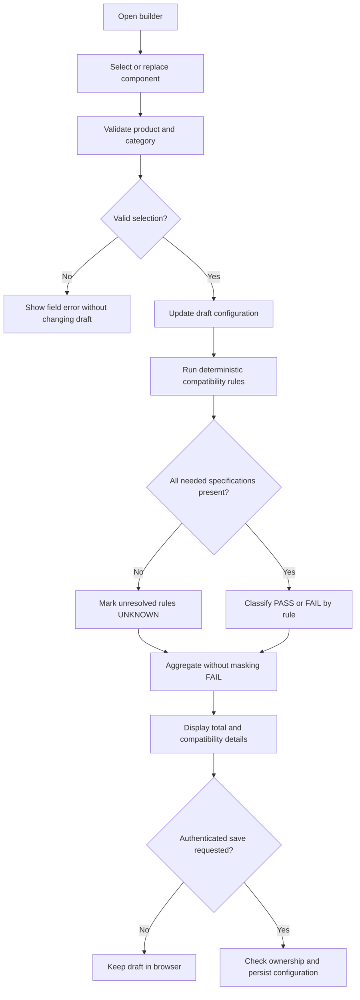
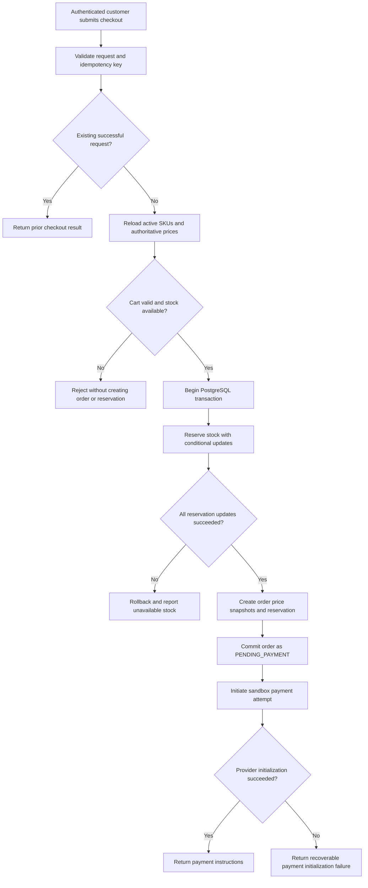
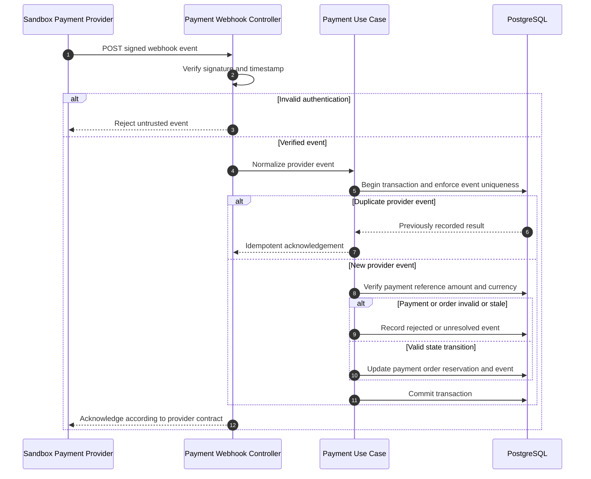
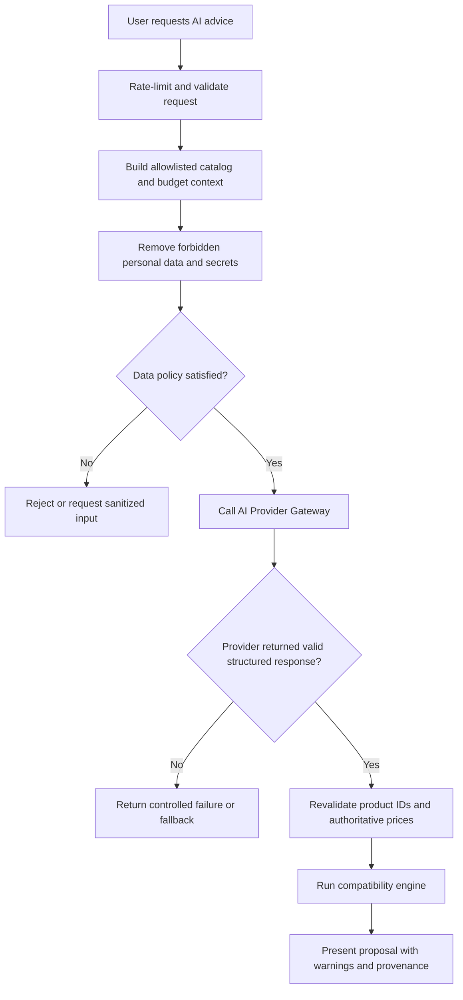
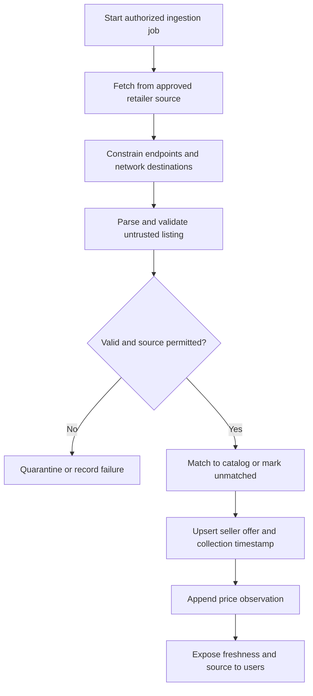

# AI PC Builder — Business Process Modeling

**Document ID:** BA-004  
**Version:** 1.0 Draft  
**Status:** Proposed — Awaiting Review  
**Canonical repository path:** `docs/02-business-analysis/04-business-process-modeling.md`  
**Related documents:** BA-001, BA-002, BA-003, BA-005, BA-006, ARCH-002, ARCH-004  
**Scope:** Business workflows, not implemented backend services or executable migrations.

## 1. Purpose and boundaries

This specification translates core use cases into business processes, actors, decisions, failure paths and business invariants. All checkout and payment flows are **educational/sandbox**. External seller offers are references, not purchasable inventory within internal checkout.

## 2. Primary actor-process matrix

| Process | Trigger | Primary actor | Outcome | Related use cases |
|---|---|---|---|---|
| Configure PC | User selects or replaces a part | Guest or Customer | Updated draft and compatibility results | UC-004, UC-005 |
| Save configuration | Customer requests save | Customer | Persisted owner-scoped draft | UC-006 |
| Checkout and reserve | Customer submits cart | Customer | Order pending payment with inventory held, or rejected | UC-009, UC-010 |
| Process payment event | Provider delivers signed notification | Payment Provider | Verified payment state transition and inventory settlement | UC-015 |
| AI recommendation | User asks for suggestions | Guest or Customer | Validated candidate configuration or safe refusal | UC-007 |
| Import seller offers | Scheduled or admin-triggered ingestion | External Data Source | Validated, timestamped reference offers | UC-016 |

## 3. PC build and compatibility workflow

**Invariants:** `BR-COMP-007` prevents missing specifications from appearing as proven compatible. `BR-COMP-008` prevents AI from overriding deterministic checks. Draft prices are estimates, never authoritative checkout amounts. Anonymous drafts do not require server persistence in the MVP.

## 4. Checkout and inventory reservation

**Transactional boundary:** Reservation and order creation must be atomic. Calling a remote payment provider should not hold open a PostgreSQL transaction. A failed provider initialization requires a documented recovery policy; it must not silently leak stock reservations. `checkout_idempotency_key` is customer-scoped and must reject payload mismatch. The reservation TTL is an **open business decision**, not fixed by this draft.

## 5. Verified payment notification and fulfillment

**Failure paths:** Duplicate and out-of-order events must not duplicate order effects. An event reporting success after order cancellation or reservation expiry follows an explicit **late-payment resolution** path: never automatically reopen the order or fulfill without an agreed policy. Browser redirects do not constitute payment confirmation. Refunds require their own verified state transitions.

## 6. AI-assisted configuration

The model provides suggestions only. The backend owns data validation, inventory, pricing, and compatibility. Do not transmit email, address, raw access credentials or complete order records to an external AI provider. Provider policy and retention must be reviewed before processing real user data.

## 7. Seller reference offer ingestion

External prices never replace internal checkout prices. The source's legal/technical permissions, SSRF constraints, request limits and data freshness policy require validation before running an actual collector.

## 8. Cross-process state ownership

| Domain | Authoritative decision | Forbidden shortcut |
|---|---|---|
| Compatibility | Deterministic compatibility rules | Model text declares incompatible hardware safe |
| Catalog and price | Backend catalog and checkout repricing | Trusting client-submitted subtotal |
| Inventory | Atomic reservation transaction | Read-then-write without concurrency control |
| Payment | Authenticated backend provider events | Treating redirect URL as payment proof |
| AI | Validated allowlisted context and response | Passing entire user/order objects |
| Reference offers | Validated seller observation with timestamp | Treating third-party price as current store offer |

## 9. Acceptance and verification scenarios

| ID | Given | When | Then |
|---|---|---|---|
| BPM-001 | Incomplete component specs | Compatibility runs | UNKNOWN is displayed; never false PASS |
| BPM-002 | Two checkouts competing for last unit | Requests overlap | At most one reservation succeeds |
| BPM-003 | Identical checkout idempotency key and request | Client retries | Existing result returned, no duplicate order |
| BPM-004 | Same idempotency key but different payload | Client retries | Conflict rejected, no duplicate order |
| BPM-005 | Forged webhook | Payment notification received | Payment and order unchanged |
| BPM-006 | Replayed verified webhook | Event delivered twice | Exactly one business effect |
| BPM-007 | Success webhook after cancellation | Event arrives late | Held for defined resolution, not auto-fulfilled |
| BPM-008 | AI recommends noncatalog SKU | Output validated | SKU rejected, not presented as purchasable |
| BPM-009 | Imported retailer price | UI renders offer | Source and collection timestamp retained |

## 10. Open decisions and handoff

| ID | Open policy | Required before |
|---|---|---|
| DEC-001 | Reservation expiration TTL and cleanup | Inventory implementation |
| DEC-002 | Payment retry and provider-init failure recovery | Payment orchestration |
| DEC-003 | Late payment resolution and refund flow | Webhook implementation |
| DEC-004 | Tax shipping discount policies | Checkout API and calculations |
| DEC-005 | Sandbox provider contract | Payment adapter |
| DEC-006 | Compatibility severity and aggregation priority | Compatibility engine |

**Handoff:** Cross-check UC and BR identifiers with BA-001–003; reconcile business state transitions with BA-005; establish HTTP schemas in ARCH-005 and PostgreSQL transaction details in ARCH-004. This document is a proposed specification, not evidence of implementation or completed tests.
