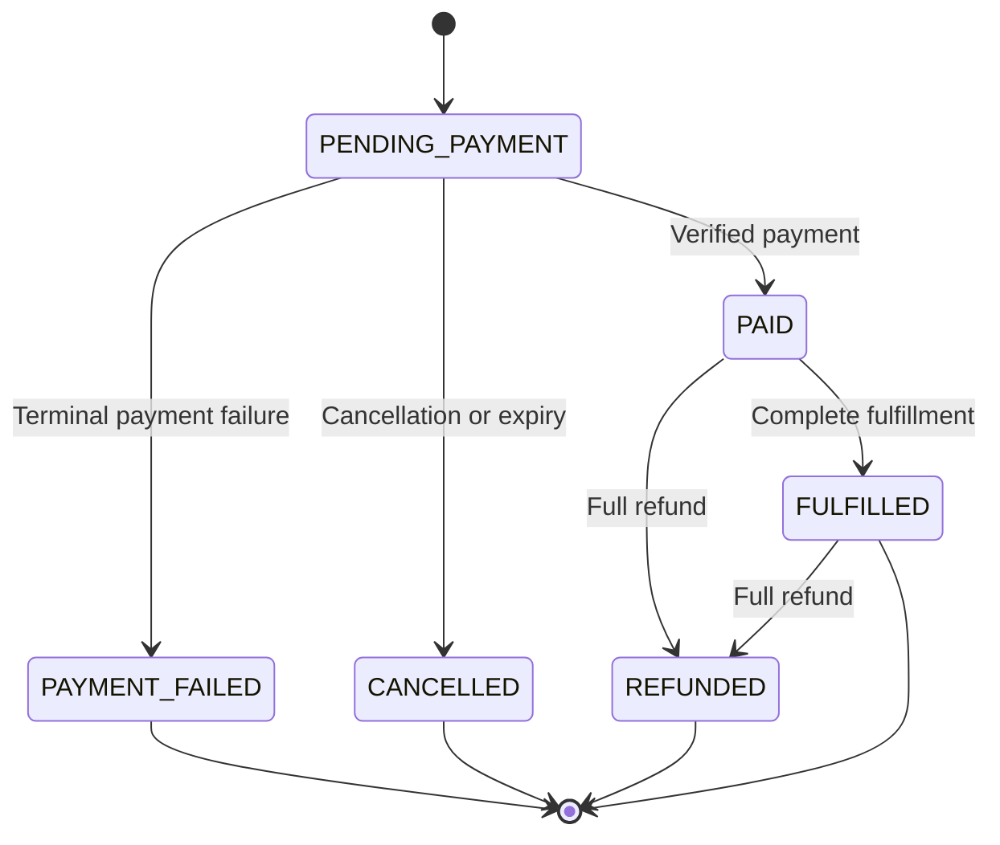
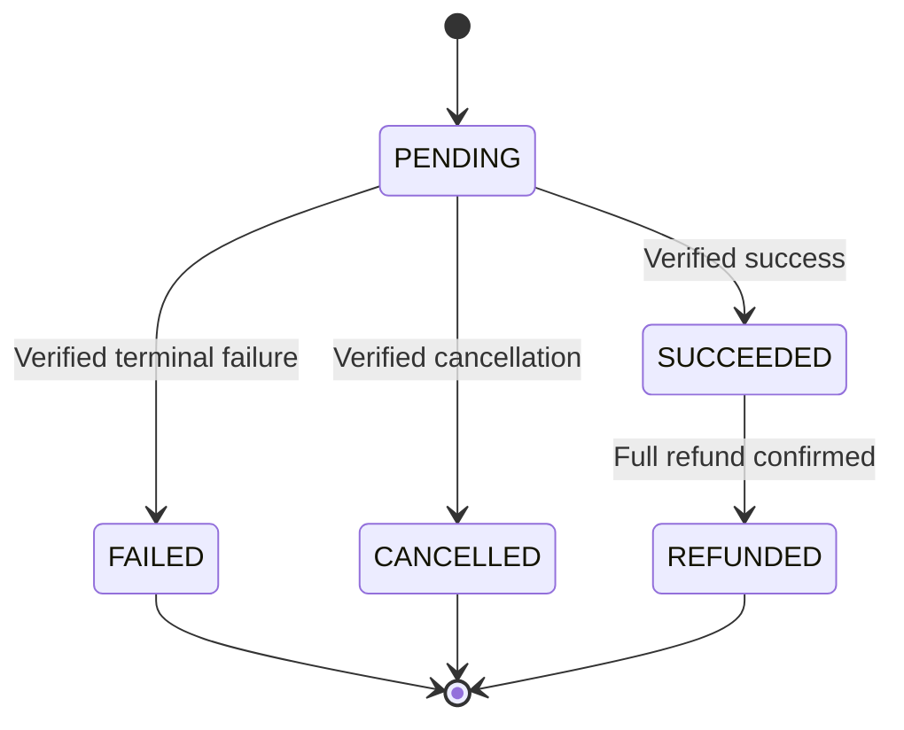
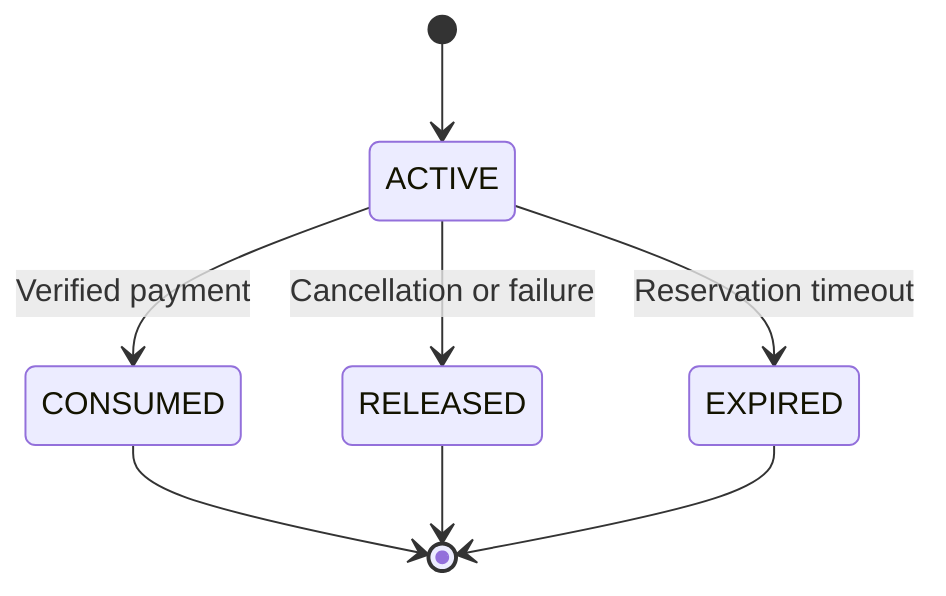
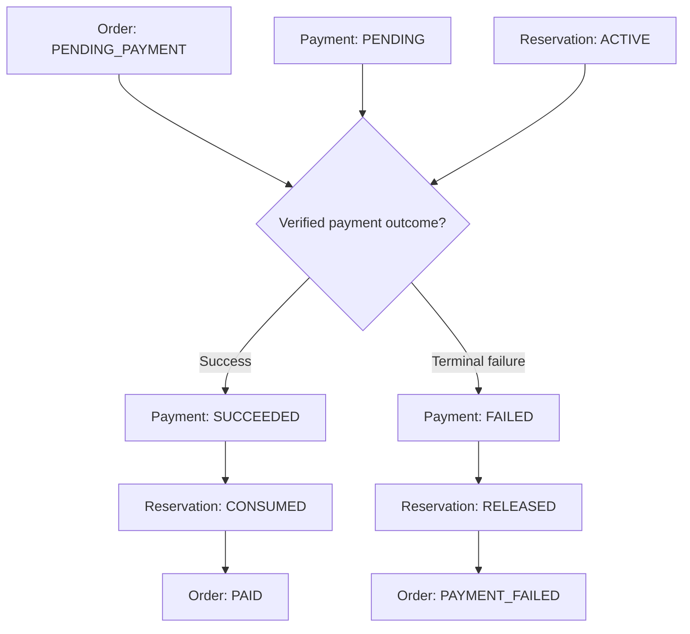

# AI PC Builder — State Machine Specification

**Document ID:** BA-005  
**Version:** 1.0 Draft  
**Status:** Proposed  
**Related Documents:** BA-002, BA-003, BA-004

---

## 1. Purpose

Define the business lifecycle and valid state transitions for orders, payment attempts, and inventory reservations.

These state machines are conceptual business models. Database transactions, concurrency controls, provider-specific event mappings, and retry mechanisms will be defined during System Design.

## 2. Design Principles

1. Order, Payment, and Inventory Reservation are separate business entities.
2. Every state transition must have an explicit trigger and precondition.
3. Duplicate requests must not duplicate business effects.
4. Invalid transitions must be rejected or safely ignored.
5. Payment success must be verified by a trusted backend process.
6. State changes affecting multiple entities must preserve consistency.
7. Historical events must remain traceable.

## 3. Order State Machine

### 3.1 States

| State | Meaning |
|---|---|
| PENDING_PAYMENT | Order created, awaiting payment |
| PAID | Payment verified and order accepted |
| PAYMENT_FAILED | Payment flow ended unsuccessfully |
| CANCELLED | Order cancelled before fulfillment |
| FULFILLED | Order fulfillment completed |
| REFUNDED | Fully refunded order |

`REFUNDED` represents a full refund. Partial refunds are outside the initial implementation scope.

### 3.2 Diagram

### 3.3 Transition Rules

| From | To | Trigger | Required Condition |
|---|---|---|---|
| PENDING_PAYMENT | PAID | Payment verified | Matching successful payment; inventory policy satisfied |
| PENDING_PAYMENT | PAYMENT_FAILED | Terminal payment failure | No successful payment has been confirmed |
| PENDING_PAYMENT | CANCELLED | Cancellation or expiry | No confirmed successful payment |
| PAID | FULFILLED | Fulfillment completed | Authorized fulfillment operation |
| PAID | REFUNDED | Full refund confirmed | Valid refund of successful payment |
| FULFILLED | REFUNDED | Full refund confirmed | Valid post-fulfillment refund |

### 3.4 Forbidden Transitions

- `CANCELLED → PAID` through an ordinary delayed webhook.
- `REFUNDED → PAID`.
- `FULFILLED → PENDING_PAYMENT`.
- `PAID → PAYMENT_FAILED` due to a stale failure event.

A successful payment received after cancellation must enter an explicit late-payment resolution workflow, not silently reopen the order.

## 4. Payment Attempt State Machine

### 4.1 States

| State | Meaning |
|---|---|
| PENDING | Payment attempt initiated |
| SUCCEEDED | Provider-confirmed payment success |
| FAILED | Payment attempt failed |
| CANCELLED | Payment attempt cancelled |
| REFUNDED | Successful payment fully refunded |

### 4.2 Diagram

### 4.3 Rules

- A payment attempt belongs to one order.
- An order may have multiple payment attempts if retries are supported.
- A payment attempt must not be marked successful without trusted verification.
- Payment amount and currency must match the expected payment.
- Duplicate webhook delivery must not duplicate transitions or business effects.
- Older events must not reverse a confirmed successful payment.
- Refunds must retain a traceable relationship with the original payment.

A payment retry creates a new attempt rather than resetting a terminal attempt to `PENDING`.

## 5. Inventory Reservation State Machine

### 5.1 States

| State | Meaning |
|---|---|
| ACTIVE | Inventory is reserved for an unpaid order |
| CONSUMED | Reservation committed to a paid order |
| RELEASED | Reservation released due to cancellation or failure |
| EXPIRED | Reservation expired and inventory was released |

### 5.2 Diagram

### 5.3 Rules

- Available inventory must not become negative.
- A reservation may be consumed only once.
- A reservation may be released only once.
- Consuming a reservation requires a valid payment and order state.
- Expiration must not release inventory already consumed.
- Reservation state changes must be concurrency-safe.

## 6. Cross-Entity State Coordination

This diagram represents expected outcomes, not the database write order.

The transitions must be coordinated to prevent inconsistent states.

## 7. Exceptional Scenarios

### 7.1 Duplicate Webhook

**Given:** A successful payment event was already processed.

**When:** The same event arrives again.

**Then:** No additional inventory consumption, order transition, or financial effect occurs.

### 7.2 Out-of-Order Failure

**Given:** Payment is already `SUCCEEDED`.

**When:** An older failure event arrives.

**Then:** The successful state remains unchanged.

### 7.3 Payment After Reservation Expiry

**Given:** Reservation has expired and stock has been released.

**When:** A verified successful payment arrives.

**Then:** The system must not automatically consume the expired reservation or mark the order fulfillable.

The payment must be recorded and routed to a defined late-payment resolution policy.

### 7.4 Concurrent Inventory Reservation

**Given:** Only one unit is available.

**When:** Two customers attempt to reserve it concurrently.

**Then:** At most one reservation succeeds.

### 7.5 Duplicate Checkout

**Given:** An order was already created for an idempotent checkout request.

**When:** The same request is retried.

**Then:** The system returns the original result rather than creating a second order.

## 8. Open Decisions

The following policies require approval before implementation:

1. Reservation timeout duration.
2. Late successful payment resolution.
3. Whether terminal payment failure immediately fails the order or permits another payment attempt.
4. Refund eligibility and authorization.
5. Whether cancellation is permitted after payment.
6. Fulfillment model for the educational store.
7. Inventory restoration after refunds.

The diagrams above use simplified initial-release assumptions. In particular, `PAYMENT_FAILED` is treated as a terminal order outcome, so payment retries must be resolved before implementing that transition.

## 9. Document Definition of Done

- Business states are explicitly defined.
- Valid transitions have triggers and preconditions.
- Forbidden transitions are documented.
- Cross-entity consistency requirements are identified.
- Exceptional scenarios are covered.
- Open policy decisions are recorded.
- State machines are traceable to business rules and tests.

---

**Status:** Awaiting Product Owner approval.