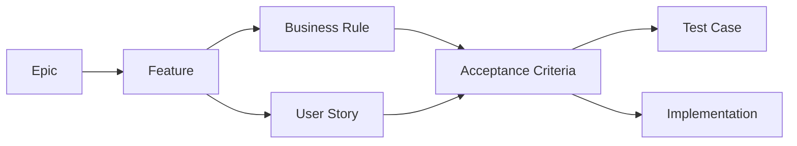

# AI PC Builder — Requirements Traceability Matrix

**Document ID:** BA-006  
**Version:** 1.0 Draft  
**Status:** Proposed  
**Related Documents:** PRD-003, BA-002, BA-003, BA-004, BA-005

---

## 1. Purpose

The Requirements Traceability Matrix connects product capabilities to business rules, user stories, acceptance criteria, and planned verification activities.

It helps ensure that:

- Important requirements are not omitted.
- Implementation decisions remain aligned with product goals.
- Business rules have test coverage.
- Changes can be assessed for downstream impact.
- GitHub documentation remains auditable.

## 2. Traceability Model

Relationships may be many-to-many.

A business rule may support multiple stories, and a single story may reference several business rules.

## 3. Initial Traceability Matrix

| Feature | Business Rule | User Story | Acceptance Criteria | Planned Test |
|---|---|---|---|---|
| F-006 Product Listing | BR-AUTH-001 | US-001 | AC-001, AC-004 | TC-CAT-001 |
| F-008 Product Search | BR-CAT-001 | US-002 | AC-001, AC-003 | TC-CAT-002 |
| F-012 Manual Builder | BR-PC-001, BR-PC-002 | US-003 | AC-001, AC-003 | TC-PC-001 |
| F-018 Socket Validation | BR-COMP-002 | US-004 | AC-001, AC-002 | TC-COMP-001 |
| F-023 Compatibility Explanation | BR-COMP-007 | US-004 | AC-003, AC-004 | TC-COMP-002 |
| F-014 Save Configuration | BR-PC-005, BR-PC-006 | US-005 | AC-001, AC-002, AC-003 | TC-PC-002 |
| F-037 Add to Cart | BR-CHECK-001 | US-006 | AC-001, AC-002 | TC-CART-001 |
| F-040 Checkout | BR-CHECK-002, BR-CHECK-003 | US-007 | AC-001, AC-003 | TC-CHECK-001 |
| F-041 Order Creation | BR-CHECK-004, BR-CHECK-006 | US-007 | AC-001, AC-004 | TC-ORDER-001 |
| F-050 Inventory Reservation | BR-INV-001, BR-INV-002 | US-007 | AC-002 | TC-INV-001 |
| F-043 Payment Session | BR-PAY-001 | US-008 | AC-001 | TC-PAY-001 |
| F-044 Payment Tracking | BR-PAY-002 | US-008 | AC-002, AC-003 | TC-PAY-002 |
| F-045 Signature Verification | BR-PAY-003, BR-PAY-006 | US-009 | AC-002 | TC-PAY-004 |
| F-046 Webhook Idempotency | BR-PAY-004 | US-009 | AC-003 | TC-PAY-003 |
| F-047 Payment Failure | BR-PAY-005, BR-PAY-008 | US-009 | AC-004 | TC-PAY-005 |
| F-025 AI Recommendation | BR-AI-001, BR-AI-003 | US-010 | AC-001, AC-002 | TC-AI-001 |
| F-033 Price Comparison | BR-DATA-001, BR-DATA-002 | US-011 | AC-001 | TC-DATA-001 |
| F-035 External Links | BR-DATA-005 | US-011 | AC-003 | TC-DATA-002 |

Acceptance Criterion IDs are scoped to their User Story. For example, `US-009/AC-003` is the complete identifier.

## 4. Planned Test Case Catalog

| Test Case | Scenario | Test Level |
|---|---|---|
| TC-CAT-001 | Guest browses visible products | Integration |
| TC-CAT-002 | Search returns matching products | Integration |
| TC-PC-001 | User selects valid components | Unit / Integration |
| TC-PC-002 | Customer saves a configuration | Integration |
| TC-COMP-001 | CPU socket compatibility | Unit |
| TC-COMP-002 | Missing specification handling | Unit |
| TC-CART-001 | Invalid cart quantity rejected | Unit / Integration |
| TC-CHECK-001 | Price changed before checkout | Integration |
| TC-ORDER-001 | Duplicate checkout submission | Integration |
| TC-INV-001 | Concurrent stock reservation | Integration |
| TC-PAY-001 | Payment session creation | Integration |
| TC-PAY-002 | Verified payment updates order | Integration |
| TC-PAY-003 | Duplicate webhook has no repeated effect | Integration |
| TC-PAY-004 | Invalid webhook signature rejected | Integration |
| TC-PAY-005 | Older failure event cannot reverse success | Integration |
| TC-AI-001 | AI recommendation passes validation | Unit / Integration |
| TC-DATA-001 | External offer includes source and timestamp | Integration |
| TC-DATA-002 | External offer bypasses internal checkout | Integration |

These test cases are planned identifiers, not implemented or passing tests.

## 5. Traceability Status

| Status | Meaning |
|---|---|
| Planned | Requirement identified but not implemented |
| Ready | Requirement sufficiently specified |
| Implemented | Code completed |
| Verified | Acceptance tests passed |
| Blocked | Unresolved dependency or decision |

## 6. Change Impact Analysis

When a business rule changes:

1. Identify related User Stories.
2. Identify affected Acceptance Criteria.
3. Identify associated Test Cases.
4. Review implementation dependencies.
5. Update relevant documentation.
6. Re-run impacted tests after implementation.

### Example

If the inventory reservation timeout changes, the impact may include:

- BR-INV-003
- BA-005 Reservation State Machine
- Checkout and payment workflows
- Reservation expiration tests
- Late payment handling

## 7. Coverage Limitations

This matrix covers the initial critical user stories defined in BA-003.

It does not yet cover every feature in the Product Feature Inventory.

Full coverage should be developed incrementally during release planning.

## 8. Document Definition of Done

- Critical features have traceability entries.
- Business rules map to relevant stories.
- Acceptance criteria are identifiable.
- Planned test cases have unique IDs.
- Unimplemented tests are not represented as completed.
- Change impact can be evaluated from the matrix.

---

**Status:** Awaiting Product Owner approval.