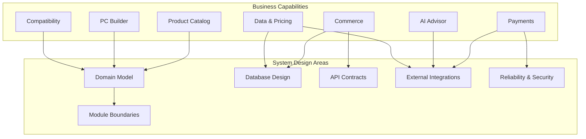

# AI PC Builder — Business Analysis Handoff

**Document ID:** BA-007  
**Version:** 1.0 Draft  
**Status:** Proposed  
**Project:** AI PC Builder  
**Next Phase:** System Design

---

## 1. Purpose

This document summarizes the Business Analysis deliverables, identifies unresolved decisions, and defines the information required for the System Design phase.

It serves as the handoff between Product/Business Analysis and Software Engineering.

## 2. Business Analysis Deliverables

| Document | ID | Purpose |
|---|---|---|
| Actors & Use Case Overview | BA-001 | Define system actors and functional boundaries |
| Business Rules Specification | BA-002 | Define business constraints and invariants |
| User Stories & Acceptance Criteria | BA-003 | Define testable user requirements |
| Business Process Modeling | BA-004 | Define major business workflows |
| State Machine Specification | BA-005 | Define lifecycle transitions |
| Requirements Traceability Matrix | BA-006 | Connect features, rules, stories, and tests |

## 3. Core Business Capabilities

The system must support:

1. Product catalog and structured specifications.
2. Manual PC configuration.
3. Deterministic compatibility validation.
4. Account-based configuration management.
5. Shopping cart and checkout.
6. Order and inventory management.
7. Sandbox payments and verified webhooks.
8. AI-assisted recommendations.
9. External seller reference offers and pricing data.
10. Administrative operations.

## 4. Critical Business Invariants

### Compatibility

- Missing data must not be represented as confirmed compatibility.
- Confirmed incompatibilities must remain visible.
- AI output must not override deterministic compatibility rules.

### Commerce

- The backend is authoritative for checkout totals.
- Orders retain historical price snapshots.
- Inventory must not be oversold.
- Duplicate checkout requests must not create duplicate orders.

### Payments

- Browser redirects do not prove payment success.
- Webhook authenticity must be verified.
- Duplicate events must not duplicate business effects.
- Out-of-order events must not corrupt payment state.
- Payment amount and currency must be verified.

### External Data

- External seller offers remain separate from internal store checkout.
- Imported data must be validated.
- Reference prices must include source and freshness information.

## 5. Business-to-System Mapping

## 6. Open Decisions

| ID | Decision | Required Before |
|---|---|---|
| DEC-001 | Reservation expiration policy | Inventory detailed design |
| DEC-002 | Payment retry policy | Payment state machine implementation |
| DEC-003 | Late payment resolution | Webhook implementation |
| DEC-004 | Checkout taxes, shipping, and discounts | Checkout calculation implementation |
| DEC-005 | Payment provider selection | Payment adapter implementation |
| DEC-006 | Compatibility severity and aggregation | Compatibility engine implementation |

These decisions are not considered approved merely because this handoff document is approved.

## 7. System Design Inputs

The System Design phase should produce:

- System Context Diagram.
- High-Level Architecture.
- Module Boundary Design.
- Domain Model.
- Database Design.
- API Contracts.
- External Provider Integration Design.
- Security and Reliability Design.
- Deployment Architecture.

## 8. Handoff Acceptance Criteria

The handoff is acceptable when:

- Core business capabilities are identified.
- Critical business invariants are documented.
- Major workflows have been modeled.
- Unresolved decisions are visible.
- System Design can proceed without silently inventing business policies.
- Requirement identifiers remain traceable.

## 9. Handoff Status

**Proposed: Ready for High-Level System Design**

Detailed Order, Inventory, and Payment implementation remains blocked by the corresponding open decisions.

---

**Document Status:** Awaiting Product Owner approval.