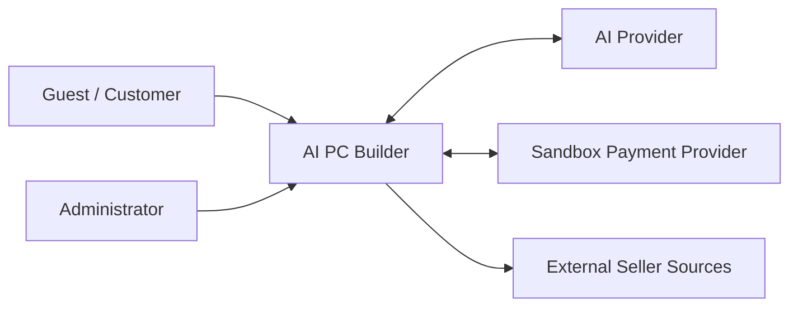
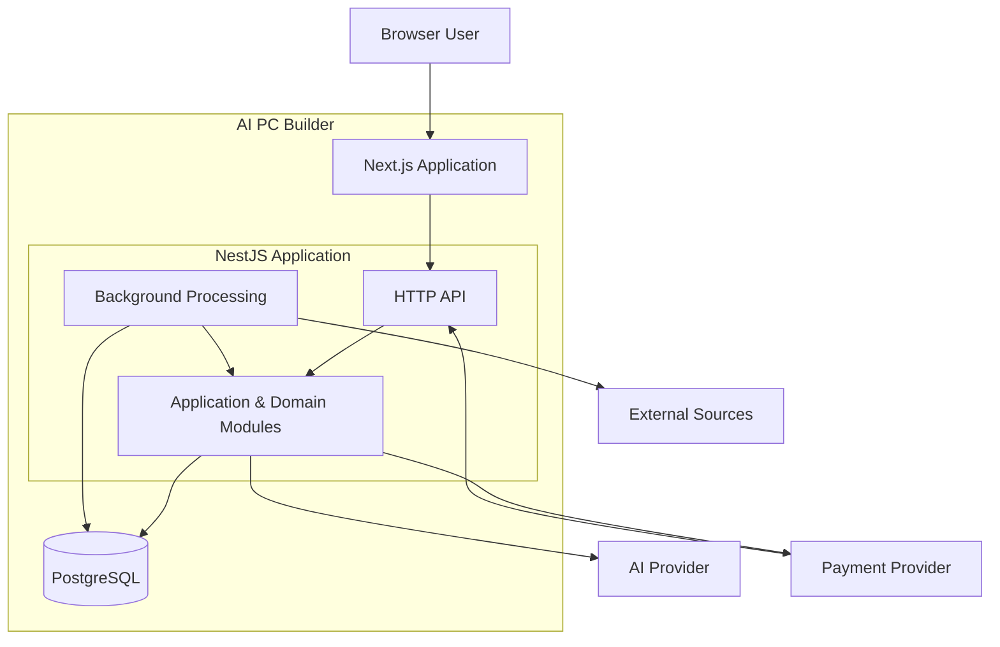

# AI PC Builder — System Context & High-Level Architecture

**Document ID:** ARCH-001  
**Version:** 1.0 Draft  
**Status:** Proposed  
**Architecture Style:** Modular Monolith  
**Related Documents:** PRD-001, PRD-004, BA-002, BA-004, BA-007

---

## 1. Purpose

This document defines the system boundary, major containers, technology choices, responsibilities, and architectural constraints of the AI PC Builder platform.

It provides the foundation for detailed module design, domain modeling, database design, and API contracts.

## 2. Architectural Goals

The architecture should:

1. Support the defined business capabilities.
2. Maintain clear boundaries between business domains.
3. Keep business logic independent of external providers.
4. Support deterministic hardware compatibility validation.
5. Preserve transactional consistency for orders, payments, and inventory.
6. Support background data collection without blocking customer requests.
7. Remain understandable and maintainable by a small development team.
8. Avoid premature distributed-system complexity.

## 3. System Context — C4 Level 1

### External Actors

- Guest: browses products, builds configurations, validates compatibility.
- Customer: manages saved configurations, carts, and orders.
- Administrator: manages products, inventory, and orders.

### External Dependencies

- AI Provider: generates structured recommendation proposals.
- Payment Provider: manages sandbox payment attempts and payment notifications.
- External Seller Sources: supply reference offers and product information where collection is permitted.

## 4. Container Architecture — C4 Level 2

Background processing may initially run as an in-process scheduled job or a separately launched worker using the same application codebase. A dedicated queue is not required for the initial release.

## 5. Container Responsibilities

### 5.1 Frontend — Next.js

Responsibilities:

- Render product catalog and product details.
- Support manual PC configuration.
- Display compatibility feedback.
- Manage customer-facing cart and checkout interfaces.
- Display order and payment status.
- Provide AI recommendation interfaces.
- Provide administrator interfaces.

Constraints:

- Must not independently determine authoritative prices.
- Must not independently change order or payment states.
- Must not treat AI output as verified hardware compatibility.
- Must not expose provider secrets.

### 5.2 Backend — NestJS

Responsibilities:

- Expose authenticated and public APIs.
- Enforce business rules.
- Coordinate use cases.
- Validate input and authorization.
- Manage transactions.
- Evaluate hardware compatibility.
- Integrate with AI and payment providers.
- Process external data.
- Maintain consistent domain state.

### 5.3 Database — PostgreSQL

Responsibilities:

- Persist catalog products and specifications.
- Persist users and saved configurations.
- Persist carts, orders, and order item snapshots.
- Maintain inventory and reservations.
- Persist payment attempts and processed webhook events.
- Store external seller offers and collection metadata.

### 5.4 Background Processing

Responsibilities:

- Fetch permitted external reference data.
- Normalize and validate imported records.
- Update collection timestamps.
- Process retryable data synchronization tasks.
- Support scheduled maintenance operations where required.

The initial implementation should favor the simplest reliable execution model.

## 6. Preliminary Backend Module Candidates

| Module | Primary Responsibility |
|---|---|
| Identity | Authentication and authorization |
| Catalog | Products, categories, specifications |
| PC Builder | Configuration creation and persistence |
| Compatibility | Deterministic compatibility rules |
| Cart | Customer cart management |
| Checkout | Checkout validation and order placement |
| Orders | Order lifecycle |
| Inventory | Stock and reservation management |
| Payments | Payment attempts and webhooks |
| AI Advisor | Recommendation orchestration |
| Seller Offers | External seller reference prices |
| Data Ingestion | Import, normalization, and matching |
| Administration | Administrative workflows and permissions |

These are candidate logical boundaries. They do not necessarily correspond to independently deployed services.

## 7. Architectural Decisions

### ADR-001 — Modular Monolith

**Decision:** Use a modular NestJS backend.

**Rationale:**

- Lower operational complexity.
- Clear domain boundaries.
- Straightforward local development.
- Easier transactional consistency.
- Suitable for the educational project scope.

**Trade-off:** Modules share one deployment lifecycle and must enforce boundaries through code organization and architecture rules.

### ADR-002 — PostgreSQL as Primary Database

**Decision:** Use PostgreSQL for transactional and structured data.

**Rationale:**

- Strong transactional capabilities.
- Relational modeling for commerce.
- Constraints and indexing.
- Suitable for inventory concurrency control.

### ADR-003 — Deterministic Compatibility Engine

**Decision:** Evaluate hardware compatibility using explicit business rules and structured specifications.

**Rationale:**

- Predictable behavior.
- Explainable results.
- Automated testability.
- Independence from AI availability.

AI may propose configurations but cannot override verified rule outcomes.

### ADR-004 — External Provider Adapters

**Decision:** Access AI and payment providers through interfaces implemented by infrastructure adapters.

**Rationale:**

- Reduce vendor coupling.
- Enable test doubles.
- Isolate SDK-specific behavior.
- Support future provider replacement.

### ADR-005 — Separate Internal Prices and External Offers

**Decision:** Model internal store pricing separately from external seller offers.

**Rationale:**

- Preserve checkout authority.
- Avoid treating reference prices as purchasable inventory.
- Support provenance and freshness.
- Reduce ambiguity in product matching.

## 8. Security Boundaries

- Browser input is untrusted.
- Authentication and authorization are enforced by the backend.
- Payment notifications require provider-specific authenticity verification.
- Payment and order updates require valid state transitions.
- Provider credentials remain server-side.
- External imported data is untrusted until validated.
- AI-generated output requires schema and business validation.

## 9. Reliability Constraints

- Checkout must not oversell inventory.
- Payment webhook processing must be idempotent.
- Retryable failures must not duplicate business effects.
- AI outages must not block manual PC building.
- Data ingestion failures must not block core ecommerce operations.
- Database transactions must protect critical state changes.

## 10. Initial Deployment Strategy

For the first release:

- One Next.js application.
- One NestJS backend.
- One PostgreSQL database.
- Optional background processing in the backend codebase.
- External AI and sandbox payment providers.

Introduce additional infrastructure only when a concrete requirement justifies it.

## 11. Deferred Decisions

- ORM selection.
- Background job execution mechanism.
- Cache strategy.
- Object storage.
- Payment provider.
- Authentication implementation.
- Deployment platform.
- Detailed module ownership.
- Database schema and indexes.
- API endpoint design.

## 12. Definition of Done

- System boundary is defined.
- Actors and external systems are identified.
- Major containers and responsibilities are documented.
- Architectural style is justified.
- Core security and reliability constraints are identified.
- External integrations are separated from business logic.
- Deferred decisions are explicitly recorded.

---

**Status:** Awaiting Architecture Review.