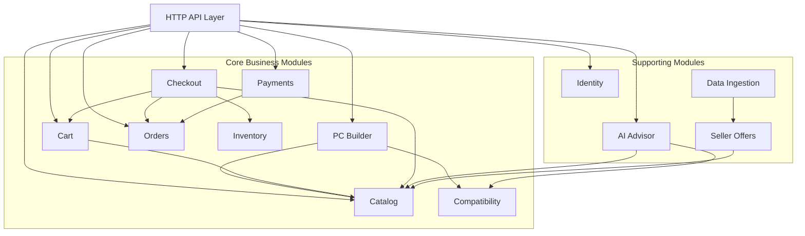
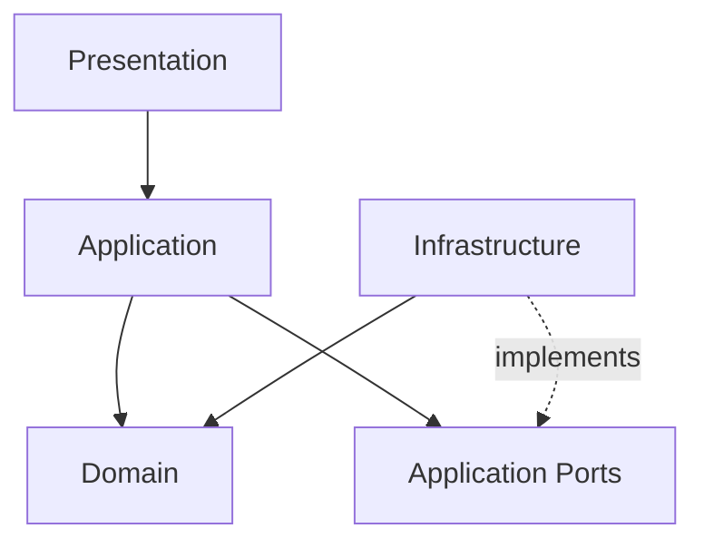
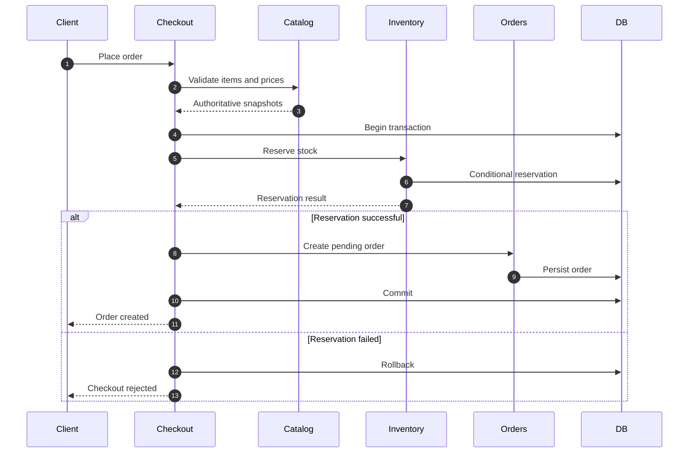

# AI PC Builder — Backend Module Boundaries & Dependency Design

**Document ID:** ARCH-002  
**Version:** 1.0 Draft  
**Status:** Proposed  
**Architecture:** Modular Monolith + Clean Architecture Principles  
**Related Documents:** ARCH-001, BA-002, BA-003, BA-004, BA-005

---

## 1. Purpose

Define the logical boundaries of the NestJS backend, establish module responsibilities, and specify dependency rules.

The goal is to maintain a modular application without introducing unnecessary microservice complexity.

## 2. Architecture Principles

1. Organize code by business capability.
2. Keep domain rules independent of frameworks.
3. Expose explicit public interfaces between modules.
4. Avoid direct access to another module's private persistence implementation.
5. Keep external providers behind adapters.
6. Coordinate cross-module transactions explicitly.
7. Prefer synchronous in-process communication for the initial implementation.
8. Introduce asynchronous messaging only when justified by business requirements.

## 3. Backend Module Map



**Diagram interpretation:** Arrows represent proposed logical collaboration, not permission to import another module's internal classes or database repositories.

This map is subject to refinement during detailed design.

## 4. Module Ownership

| Module | Owns | Does Not Own |
|---|---|---|
| Identity | Users, credentials, authentication policies | Orders or product data |
| Catalog | Products, categories, specifications, internal prices | External seller offers |
| PC Builder | Saved configurations, selected components | Hardware specifications |
| Compatibility | Rule definitions and evaluation results | Product catalog persistence |
| Cart | Cart items and quantities | Final order prices |
| Checkout | Checkout orchestration and idempotency | Product catalog or inventory records |
| Orders | Orders, order items, order lifecycle | Payment provider integration |
| Inventory | Stock and inventory reservations | Order prices |
| Payments | Payment attempts, webhook events, refund records | Inventory balances |
| AI Advisor | Recommendation orchestration and validation | Authoritative compatibility rules |
| Seller Offers | External offers, source metadata, price observations | Internal checkout prices |
| Data Ingestion | Collection jobs, normalization and matching workflows | Internal store inventory |

Administration is initially implemented as authorized operations exposed by the owning modules, rather than a separate domain that duplicates catalog, inventory, and order logic.

## 5. Internal Layering

Each sufficiently complex module follows:



### Domain

Contains:

- Entities.
- Value objects.
- Domain invariants.
- Domain services.
- Domain errors.

Must not depend on NestJS, Prisma, HTTP, or provider SDKs.

### Application

Contains:

- Use cases.
- Application orchestration.
- Transaction boundaries.
- Repository and integration ports.
- Authorization coordination where required.

Depends on domain concepts, not concrete infrastructure implementations.

### Infrastructure

Contains:

- Prisma repositories.
- Provider SDK adapters.
- External HTTP clients.
- Database transaction implementations.
- Background job integrations.

Implements application-facing contracts.

### Presentation

Contains:

- Controllers.
- Request and response DTOs.
- Guards.
- HTTP validation.
- Exception mapping.

Translates transport requests into application use case calls.

## 6. Proposed Source Structure

```text
apps/
  web/
    src/
      app/
      components/
      features/

  api/
    src/
      main.ts
      app.module.ts

      modules/
        identity/
        catalog/
          domain/
          application/
          infrastructure/
          presentation/
          catalog.module.ts

        pc-builder/
          domain/
          application/
          infrastructure/
          presentation/

        compatibility/
          domain/
          application/
          infrastructure/
          presentation/

        cart/
        checkout/
        orders/
        inventory/
        payments/
        ai-advisor/
        seller-offers/
        data-ingestion/

      shared/
        kernel/
        database/
        config/
        logging/
```

The repository structure is a proposal, not an implementation requirement.

## 7. Cross-Module Communication Rules

### Rule ARCH-MOD-001

A module may invoke another module only through an explicitly exported application-level interface.

### Rule ARCH-MOD-002

A module must not import another module's private repository implementation.

### Rule ARCH-MOD-003

A module must not directly mutate database tables owned by another module.

### Rule ARCH-MOD-004

Shared code must contain reusable technical or foundational concepts, not arbitrary business logic.

### Rule ARCH-MOD-005

Business transactions spanning modules must have a defined coordinator.

### Rule ARCH-MOD-006

Avoid circular module dependencies. Redesign collaboration rather than relying on `forwardRef()` as the default solution.

### Rule ARCH-MOD-007

Cross-module read models may be introduced for complex queries, but they must not become uncontrolled write paths.

## 8. Checkout Coordination

Checkout is a cross-module application workflow.



The transaction mechanism must allow participating modules to operate within one coordinated database transaction without exposing each module's private repositories.

Possible designs include a transaction context abstraction or a dedicated checkout unit-of-work.

The exact approach will be decided during persistence design.

## 9. Payment Coordination

Payments owns provider integration and payment attempts.

Orders owns order state transitions.

Inventory owns reservation transitions.

A verified payment event may require coordinated updates across all three modules.

The Payment module must not bypass the Orders or Inventory application contracts.

For the initial monolith, a synchronous application coordinator and a shared database transaction may be sufficient.

If external side effects are required, they must not be assumed atomic with PostgreSQL commits.

## 10. AI Advisor Boundaries

The AI Advisor:

1. Receives budget and workload requirements.
2. Retrieves candidate products through Catalog contracts.
3. Invokes the configured AI provider.
4. Validates structured output.
5. Calls Compatibility to evaluate proposed components.
6. Returns an explanation and verified compatibility information.

The AI provider cannot directly:

- Modify product prices.
- Create orders.
- Change payment states.
- Override deterministic compatibility results.

## 11. Data Ingestion Boundaries

Data Ingestion:

1. Collects permitted external data.
2. Normalizes source-specific formats.
3. Validates incoming records.
4. Matches external products to internal catalog references.
5. Stores accepted external seller offers through Seller Offers contracts.

Ambiguous product matches must not be silently treated as verified matches.

## 12. Shared Kernel Policy

Allowed examples:

- Common identifiers.
- Pagination primitives.
- Clock abstraction.
- Generic result types.
- Technical error base types.

Avoid placing business rules from unrelated modules into `shared`.

Shared code must not become a dependency dumping ground.

## 13. Architecture Validation

The implementation should eventually enforce module boundaries through:

- ESLint import restrictions.
- TypeScript path boundaries.
- Module public entry points.
- Architecture-focused tests where useful.
- Code review conventions.

These controls are proposed and will be introduced incrementally.

## 14. Open Decisions

1. Exact transaction context implementation.
2. Prisma versus alternative ORM.
3. Whether Compatibility needs its own persisted rule versions.
4. Payment event coordination design.
5. Shared DTO and contract conventions.
6. Background job execution mechanism.
7. Module dependency enforcement tooling.

## 15. Definition of Done

- Module responsibilities are explicit.
- Data ownership is defined.
- Cross-module communication rules are documented.
- Dependency direction is clear.
- Critical workflows have coordinators.
- Framework-independent domain logic is protected.
- Open architectural decisions are recorded.

---

**Status:** Awaiting Architecture Review.