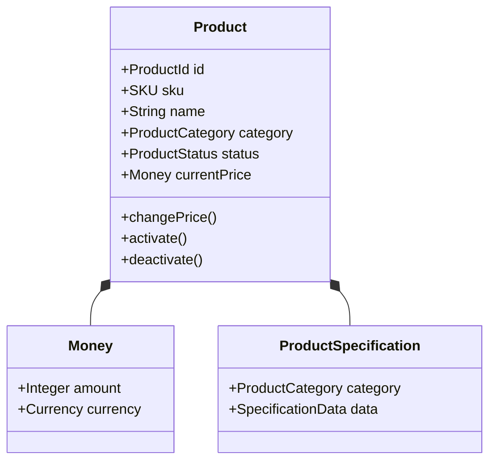
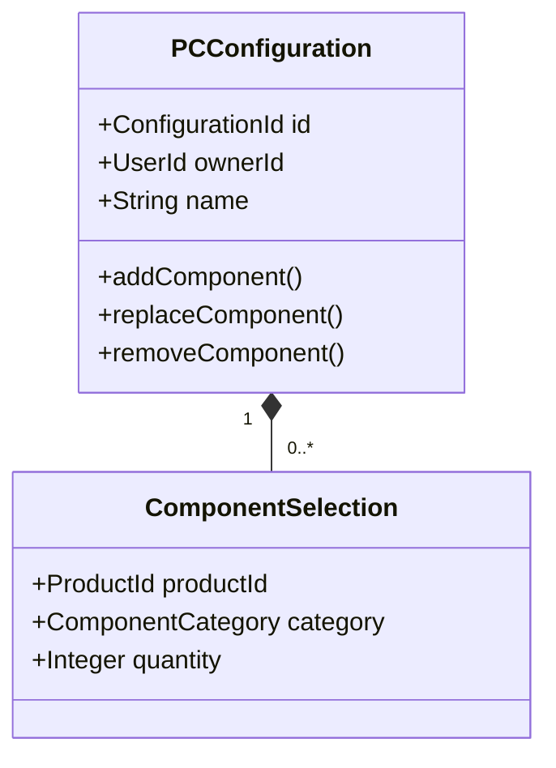
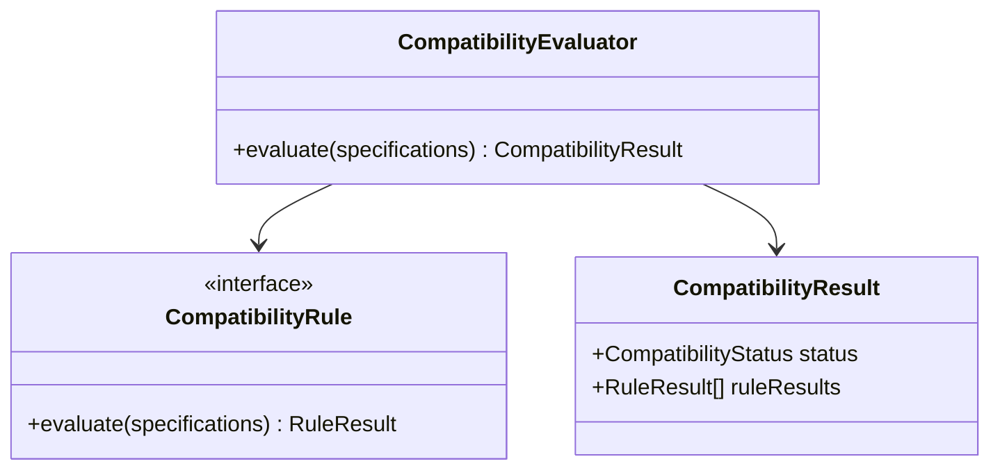
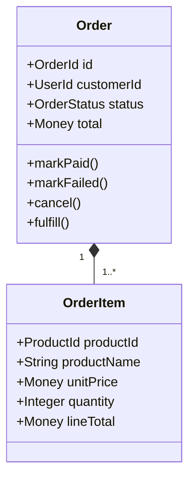
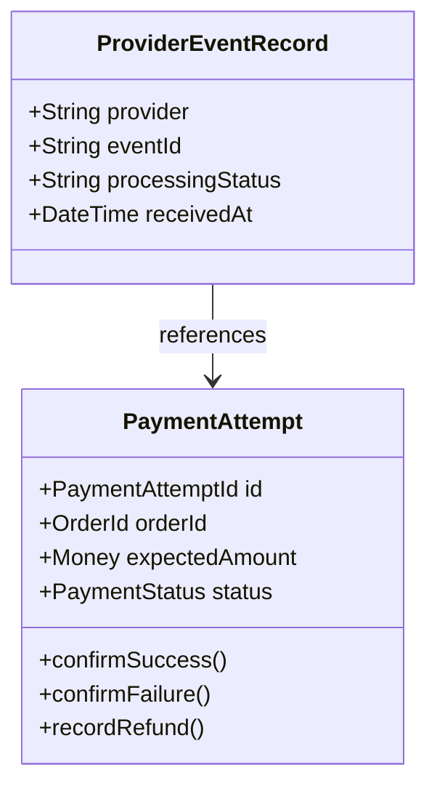

# AI PC Builder — Domain Model & Aggregate Design

**Document ID:** ARCH-003  
**Version:** 1.0 Draft  
**Status:** Proposed  
**Architecture:** Modular Monolith with Clean Architecture Principles  
**Related Documents:** BA-002, BA-003, BA-005, ARCH-001, ARCH-002

---

## 1. Purpose

Define the primary domain concepts, entity relationships, aggregate boundaries, and business invariants for AI PC Builder.

The design aims to preserve business correctness while avoiding unnecessary Domain-Driven Design complexity.

This document describes the logical domain model, not the physical database schema.

## 2. Modeling Principles

1. Model behavior and business invariants, not only data fields.
2. Keep aggregates small enough to manage consistently.
3. Reference other aggregates by identity.
4. Do not use ORM models as the domain model by default.
5. Use Value Objects for meaningful immutable concepts.
6. Use Domain Services for cross-entity calculations that do not naturally belong to one aggregate.
7. Coordinate changes across aggregates through Application Services.
8. Keep external provider details outside the domain layer.

## 3. Domain Map

| Domain | Primary Aggregate Root | Supporting Concepts |
|---|---|---|
| Catalog | Product | ProductSpecification, Money |
| PC Builder | PCConfiguration | ComponentSelection |
| Cart | Cart | CartItem |
| Orders | Order | OrderItem, OrderStatus |
| Inventory | StockItem, InventoryReservation | Quantity |
| Payments | PaymentAttempt | PaymentStatus, ProviderEventIdentity |
| Seller Offers | SellerOffer | SourceReference, ObservedPrice |
| Compatibility | No persistent aggregate required initially | CompatibilityRule, CompatibilityResult |
| AI Advisor | No persistent aggregate required initially | RecommendationRequest, RecommendationResult |

This is a preliminary design. Aggregate boundaries may be refined during detailed workflow and persistence design.

---

## 4. Catalog Domain

### 4.1 Product Aggregate

**Aggregate Root:** `Product`

Suggested properties:

- `id`
- `sku`
- `name`
- `category`
- `status`
- `specifications`
- `currentPrice`
- `createdAt`
- `updatedAt`

### 4.2 Invariants

- SKU must be unique within the internal catalog.
- Product category must be supported.
- Product price must not be negative.
- Specifications must satisfy category-specific validation.
- Inactive products cannot be purchased through internal checkout.

SKU uniqueness is enforced at the persistence boundary as well as validated by application logic.

### 4.3 Value Objects

**Money**

- `amount`
- `currency`

Rules:

- Currency must be supported.
- Monetary values must use an exact representation.
- Arithmetic must not depend on binary floating-point approximations.

For the initial VND-only system, integer amounts are a suitable representation.

**HardwareSocket**

Examples:

- AM5
- LGA1700
- LGA1851

Socket values should be normalized and validated.

### 4.4 Domain Diagram

---

## 5. PC Builder Domain

### 5.1 PCConfiguration Aggregate

**Aggregate Root:** `PCConfiguration`

Suggested properties:

- `id`
- `ownerId` (optional for temporary guest configurations)
- `name`
- `selections`
- `createdAt`
- `updatedAt`

### 5.2 ComponentSelection

A selection represents a catalog product chosen for a specific component category.

Suggested properties:

- `productId`
- `category`
- `quantity`

### 5.3 Invariants

- A configuration may be incomplete.
- Selected products must belong to appropriate categories.
- Single-slot categories cannot contain multiple active selections.
- Quantities must satisfy category-specific policies.
- Only the owner may modify a persisted private configuration.

Product existence and category validation require authoritative catalog information supplied through an application workflow.

### 5.4 Aggregate Diagram

---

## 6. Compatibility Domain

Compatibility evaluation is modeled as a domain service rather than a persistent aggregate.

### 6.1 CompatibilityEvaluator

Inputs:

- Selected component specifications.
- Applicable compatibility rules.

Outputs:

- Overall compatibility status.
- Rule-level results.
- Explanations.
- Missing-data warnings.

### 6.2 Status Values

- `COMPATIBLE`
- `INCOMPATIBLE`
- `UNKNOWN`

### 6.3 Invariants

- A confirmed rule violation must remain visible.
- Missing required specifications cannot produce a confirmed compatible result.
- AI output cannot override deterministic compatibility evaluation.

### 6.4 Rule Examples

- CPU socket compatibility.
- RAM technology compatibility.
- Motherboard form factor support.
- GPU clearance.
- PSU capacity sufficiency.

### 6.5 Diagram

---

## 7. Cart Domain

### 7.1 Cart Aggregate

**Aggregate Root:** `Cart`

Contains:

- `id`
- `customerId`
- `items`

### 7.2 CartItem

Contains:

- `productId`
- `quantity`

### 7.3 Invariants

- Quantities must be positive integers.
- A cart cannot contain duplicate independent lines for the same product under the initial policy.
- Cart data does not guarantee price or stock availability.
- Checkout must revalidate authoritative catalog data.

The cart is a purchase intention, not an order.

---

## 8. Order Domain

### 8.1 Order Aggregate

**Aggregate Root:** `Order`

Suggested properties:

- `id`
- `customerId`
- `items`
- `total`
- `status`
- `createdAt`
- `updatedAt`

### 8.2 OrderItem

An OrderItem is a historical purchase snapshot.

Suggested properties:

- `productId`
- `productName`
- `sku`
- `unitPrice`
- `quantity`
- `lineTotal`

### 8.3 Invariants

- Order items must have positive quantities.
- Order totals must match the accepted price snapshots and applicable charges.
- Order snapshots must not change when catalog prices change.
- Order state transitions must follow the approved state machine.
- Order payment confirmation requires verified payment evidence supplied by the application layer.

### 8.4 Aggregate Diagram

The Order aggregate must not call a payment provider directly.

---

## 9. Inventory Domain

### 9.1 StockItem Aggregate

**Aggregate Root:** `StockItem`

Suggested properties:

- `productId`
- `onHandQuantity`
- `reservedQuantity`

Derived:

`availableQuantity = onHandQuantity - reservedQuantity`

### 9.2 InventoryReservation Aggregate

**Aggregate Root:** `InventoryReservation`

Suggested properties:

- `id`
- `orderId`
- `items`
- `status`
- `expiresAt`

### 9.3 Invariants

- On-hand quantity cannot be negative.
- Reserved quantity cannot exceed on-hand quantity.
- Available quantity cannot be negative.
- A reservation cannot be consumed twice.
- A reservation cannot be released twice.
- Expired reservations cannot be consumed through the normal payment path.

### 9.4 Concurrency Boundary

Stock changes must be protected by database-level concurrency control.

Possible approaches include:

- Conditional atomic updates.
- Row-level locking.
- Transactional reservation operations.

The final choice will be documented during persistence design.

### 9.5 Important Aggregate Consideration

`StockItem` and `InventoryReservation` are separate logical aggregates, but reservation operations require coordinated transactional consistency.

A reservation service or application coordinator must ensure that stock and reservation records cannot diverge.

---

## 10. Payment Domain

### 10.1 PaymentAttempt Aggregate

**Aggregate Root:** `PaymentAttempt`

Suggested properties:

- `id`
- `orderId`
- `provider`
- `providerPaymentId`
- `expectedAmount`
- `status`
- `createdAt`
- `updatedAt`

### 10.2 Invariants

- A payment attempt belongs to one order.
- Successful payment requires trusted provider verification.
- Verified amount and currency must match the expected values.
- Terminal states cannot be arbitrarily reset.
- Refunds must reference the original successful payment.
- Duplicate provider events must not duplicate business effects.

### 10.3 Provider Event Tracking

Processed webhook events require persistent event identity and processing status.

They may be modeled as separate persistence records rather than children loaded into the PaymentAttempt aggregate.

A unique provider/event identity must be enforced to support idempotency.

### 10.4 Diagram

---

## 11. Seller Offers Domain

### 11.1 SellerOffer Aggregate

**Aggregate Root:** `SellerOffer`

Suggested properties:

- `id`
- `catalogProductId`
- `sellerId`
- `externalProductUrl`
- `observedPrice`
- `collectedAt`
- `matchStatus`

### 11.2 Invariants

- Every offer must identify its source.
- Price observations require collection timestamps.
- Ambiguous product matches cannot be treated as verified.
- External offers cannot enter internal checkout as internal store products.

---

## 12. Aggregate Reference Rules

Aggregates should reference one another by stable identifiers.

Examples:

- OrderItem references ProductId.
- PaymentAttempt references OrderId.
- InventoryReservation references OrderId.
- ComponentSelection references ProductId.
- SellerOffer references ProductId.

These references do not grant permission to mutate another aggregate's state.

## 13. Transaction Boundaries

### Local Aggregate Changes

A single aggregate should protect its own invariants.

### Cross-Aggregate Changes

Application services coordinate workflows such as:

- Checkout and inventory reservation.
- Verified payment and order confirmation.
- Payment failure and inventory release.
- Reservation expiration and order cancellation.

For the initial Modular Monolith, PostgreSQL transactions may coordinate changes spanning several aggregates.

External API calls must not be assumed atomic with database transactions.

## 14. Open Decisions

1. Product specification representation.
2. Compatibility rule versioning.
3. Money and currency policy.
4. Order pricing components.
5. Reservation expiration duration.
6. Payment retry and late-payment policy.
7. Refund and inventory restoration policy.
8. Domain event requirements.
9. Aggregate persistence mapping.

## 15. Definition of Done

- Primary domain entities are identified.
- Value Objects are distinguished from Entities.
- Aggregate Roots and ownership are documented.
- Critical invariants are explicit.
- Cross-aggregate references use identities.
- Transaction coordination requirements are identified.
- Open decisions are tracked.

---

**Status:** Awaiting Architecture Review.