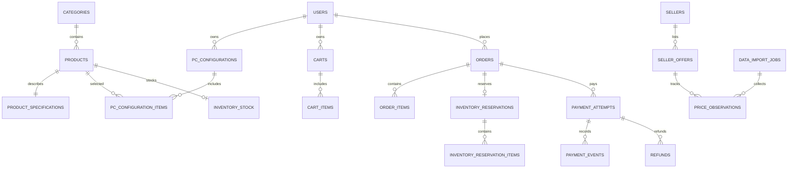
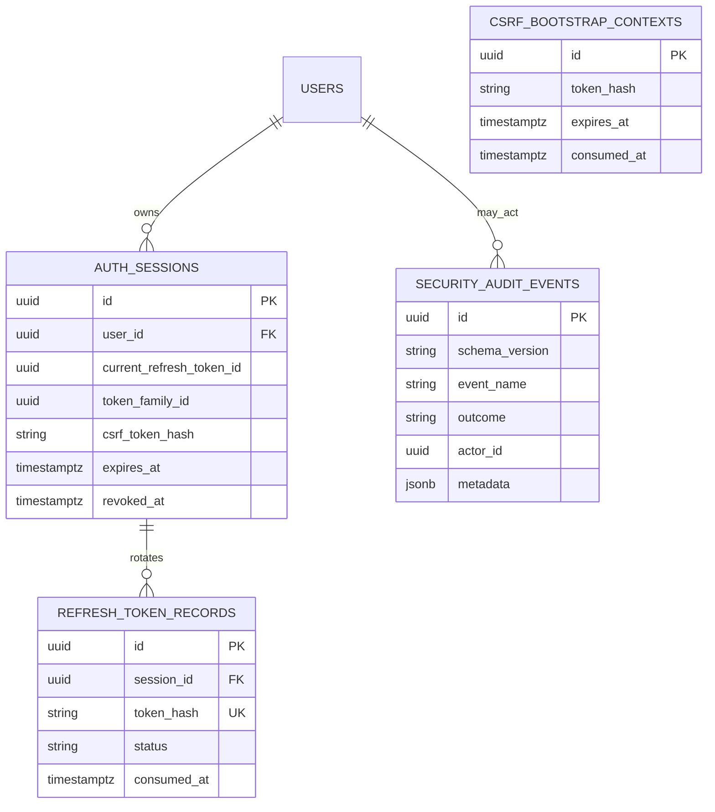
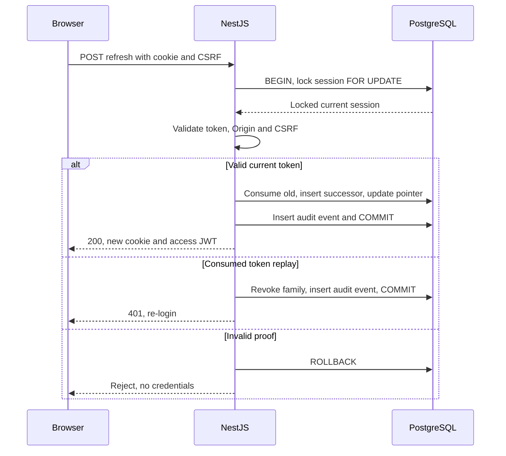

# AI PC Builder — Database Design

**Document ID:** ARCH-004
**Version:** 1.1 Draft — consolidated
**Status:** Proposed — Awaiting Architecture Review
**Scope:** Canonical PostgreSQL design for identity, catalog, PC builds, cart, orders, inventory, sandbox payments, external reference offers, and security persistence.
**Related:** BA-002, BA-005, ARCH-002, ARCH-003, SEC-002.1, SEC-002.2, SEC-002.4

## 1. Purpose and principles

PostgreSQL is the system of record for the modular monolith. Use UUID primary keys, explicit foreign keys, transactional invariants, server-authoritative pricing, and immutable order snapshots. Application services validate business rules; the database enforces structural and concurrency constraints. This document specifies a design, not applied migrations.

## 2. Business relational model

## 3. Business tables

### 3.1 Identity

### `users`

| Column | PostgreSQL type | Constraints / notes |
|---|---|---|
| `id` | `UUID` | PK |
| `email` | `VARCHAR(255)` | UNIQUE NOT NULL |
| `password_hash` | `TEXT` | Nullable for future external auth |
| `role` | `VARCHAR(30)` | NOT NULL |
| `status` | `VARCHAR(30)` | NOT NULL |
| `created_at` | `TIMESTAMPTZ` | NOT NULL |
| `updated_at` | `TIMESTAMPTZ` | NOT NULL |

### 3.2 Catalog

### `categories`

| Column | PostgreSQL type | Constraints / notes |
|---|---|---|
| `id` | `UUID` | PK |
| `code` | `VARCHAR(50)` | UNIQUE NOT NULL |
| `name` | `VARCHAR(100)` | NOT NULL |

### `products`

| Column | PostgreSQL type | Constraints / notes |
|---|---|---|
| `id` | `UUID` | PK |
| `category_id` | `UUID` | FK categories.id |
| `sku` | `VARCHAR(100)` | UNIQUE NOT NULL |
| `name` | `TEXT` | NOT NULL |
| `status` | `VARCHAR(30)` | NOT NULL |
| `price_vnd` | `BIGINT` | NOT NULL CHECK >= 0 |
| `created_at` | `TIMESTAMPTZ` | NOT NULL |
| `updated_at` | `TIMESTAMPTZ` | NOT NULL |

### `product_specifications`

| Column | PostgreSQL type | Constraints / notes |
|---|---|---|
| `product_id` | `UUID` | PK FK products.id |
| `specification_data` | `JSONB` | NOT NULL |
| `schema_version` | `INTEGER` | NOT NULL |

### 3.3 PC Builder

### `pc_configurations`

| Column | PostgreSQL type | Constraints / notes |
|---|---|---|
| `id` | `UUID` | PK |
| `owner_id` | `UUID` | NOT NULL FK users.id |
| `name` | `VARCHAR(150)` | NOT NULL |
| `created_at` | `TIMESTAMPTZ` | NOT NULL |
| `updated_at` | `TIMESTAMPTZ` | NOT NULL |

### `pc_configuration_items`

| Column | PostgreSQL type | Constraints / notes |
|---|---|---|
| `id` | `UUID` | PK |
| `configuration_id` | `UUID` | FK pc_configurations.id |
| `product_id` | `UUID` | FK products.id |
| `category_code` | `VARCHAR(50)` | NOT NULL |
| `quantity` | `INTEGER` | CHECK > 0 |

### 3.4 Cart

### `carts`

| Column | PostgreSQL type | Constraints / notes |
|---|---|---|
| `id` | `UUID` | PK |
| `customer_id` | `UUID` | FK users.id |
| `status` | `VARCHAR(30)` | NOT NULL |
| `created_at` | `TIMESTAMPTZ` | NOT NULL |
| `updated_at` | `TIMESTAMPTZ` | NOT NULL |

### `cart_items`

| Column | PostgreSQL type | Constraints / notes |
|---|---|---|
| `id` | `UUID` | PK |
| `cart_id` | `UUID` | FK carts.id |
| `product_id` | `UUID` | FK products.id |
| `quantity` | `INTEGER` | CHECK > 0 |

### 3.5 Orders

### `orders`

| Column | PostgreSQL type | Constraints / notes |
|---|---|---|
| `id` | `UUID` | PK |
| `customer_id` | `UUID` | FK users.id |
| `status` | `VARCHAR(30)` | NOT NULL |
| `currency` | `CHAR(3)` | NOT NULL |
| `subtotal_amount` | `BIGINT` | NOT NULL CHECK >= 0 |
| `total_amount` | `BIGINT` | NOT NULL CHECK >= 0 |
| `checkout_idempotency_key` | `VARCHAR(150)` | NOT NULL |
| `created_at` | `TIMESTAMPTZ` | NOT NULL |
| `updated_at` | `TIMESTAMPTZ` | NOT NULL |

### `order_items`

| Column | PostgreSQL type | Constraints / notes |
|---|---|---|
| `id` | `UUID` | PK |
| `order_id` | `UUID` | FK orders.id |
| `product_id` | `UUID` | FK products.id |
| `sku_snapshot` | `VARCHAR(100)` | NOT NULL |
| `name_snapshot` | `TEXT` | NOT NULL |
| `unit_price_amount` | `BIGINT` | NOT NULL CHECK >= 0 |
| `quantity` | `INTEGER` | CHECK > 0 |
| `line_total_amount` | `BIGINT` | NOT NULL CHECK >= 0 |

### 3.6 Inventory

### `inventory_stock`

| Column | PostgreSQL type | Constraints / notes |
|---|---|---|
| `product_id` | `UUID` | PK FK products.id |
| `on_hand_quantity` | `INTEGER` | NOT NULL CHECK >= 0 |
| `reserved_quantity` | `INTEGER` | NOT NULL CHECK >= 0 |
| `updated_at` | `TIMESTAMPTZ` | NOT NULL |

### `inventory_reservations`

| Column | PostgreSQL type | Constraints / notes |
|---|---|---|
| `id` | `UUID` | PK |
| `order_id` | `UUID` | UNIQUE FK orders.id |
| `status` | `VARCHAR(30)` | NOT NULL |
| `expires_at` | `TIMESTAMPTZ` | NOT NULL |
| `created_at` | `TIMESTAMPTZ` | NOT NULL |
| `updated_at` | `TIMESTAMPTZ` | NOT NULL |

### `inventory_reservation_items`

| Column | PostgreSQL type | Constraints / notes |
|---|---|---|
| `id` | `UUID` | PK |
| `reservation_id` | `UUID` | FK inventory_reservations.id |
| `product_id` | `UUID` | FK products.id |
| `quantity` | `INTEGER` | CHECK > 0 |

### 3.7 Payments

### `payment_attempts`

| Column | PostgreSQL type | Constraints / notes |
|---|---|---|
| `id` | `UUID` | PK |
| `order_id` | `UUID` | FK orders.id |
| `provider` | `VARCHAR(50)` | NOT NULL |
| `provider_payment_id` | `VARCHAR(255)` | Nullable, UNIQUE with provider when present |
| `expected_amount` | `BIGINT` | NOT NULL CHECK >= 0 |
| `currency` | `CHAR(3)` | NOT NULL |
| `status` | `VARCHAR(30)` | NOT NULL |
| `created_at` | `TIMESTAMPTZ` | NOT NULL |
| `updated_at` | `TIMESTAMPTZ` | NOT NULL |

### `payment_events`

| Column | PostgreSQL type | Constraints / notes |
|---|---|---|
| `id` | `UUID` | PK |
| `payment_attempt_id` | `UUID` | Nullable FK payment_attempts.id |
| `provider` | `VARCHAR(50)` | NOT NULL |
| `provider_event_id` | `VARCHAR(255)` | NOT NULL |
| `event_type` | `VARCHAR(100)` | NOT NULL |
| `processing_status` | `VARCHAR(30)` | NOT NULL |
| `received_at` | `TIMESTAMPTZ` | NOT NULL |
| `processed_at` | `TIMESTAMPTZ` | Nullable |

### `refunds`

| Column | PostgreSQL type | Constraints / notes |
|---|---|---|
| `id` | `UUID` | PK |
| `payment_attempt_id` | `UUID` | FK payment_attempts.id |
| `provider_refund_id` | `VARCHAR(255)` | Nullable |
| `amount` | `BIGINT` | NOT NULL CHECK > 0 |
| `status` | `VARCHAR(30)` | NOT NULL |
| `created_at` | `TIMESTAMPTZ` | NOT NULL |

### 3.8 External Pricing

### `sellers`

| Column | PostgreSQL type | Constraints / notes |
|---|---|---|
| `id` | `UUID` | PK |
| `name` | `VARCHAR(150)` | NOT NULL |
| `website_url` | `TEXT` | NOT NULL |
| `status` | `VARCHAR(30)` | NOT NULL |

### `seller_offers`

| Column | PostgreSQL type | Constraints / notes |
|---|---|---|
| `id` | `UUID` | PK |
| `seller_id` | `UUID` | FK sellers.id |
| `catalog_product_id` | `UUID` | Nullable FK products.id |
| `external_product_key` | `TEXT` | NOT NULL |
| `external_url` | `TEXT` | NOT NULL |
| `match_status` | `VARCHAR(30)` | NOT NULL |
| `latest_price_amount` | `BIGINT` | CHECK >= 0 |
| `currency` | `CHAR(3)` | NOT NULL |
| `last_collected_at` | `TIMESTAMPTZ` | Nullable |

### `price_observations`

| Column | PostgreSQL type | Constraints / notes |
|---|---|---|
| `id` | `UUID` | PK |
| `seller_offer_id` | `UUID` | FK seller_offers.id |
| `observed_price_amount` | `BIGINT` | NOT NULL CHECK >= 0 |
| `observed_at` | `TIMESTAMPTZ` | NOT NULL |
| `collection_job_id` | `UUID` | Nullable FK data_import_jobs.id |

### `data_import_jobs`

| Column | PostgreSQL type | Constraints / notes |
|---|---|---|
| `id` | `UUID` | PK |
| `source` | `VARCHAR(100)` | NOT NULL |
| `status` | `VARCHAR(30)` | NOT NULL |
| `started_at` | `TIMESTAMPTZ` | NOT NULL |
| `finished_at` | `TIMESTAMPTZ` | Nullable |
| `error_summary` | `TEXT` | Nullable |

### 3.9 Business integrity rules

- `cart_items`: UNIQUE (`cart_id`, `product_id`).
- `orders`: UNIQUE (`customer_id`, `checkout_idempotency_key`); persist the original request outcome for idempotent replay.
- `inventory_stock`: CHECK (`reserved_quantity <= on_hand_quantity`); available = on_hand − reserved.
- `inventory_reservation_items`: UNIQUE (`reservation_id`, `product_id`).
- `payment_attempts`: UNIQUE (`provider`, `provider_payment_id`) for non-null provider IDs.
- `payment_events`: UNIQUE (`provider`, `provider_event_id`).
- `seller_offers`: UNIQUE (`seller_id`, `external_product_key`).
- `order_items` price/name/SKU snapshots do not change after order creation.
- Guest PC configurations may remain client-side; saved configurations require an owner.
- Category-specific hardware specs in JSONB require versioned Zod validation. Consider expression indexes only for proven queries.
- Single-slot components may use partial unique indexes; multi-quantity RAM/storage need explicit category rules before implementation.

## 4. Security persistence integration (SEC-INT-002)

ARCH-004 is the canonical database contract. SEC-002.1 defines session behavior, SEC-002.2 defines CSRF behavior, and SEC-002.4 defines audit event semantics.

### `auth_sessions`

| Column | PostgreSQL type | Constraints / notes |
|---|---|---|
| `id` | `UUID` | PK |
| `user_id` | `UUID` | NOT NULL FK users.id |
| `token_family_id` | `UUID` | NOT NULL |
| `current_refresh_token_id` | `UUID` | Nullable, composite FK to refresh_token_records(session_id,id) |
| `csrf_token_hash` | `TEXT` | NOT NULL |
| `csrf_issued_at` | `TIMESTAMPTZ` | NOT NULL |
| `created_at` | `TIMESTAMPTZ` | NOT NULL |
| `expires_at` | `TIMESTAMPTZ` | NOT NULL |
| `revoked_at` | `TIMESTAMPTZ` | Nullable |
| `revocation_reason` | `VARCHAR(80)` | Nullable |
| `last_used_at` | `TIMESTAMPTZ` | Nullable |

### `refresh_token_records`

| Column | PostgreSQL type | Constraints / notes |
|---|---|---|
| `id` | `UUID` | PK |
| `session_id` | `UUID` | NOT NULL FK auth_sessions.id |
| `token_hash` | `TEXT` | NOT NULL UNIQUE, never plaintext |
| `status` | `VARCHAR(20)` | NOT NULL, CURRENT/CONSUMED/REVOKED |
| `issued_at` | `TIMESTAMPTZ` | NOT NULL |
| `expires_at` | `TIMESTAMPTZ` | NOT NULL |
| `consumed_at` | `TIMESTAMPTZ` | Nullable |
| `replaced_by_token_id` | `UUID` | Nullable self-FK |

### `csrf_bootstrap_contexts`

| Column | PostgreSQL type | Constraints / notes |
|---|---|---|
| `id` | `UUID` | PK |
| `token_hash` | `TEXT` | NOT NULL |
| `created_at` | `TIMESTAMPTZ` | NOT NULL |
| `expires_at` | `TIMESTAMPTZ` | NOT NULL |
| `consumed_at` | `TIMESTAMPTZ` | Nullable |

### `security_audit_events`

| Column | PostgreSQL type | Constraints / notes |
|---|---|---|
| `id` | `UUID` | PK |
| `schema_version` | `VARCHAR(20)` | NOT NULL |
| `occurred_at` | `TIMESTAMPTZ` | NOT NULL |
| `event_name` | `VARCHAR(160)` | NOT NULL |
| `event_category` | `VARCHAR(40)` | NOT NULL |
| `outcome` | `VARCHAR(20)` | NOT NULL |
| `severity` | `VARCHAR(10)` | NOT NULL |
| `service_name` | `VARCHAR(100)` | NOT NULL |
| `actor_type` | `VARCHAR(20)` | NOT NULL |
| `actor_id` | `UUID` | Nullable logical reference, no mandatory FK |
| `resource_type` | `VARCHAR(100)` | Nullable |
| `resource_id` | `VARCHAR(255)` | Nullable |
| `request_id` | `VARCHAR(150)` | Nullable |
| `trace_id` | `VARCHAR(150)` | Nullable |
| `reason_code` | `VARCHAR(100)` | Nullable |
| `metadata` | `JSONB` | NOT NULL DEFAULT '{}'::jsonb |

### 4.1 Security constraints and indexes

- Sessions: `expires_at > created_at`; `revoked_at IS NULL OR revoked_at >= created_at`.
- Refresh tokens: `expires_at > issued_at`; consumed status requires `consumed_at`; `replaced_by_token_id <> id`.
- Refresh tokens: UNIQUE (`session_id`, `id`) to support a composite FK from (`auth_sessions.id`, `auth_sessions.current_refresh_token_id`) to (`refresh_token_records.session_id`, `refresh_token_records.id`).
- Refresh tokens: partial UNIQUE (`session_id`) WHERE `status = 'CURRENT'` ensures at most one current record.
- Bootstrap: `expires_at > created_at`, one-time consumption, TTL cleanup.
- Session indexes: (`user_id`, `revoked_at`, `expires_at`) and (`expires_at`).
- Audit index candidates: (`occurred_at DESC`), (`event_name`, `occurred_at DESC`), (`actor_id`, `occurred_at DESC`), (`resource_type`, `resource_id`, `occurred_at DESC`), (`request_id`).
- Audit metadata must be a JSON object containing only allowlisted non-secret fields; application DB roles cannot update/delete audit events.

**Circular FK ordering:** Create `auth_sessions` first without current-token FK, create `refresh_token_records`, then add the composite FK. During login, insert session with NULL pointer, insert initial refresh record, set pointer, and commit in one transaction.

**Hashing:** Store keyed hashes of random opaque refresh tokens, never raw tokens. Determine HMAC key versioning and rotation policy before migrations.

## 5. Transactions and concurrency

- **Checkout:** validate current prices, reserve stock atomically, create order and items, commit; consistent lock ordering prevents overselling.
- **Inventory:** release/consume reservation once; update stock and reservation in the same transaction.
- **Payments:** verify provider signature, deduplicate event, validate amount/currency and order state, commit event and state transition atomically.
- **Login:** validate Origin/CSRF, consume bootstrap context, insert session, initial token, and critical audit event in one transaction.
- **Refresh:** lock session, re-check current token, consume once, create successor, update pointer, commit. A consumed token must not mint credentials.
- **Logout:** revoke session/family and persist critical audit event transactionally.
- **Audit:** business-critical administrative mutations and corresponding durable audit events should commit together.

## 6. Migration and validation plan

1. Choose ORM/migration tool and establish a deterministic migration order.
2. Migrate business tables and foreign keys; apply monetary/quantity constraints.
3. Migrate security tables, composite session/token FK and partial unique index.
4. Add durable audit insert permissions and controlled retention process.
5. Test two concurrent refreshes, replay, rollback, stock reservation race, webhook idempotency, and audit failure.
6. Confirm index query plans against real workloads; avoid indexing every JSONB field.

## 7. Open decisions

- ORM and migration tooling; category-specific product spec schemas and indexes.
- Reservation expiration, late payment, refunds, idempotency key retention.
- Token hashing key rotation, session TTL, CSRF bootstrap failure behavior.
- Browser refresh lost-response and cross-tab recovery policy (SEC-INT-003).
- Audit retention and deletion rights, user deletion versus audit traceability.
- External seller data source legality and retention requirements.

## 8. Definition of done

- All business tables and security tables appear in one canonical ARCH-004.
- Foreign keys, uniqueness constraints, lifecycle invariants and transaction boundaries are documented.
- Mermaid diagrams render; API contracts are reconciled in future ARCH-005.
- Migrations and automated tests are separate future implementation work.

**Status:** Proposed design, not implemented or verified.
