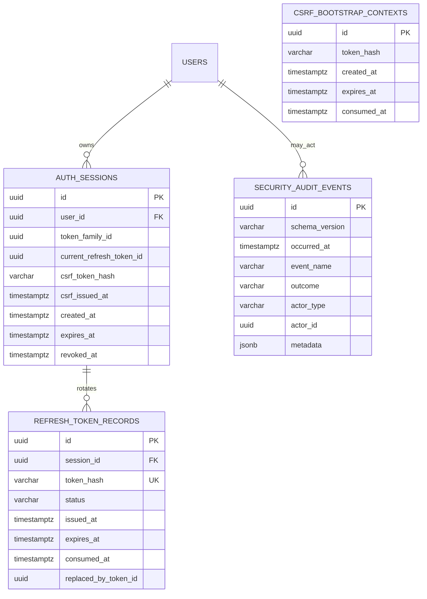
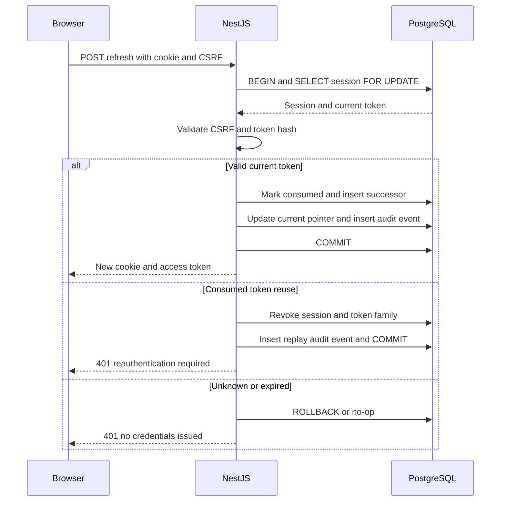

# ARCH-004 — Security Persistence Integration (SEC-INT-002)

**Project:** AI PC Builder Platform
**Status:** Proposed design delta — not a migration or implemented database
**Reviewed against:** GitHub `main` on 2026-10-25: ARCH-004, SEC-002.1 v1.0.2, SEC-002.2 v1.0, SEC-002.4 v1.0.
**Integration target:** Insert this content into `docs/03-system-design/04-database-design.md`, after its existing `users` table, then merge the index/transaction/open-decision sections. Do not maintain this as a competing canonical schema.

## 1. Purpose and authority

The existing ARCH-004 defines `users` but defers session storage. The detailed security designs now require four additional PostgreSQL tables. ARCH-004 is the canonical relational schema; SEC-002.1 owns session behavior, SEC-002.2 owns CSRF behavior, and SEC-002.4 owns audit event semantics.

**Scope:** Identity sessions, refresh rotation, anonymous login-CSRF bootstrap, and durable security audit events. No new Redis dependency. All constraints below are **proposed**, subject to migration and integration testing.

## 2. Relational model

**Note:** `security_audit_events.actor_id` is a logical user reference rather than a required foreign key. This preserves anonymous/provider events and avoids accidental deletion of audit history. Audit has no required session FK; session ID may be an allowlisted reference in a future schema revision, not a second canonical audit model.

## 3. Tables and constraints

### 3.1 `auth_sessions` — Identity module

| Column | PostgreSQL type | Constraint / meaning |
|---|---|---|
| `id` | UUID | Primary key |
| `user_id` | UUID | NOT NULL, FK `users(id)` with `ON DELETE RESTRICT` for MVP |
| `token_family_id` | UUID | NOT NULL; family identity for replay/revocation |
| `current_refresh_token_id` | UUID | NULL initially during creation; FK added after refresh table creation |
| `csrf_token_hash` | TEXT | NOT NULL; hash of session-bound CSRF token |
| `csrf_issued_at` | TIMESTAMPTZ | NOT NULL |
| `created_at` | TIMESTAMPTZ | NOT NULL |
| `expires_at` | TIMESTAMPTZ | NOT NULL; absolute expiry |
| `revoked_at` | TIMESTAMPTZ | NULL unless revoked |
| `revocation_reason` | VARCHAR(80) | NULL; controlled reason code |
| `last_used_at` | TIMESTAMPTZ | NULL |

Constraints: `expires_at > created_at`; `revoked_at IS NULL OR revoked_at >= created_at`. `current_refresh_token_id` must refer to a token **belonging to the same session**; enforce via composite FK `(id, current_refresh_token_id)` -> `refresh_token_records(session_id,id)` or equivalent transaction-safe validation. A simple FK on token ID alone is insufficient.

Indexes: `(user_id, revoked_at, expires_at)` for active-session lookup; `(expires_at)` for cleanup. Primary keys already have indexes.

### 3.2 `refresh_token_records` — Identity module

| Column | PostgreSQL type | Constraint / meaning |
|---|---|---|
| `id` | UUID | Primary key |
| `session_id` | UUID | NOT NULL, FK `auth_sessions(id)` |
| `token_hash` | TEXT | NOT NULL, UNIQUE; never plaintext |
| `status` | VARCHAR(20) | NOT NULL; `CURRENT`, `CONSUMED`, `REVOKED` |
| `issued_at` | TIMESTAMPTZ | NOT NULL |
| `expires_at` | TIMESTAMPTZ | NOT NULL |
| `consumed_at` | TIMESTAMPTZ | NULL |
| `replaced_by_token_id` | UUID | NULL, self-referencing FK |

Constraints: `expires_at > issued_at`; `status = 'CONSUMED'` requires `consumed_at IS NOT NULL`; `replaced_by_token_id <> id` when present. Enforce `UNIQUE(session_id,id)` to support the composite current-token FK. A partial unique index on `(session_id) WHERE status = 'CURRENT'` ensures at most one current token per session.

**Circular FK migration:** Create `auth_sessions` without the current-token FK, create `refresh_token_records`, then add the composite FK. For session creation, insert session with `current_refresh_token_id=NULL`, insert refresh record, update session current pointer, all in **one transaction**. Use a `DEFERRABLE` constraint if required by the chosen insertion order. Do not expose an incompletely initialized session before commit.

**Token hashes:** Use keyed HMAC-SHA-256 or a cryptographically appropriate token hash with an application-managed secret; random opaque tokens must have sufficient entropy. Do not store plaintext tokens or log token hashes. Secret rotation needs a versioning policy before implementation.

### 3.3 `csrf_bootstrap_contexts` — Identity/CSRF module

| Column | PostgreSQL type | Constraint / meaning |
|---|---|---|
| `id` | UUID | Primary key; unguessable context identifier in secure bootstrap cookie |
| `token_hash` | TEXT | NOT NULL; server-side hash only |
| `created_at` | TIMESTAMPTZ | NOT NULL |
| `expires_at` | TIMESTAMPTZ | NOT NULL |
| `consumed_at` | TIMESTAMPTZ | NULL until successful bootstrap consumption |

Constraints: `expires_at > created_at`; `consumed_at IS NULL OR consumed_at >= created_at`. Index `(expires_at)` for TTL cleanup. On login, verify Origin + bootstrap cookie + CSRF header, lock context row, ensure not expired/consumed, validate credentials, and consume bootstrap atomically with creation of session and refresh credential. Failure-path consumption policy (invalid password, throttling) must be finalized in SEC-002.2 before implementation. The bootstrap cookie is not an authenticated session.

### 3.4 `security_audit_events` — Audit module

**Canonical fields from SEC-002.4** (not the illustrative four-field entity in SEC-002.1):

| Column | PostgreSQL type | Constraint |
|---|---|---|
| `id` | UUID | PK |
| `schema_version` | VARCHAR(20) | NOT NULL, initially `1.0` |
| `occurred_at` | TIMESTAMPTZ | NOT NULL |
| `event_name` | VARCHAR(160) | NOT NULL |
| `event_category` | VARCHAR(40) | NOT NULL |
| `outcome` | VARCHAR(20) | NOT NULL; `success`, `failure`, `denied`, `unknown` |
| `severity` | VARCHAR(10) | NOT NULL; `DEBUG`, `INFO`, `WARN`, `ERROR` |
| `service_name` | VARCHAR(100) | NOT NULL |
| `actor_type` | VARCHAR(20) | NOT NULL; `customer`, `admin`, `system`, `anonymous`, `provider` |
| `actor_id` | UUID | NULL; logical reference, no enforced FK in MVP |
| `resource_type` | VARCHAR(100) | NULL |
| `resource_id` | VARCHAR(255) | NULL |
| `request_id` | VARCHAR(150) | NULL |
| `trace_id` | VARCHAR(150) | NULL |
| `reason_code` | VARCHAR(100) | NULL |
| `metadata` | JSONB | NOT NULL DEFAULT '{}'::jsonb, must be an object |

Indexes: `(occurred_at DESC)`, `(event_name,occurred_at DESC)`, `(actor_id,occurred_at DESC)` where actor_id non-null, `(resource_type,resource_id,occurred_at DESC)` for resource investigations, `(request_id)` where non-null. These are **candidates**, to prune after actual query patterns.

The table is append-only via application roles. Only controlled retention processes may delete. Metadata is event-specific allowlisted data; never store passwords, tokens, cookie headers, raw prompts, payment credentials, request bodies, or full addresses. Audit retention duration and access approval remain open.

## 4. Transaction boundaries and concurrency

- **Login:** one transaction for bootstrap consumption, session creation, initial refresh hash and critical audit event; do not commit partial session state.
- **Refresh:** lock session, validate that submitted hash identifies the current token, consume it once, insert successor, change current pointer, and commit together.
- **Replay:** previously consumed token is never accepted. Confirmed replay revokes affected session/family per SEC-002.1; cross-tab duplicate/lost-response may trigger re-login. Browser single-flight and multi-tab coordination remain required.
- **Logout:** session revocation, token invalidation and durable audit event in one transaction; clear cookie in response.
- **Critical admin mutations:** business mutation and durable audit insert in same database transaction, when within the same database.
- **Operational failures:** database outage fails closed for session validation and critical authenticated mutations. Logging errors must not expose secrets.

## 5. Migration plan (design, not executed)

1. Confirm ORM/migration tool and naming conventions.
2. Add `auth_sessions`, `refresh_token_records`, composite FK/current-pointer and relevant constraints.
3. Add `csrf_bootstrap_contexts`.
4. Add canonical `security_audit_events` and audit insert-only privileges.
5. Implement repositories and transaction tests; do not seed or log real tokens.
6. Validate referential integrity, rollback, expiration cleanup and index usage with PostgreSQL.
7. Update SEC-002.1 illustrative ERD notes to point to ARCH-004 as canonical.

## 6. Verification checklist

| Test | Required outcome |
|---|---|
| Session references missing user | FK rejects |
| Session current token belongs to another session | Composite FK rejects |
| Two CURRENT refresh records for one session | Partial unique index rejects |
| Two concurrent refresh requests | At most one rotation commits |
| Refresh transaction fails midway | No consumed token without successor |
| Consumed refresh token replayed | No token issued; affected session revoked |
| Expired bootstrap context | Login rejected; no session created |
| Bootstrap consumed twice | Second login attempt rejected |
| Logout transaction fails | No partial revocation reported successful |
| Audit insert fails in critical mutation | Critical mutation rolled back |
| Anonymous/provider audit event | Can persist without `users` FK |
| Sensitive metadata supplied | Application rejects or strips before persistence |
| Retention cleanup | Only expired/eligible records removed per approved policy |

## 7. Unresolved decisions

- **SEC-DB-001:** Refresh token hashing and key rotation policy.
- **SEC-DB-002:** Bootstrap context behavior on invalid login credentials.
- **SEC-DB-003:** Cross-tab refresh and lost-response UX; replay false positives.
- **SEC-DB-004:** Audit retention duration, access roles, archival/deletion.
- **SEC-DB-005:** Final migration/ORM tooling.
- **SEC-DB-006:** User deletion policy versus long-lived session/audit references.
- **SEC-DB-007:** Session expiration cleanup cadence and replay detection retention.

**Definition of Done for this design checkpoint:** ARCH-004 contains one consolidated schema, diagrams and constraints are consistent with SEC-002.1/002.2/002.4, open decisions remain explicit, and the Markdown/Mermaid render is validated. No application implementation is implied.
