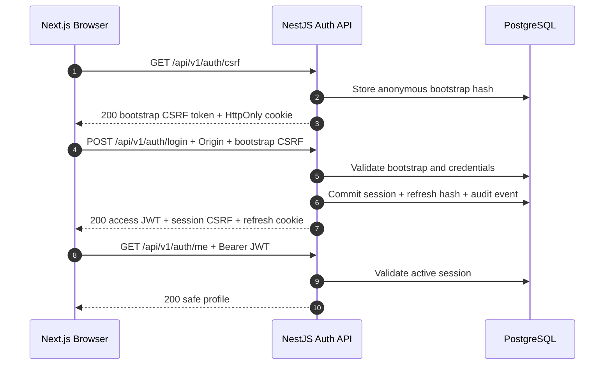
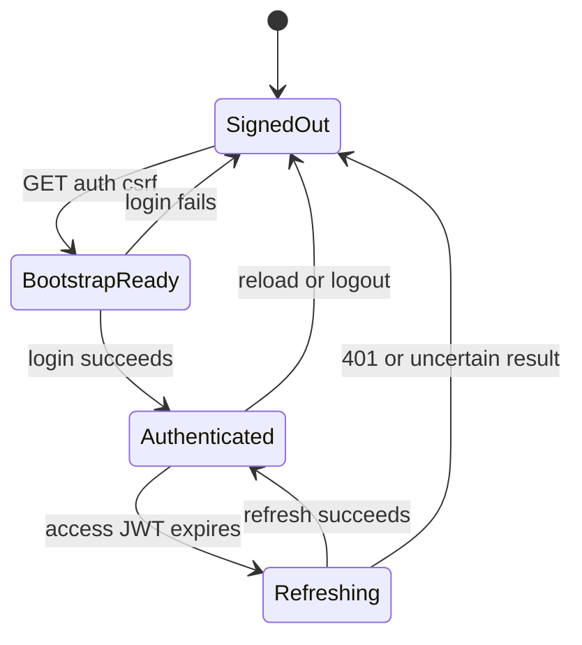
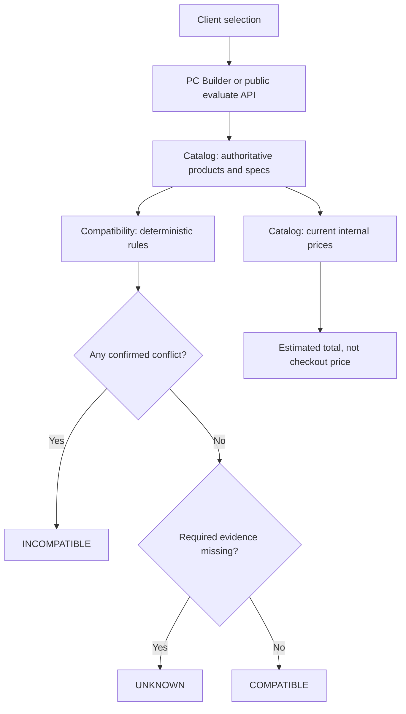

# AI PC Builder — API Contract Design

**Document ID:** ARCH-005  
**Version:** 0.3 — Identity, Catalog, PC Builder & Compatibility checkpoints  
**Status:** Proposed — Awaiting Architecture Review  
**Canonical path:** `docs/03-system-design/05-api-contract-design.md`  
**Related:** ARCH-002, ARCH-004, SEC-002.1, SEC-002.2, SEC-002.4, SEC-INT-003  
**Implementation:** Not started; all payloads are illustrative, not deployed endpoints.

## 1. Purpose and scope

This document defines the externally observable HTTP contract for the modular-monolith NestJS API. This document currently covers **Identity & Authentication and Catalog**. Compatibility, configurations, cart, checkout, payments, AI advisor, ingestion and other administration endpoints will be added as separately reviewed sections in later checkpoints, without creating competing API contract files.

### 1.1 MVP security decision

The browser holds access JWT and authenticated CSRF token **in memory**; the opaque refresh token is an `HttpOnly` cookie. After a full reload, the browser cannot use the session-bound CSRF token. **MVP policy: require explicit login again.** No authenticated CSRF-recovery endpoint is available in this contract. Do not attempt a blind refresh or reuse the anonymous CSRF bootstrap as authenticated proof. This is a deliberate UX trade-off, not a claim that an existing refresh cookie is automatically revoked on reload.

If future product requirements demand seamless reload recovery, first approve a separate authenticated recovery protocol, update SEC-002.1/SEC-002.2 and ARCH-005, then implement it.

## 2. API conventions

| Property | Contract |
|---|---|
| Base path | `/api/v1` |
| Transport | HTTPS in deployed environments |
| Request/response format | JSON UTF-8, except `204 No Content` |
| Time representation | ISO 8601 UTC |
| Resource identifiers | UUID |
| Access authentication | `Authorization: Bearer <access_jwt>` |
| Refresh authentication | Host-only Secure HttpOnly refresh cookie, not exposed to JavaScript |
| Cookie-backed mutations | Exact allowed `Origin` and `X-CSRF-Token` |
| CSRF bootstrap | Anonymous, cookie-bound, `Cache-Control: no-store` |
| Sensitive responses | `Cache-Control: no-store` |
| Validation | NestJS DTO/Zod-compatible validation, no unexpected fields |
| Observability | `X-Request-Id` response header; no credentials or raw PII in logs |
| Rate limiting | Required for register, CSRF bootstrap, login, refresh; exact thresholds TBD |
| Deployment | Prefer same-origin reverse proxy `/api/v1`; cookie domain/path and allowed origins configured per environment |

### 2.1 Response envelope

Success for JSON endpoints:

```json
{
  "data": {
    "id": "5b62e9b4-80ab-46d1-98cb-6f74d0bfc71a"
  }
}
```

Errors:

```json
{
  "error": {
    "code": "AUTH_INVALID_CREDENTIALS",
    "message": "Invalid credentials",
    "requestId": "req_example_001"
  }
}
```

`message` is safe for display and must not disclose whether an account exists, token is replayed, or session was revoked. Do not include raw validation input, tokens, passwords, or stack traces. The `requestId` matches `X-Request-Id`.

### 2.2 HTTP status conventions

| HTTP | Meaning |
|---|---|
| 200 | Successful read or credential issuance |
| 201 | Account created |
| 204 | Mutation succeeded, no response body |
| 400 | Invalid syntax or DTO |
| 401 | Invalid credentials or unauthenticated/expired session |
| 403 | Invalid CSRF/Origin or insufficient authorization |
| 409 | Conflicting resource state, where safely disclosable |
| 422 | Well-formed but invalid business input, if used by later modules |
| 429 | Rate limit exceeded; `Retry-After` when available |
| 500 | Unexpected server failure; generic message |
| 503 | Required persistence service unavailable; fail closed |

## 3. Authentication flow



**Security invariants:** validate Origin and CSRF before cookie-authenticated state mutation. Login consumes the bootstrap context atomically on successful session creation. The server validates JWT signature, issuer, audience, expiry, required claims, and active `sid` in PostgreSQL for protected requests. CSRF is not a substitute for authentication.

## 4. Endpoint inventory

| Method | Path | Authentication / proof | Success |
|---|---|---|---|
| GET | `/auth/csrf` | Anonymous, exact Origin policy | 200 |
| POST | `/auth/register` | Anonymous; anti-abuse; CSRF policy unresolved | 201 |
| POST | `/auth/login` | Bootstrap cookie + Origin + `X-CSRF-Token` | 200 |
| POST | `/auth/refresh` | Refresh cookie + Origin + session `X-CSRF-Token` | 200 |
| POST | `/auth/logout` | Refresh cookie + Origin + session `X-CSRF-Token` | 204 |
| POST | `/auth/logout-all` | Bearer JWT + active session; CSRF if cookie is used | 204 |
| GET | `/auth/me` | Bearer JWT + active session | 200 |

All paths in the table are relative to `/api/v1`.

## 5. Endpoint contracts

### 5.1 `GET /api/v1/auth/csrf`

**Purpose:** Create an anonymous pre-login CSRF context; does not authenticate the browser.

**Request:** No body. Validate allowed Origin when supplied; define exact behavior for absent Origin and non-browser clients before implementation.

**Response 200:**

```http
Cache-Control: no-store
Set-Cookie: __Host-pc_csrf_bootstrap=<opaque_id>; Path=/; Secure; HttpOnly; SameSite=Lax
```

```json
{
  "data": {
    "csrfToken": "random-opaque-bootstrap-csrf-token",
    "expiresAt": "2026-10-25T15:30:00.000Z"
  }
}
```

`csrfToken` is a **placeholder**, not a production secret. Store only its hash server-side. The bootstrap cookie's value identifies the context, not the CSRF token. A valid context is short-lived and one-time use.

**Errors:** 403 `SEC_ORIGIN_DENIED`; 429 `RATE_LIMITED`; 503 `SERVICE_UNAVAILABLE`.

### 5.2 `POST /api/v1/auth/register`

**Status: Contract provisional / security decision required.** Registration CSRF requirements, email verification, account enumeration policy, and whether registration establishes a session are not yet approved.

Proposed input:

```json
{
  "email": "customer@example.com",
  "password": "example-only-not-a-real-password"
}
```

Proposed `201` response:

```json
{
  "data": {
    "id": "5b62e9b4-80ab-46d1-98cb-6f74d0bfc71a",
    "email": "customer@example.com",
    "status": "PENDING_VERIFICATION"
  }
}
```

`PENDING_VERIFICATION` is illustrative and must not be implemented until the account state machine is aligned with BA-005 and ARCH-004. **Do not implement this endpoint from the provisional example alone.** Password policy, verification, registration CSRF and post-registration login behavior are blockers.

### 5.3 `POST /api/v1/auth/login`

**Request headers:** `Content-Type: application/json`, `Origin: <allowed_origin>`, `X-CSRF-Token: <bootstrap_csrf>`. Browser automatically sends `__Host-pc_csrf_bootstrap` cookie.

```json
{
  "email": "customer@example.com",
  "password": "example-only-not-a-real-password"
}
```

**Response 200:**

```http
Cache-Control: no-store
Set-Cookie: __Host-pc_refresh=<opaque_refresh_token>; Path=/; Secure; HttpOnly; SameSite=Lax
Set-Cookie: __Host-pc_csrf_bootstrap=; Path=/; Secure; HttpOnly; SameSite=Lax; Max-Age=0
```

```json
{
  "data": {
    "accessToken": "jwt-placeholder",
    "tokenType": "Bearer",
    "expiresIn": 900,
    "csrfToken": "random-opaque-session-csrf-token",
    "user": {
      "id": "5b62e9b4-80ab-46d1-98cb-6f74d0bfc71a",
      "email": "customer@example.com",
      "role": "CUSTOMER"
    }
  }
}
```

`expiresIn: 900` is an **illustrative value**, not an approved TTL. Session-bound CSRF token is distinct from bootstrap token. Refresh cookie value is opaque and never returned in JSON.

**Errors:** 400 `VALIDATION_FAILED`; 401 `AUTH_INVALID_CREDENTIALS`; 403 `SEC_CSRF_INVALID` or `SEC_ORIGIN_DENIED`; 429 `RATE_LIMITED`; 503 `SERVICE_UNAVAILABLE`. Credential failures use a generic response regardless of account existence.

**Atomicity:** consume bootstrap, create session and initial refresh token hash, and record critical audit event in a transaction. Decide whether an invalid-password attempt consumes bootstrap before implementation.

### 5.4 `POST /api/v1/auth/refresh`

**Request:** No JSON body. Cookie `__Host-pc_refresh` plus exact allowed `Origin` and `X-CSRF-Token` containing the authenticated session token.

**Response 200:** same JSON credential fields as login **except `user` is optional and omitted in the MVP refresh response**, and a rotated `__Host-pc_refresh` cookie. CSRF token is **not rotated** on ordinary refresh; it need not be returned again.

```json
{
  "data": {
    "accessToken": "new-jwt-placeholder",
    "tokenType": "Bearer",
    "expiresIn": 900
  }
}
```

**Errors:** 401 `AUTH_SESSION_INVALID` (expired, revoked, unknown or consumed token; do not expose replay detail); 403 `SEC_CSRF_INVALID` / `SEC_ORIGIN_DENIED`; 429 `RATE_LIMITED`; 503 `SERVICE_UNAVAILABLE`.

**Concurrency:** lock session row and re-read token status. Only one transaction may consume the current token and issue a successor. Confirmed consumed-token reuse revokes the affected session/family, even when caused by a legitimate race; frontend should coordinate refreshes to reduce this risk.

**Lost response:** no automatic blind retry. An unknown outcome requires re-login for MVP.

### 5.5 `POST /api/v1/auth/logout`

**Request:** No body. Valid refresh cookie + Origin + session-bound CSRF header. Access JWT is **not required**: this enables logout even if the access JWT has expired.

**Response:** `204 No Content`, empty body; clear refresh cookie.

```http
Set-Cookie: __Host-pc_refresh=; Path=/; Secure; HttpOnly; SameSite=Lax; Max-Age=0
Cache-Control: no-store
```

**Policy:** Valid CSRF and an already revoked/expired refresh session may still receive 204 to avoid session-state disclosure; no active session is recreated. If CSRF cannot be validated, return 403 and do not claim server-side revocation. Browser may always clear in-memory auth independently, but must not report server-side logout success when revocation was not confirmed.

**Errors:** 403 `SEC_CSRF_INVALID` / `SEC_ORIGIN_DENIED`; 503 `SERVICE_UNAVAILABLE`. Unknown-cookie behavior and its CSRF treatment require a final security review.

### 5.6 `POST /api/v1/auth/logout-all`

**Request:** `Authorization: Bearer <access_jwt>`, no body. Require active user/session. If refresh cookie is also used for this mutation, require Origin and session CSRF proof; for the MVP contract, **do not use the refresh cookie as an authentication fallback**.

**Response:** `204 No Content`, clear current refresh cookie. Revoke all active sessions belonging to the authenticated user transactionally.

**Errors:** 401 `AUTH_SESSION_INVALID`; 403 `SEC_CSRF_INVALID` if cookie-backed proof applies; 503 `SERVICE_UNAVAILABLE`.

### 5.7 `GET /api/v1/auth/me`

**Request:** Bearer access JWT. No refresh-cookie authentication; no CSRF header required.

**Response 200:**

```json
{
  "data": {
    "id": "5b62e9b4-80ab-46d1-98cb-6f74d0bfc71a",
    "email": "customer@example.com",
    "role": "CUSTOMER",
    "status": "ACTIVE"
  }
}
```

**Errors:** 401 `AUTH_SESSION_INVALID`; 403 `AUTH_FORBIDDEN` for an account status or policy denial when appropriate.

## 6. Cookie and token topology

The `__Host-` cookie prefix requires `Secure`, `Path=/`, and **no `Domain` attribute**. This means a host-only cookie scoped to the API host. The same-origin reverse-proxy deployment is preferred.

Do not place refresh tokens in localStorage, sessionStorage, broadcast messages, URL parameters or JSON responses. Store access JWT and session CSRF token only in memory. Set `Cache-Control: no-store` on authentication responses. Use strict allowlisted Origin checks and reject unsafe cross-origin credentialed requests.

**Important:** SameSite=Lax is not a substitute for Origin/CSRF validation. Production frontend/API topology, CORS credentials and cookie deployment must be confirmed before implementation.

## 7. Error handling and security boundaries

| Error code | HTTP | Client behavior |
|---|---:|---|
| `VALIDATION_FAILED` | 400 | Correct input |
| `AUTH_INVALID_CREDENTIALS` | 401 | Display generic sign-in error |
| `AUTH_SESSION_INVALID` | 401 | Clear in-memory auth; sign in |
| `AUTH_FORBIDDEN` | 403 | Do not retry with elevated permissions |
| `SEC_CSRF_INVALID` | 403 | Stop cookie mutation; no blind retry |
| `SEC_ORIGIN_DENIED` | 403 | Stop request; review deployment origin |
| `RATE_LIMITED` | 429 | Respect retry policy |
| `SERVICE_UNAVAILABLE` | 503 | Fail closed, surface temporary failure |
| `INTERNAL_ERROR` | 500 | Generic message, include requestId |

Audit `auth.login.failed`, `auth.refresh.reuse_detected`, `auth.session.revoked`, `security.csrf.validation_failed` with allowlisted metadata only. Never log raw JWT, refresh token, CSRF token, password, cookies, or full request body.

## 8. Client-side state and recovery



The browser should use **single-flight refresh per tab**. Cross-tab coordination via BroadcastChannel and a best-effort lease may reduce races, but does not guarantee exactly-once requests. Broadcast only non-sensitive coordination events. A tab receiving `refresh-finished` does not automatically gain another tab's in-memory access JWT or CSRF token.

**UX requirement:** preserve an unsaved guest PC configuration separately from credentials so a forced re-login does not discard the build.

## 9. Verification matrix

| Test ID | Contract assertion | Test layer |
|---|---|---|
| API-AUTH-001 | CSRF bootstrap returns no-store and HttpOnly cookie | Integration |
| API-AUTH-002 | Login without bootstrap header/cookie returns 403 | Integration |
| API-AUTH-003 | Valid login returns access JWT, session CSRF and refresh cookie | Integration |
| API-AUTH-004 | Invalid credentials return generic 401 | Integration |
| API-AUTH-005 | Refresh without Origin or session CSRF rejected | Integration |
| API-AUTH-006 | Valid refresh rotates once, old token consumed | PostgreSQL integration |
| API-AUTH-007 | Concurrent refresh cannot commit two successors | PostgreSQL concurrency |
| API-AUTH-008 | Reuse of consumed token revokes session/family | PostgreSQL integration |
| API-AUTH-009 | Logout works with expired access JWT and valid cookie+CSRF | Integration |
| API-AUTH-010 | Logout-all revokes all user's sessions only | Integration |
| API-AUTH-011 | `/me` rejects JWT for revoked session | Integration |
| API-AUTH-012 | Cookies satisfy Secure, HttpOnly, SameSite, host-only rules | Browser |
| API-AUTH-013 | Cross-origin forgery rejected | Browser |
| API-AUTH-014 | Lost refresh response not blindly retried | Frontend |
| API-AUTH-015 | Reload requires explicit login in MVP | Browser |
| API-AUTH-016 | Logs and audit records contain no secrets | Integration |
| API-AUTH-017 | Session database outage fails closed | Integration |
| API-AUTH-018 | Invalid register contract cannot be implemented before decision | Design review |

Recommended tests: Vitest + Supertest + a real PostgreSQL test database for transactions; browser-level tests for actual cookie/CORS/SameSite behavior.

## 10. Open decisions and approval gates

| ID | Decision | Impact |
|---|---|---|
| API-DEC-001 | Registration CSRF, email verification, account state | Blocks register implementation |
| API-DEC-002 | Access/refresh/session TTLs and signing-key rotation | Blocks token configuration |
| API-DEC-003 | Exact frontend/API host topology and Origin allowlist | Blocks cookie/CORS deployment |
| API-DEC-004 | Rate-limit thresholds and abuse handling | Blocks production hardening |
| API-DEC-005 | Bootstrap consumption on failed credentials | Blocks login edge-case implementation |
| API-DEC-006 | Unknown refresh cookie / logout idempotency policy | Blocks logout finalization |
| API-DEC-007 | Browser reload recovery beyond explicit login | Deferred; not an MVP feature |
| API-DEC-008 | Role and account-status vocabulary aligned with BA-005 | Blocks final DTOs |
| API-DEC-009 | Response envelope and requestId conventions | Needs frontend/backend approval |

## 11. Definition of Done for this checkpoint

- [x] Identity endpoint inventory drafted.
- [x] Example request/response contracts drafted.
- [x] Refresh rotation, CSRF, logout and lost-response policies represented.
- [x] Initial error catalog and verification matrix drafted.
- [ ] Security/BA reviewers approve provisional decisions.
- [ ] Cookie topology and token TTLs approved.
- [ ] Mermaid rendered and all links validated.
- [ ] NestJS controllers/DTOs implemented and tests executed.

**Next checkpoint after Identity:** Catalog API contracts are appended as Part II below. Continue to use this **same ARCH-005 file** for subsequent modules.

**Status:** Proposed design only. No deployed endpoints, migrations or executed tests are claimed.

---

# Part II — Catalog API Contract (Checkpoint ARCH-005.2)

## 12. Catalog scope and ownership

The **Catalog** module owns `categories`, `products`, `product_specifications` and the internal store price `products.price_vnd` from ARCH-004. Public visitors may browse without authentication (BA-002 BR-AUTH-001). Admin writes require a valid bearer JWT, active PostgreSQL session and an explicit `ADMIN` authorization policy; client-provided roles are never trusted. Seller reference prices, seller offers and price observations are owned by the **Seller Offers** module and are not part of these endpoints.

All catalog prices are **integer VND** (not floating-point). Product specifications are category-specific, versioned JSON objects validated by backend schemas. Only `ACTIVE` products are visible on public endpoints. Inventory availability is owned by Inventory; a catalog product's existence or `ACTIVE` status does not guarantee stock or checkout eligibility.

### 12.1 Catalog endpoint inventory

| Method | Route | Access | Success | Purpose |
|---|---|---|---|---|
| GET | `/api/v1/catalog/categories` | Public | 200 | Supported categories |
| GET | `/api/v1/catalog/products` | Public | 200 | Search/filter/paginate active products |
| GET | `/api/v1/catalog/products/{id}` | Public | 200 | Active product detail |
| POST | `/api/v1/admin/catalog/products` | Admin | 201 | Create draft product |
| PATCH | `/api/v1/admin/catalog/products/{id}` | Admin | 200 | Update permitted product fields |
| PATCH | `/api/v1/admin/catalog/products/{id}/status` | Admin | 200 | Activate/deactivate product |

`/api/v1` is the common base path. Admin routes belong to the Catalog module, not to a duplicated Admin domain. Product deletion is intentionally excluded from MVP to preserve order references and price snapshots.

## 13. Public Catalog endpoints

### 13.1 `GET /api/v1/catalog/categories`

**Request:** No authentication or request body.

**Response 200:**

```json
{
  "data": [
    { "id": "4cb4bb8f-9d1c-4bb1-bef6-4a3ed4dd75a7", "code": "CPU", "name": "Processors" },
    { "id": "7e9d44d0-23d5-4f82-86ce-1a56a27f91e4", "code": "GPU", "name": "Graphics Cards" }
  ]
}
```

Return only categories supported by the current catalog. Category codes are stable identifiers; client display names may change. Category ordering is deterministic by `code` until an explicit display-order field is added to ARCH-004. This is a product catalog, not a taxonomy of external sellers.

### 13.2 `GET /api/v1/catalog/products`

**Query parameters:**

| Parameter | Type | Default | Rules |
|---|---|---|---|
| `q` | string | none | Trimmed keyword, maximum 100 characters |
| `category` | string | none | Exact category code, e.g. `CPU` |
| `minPrice` | integer | none | VND, >= 0 |
| `maxPrice` | integer | none | VND, >= 0 and >= minPrice |
| `sort` | enum | `newest` | `newest`, `price_asc`, `price_desc`, `name_asc` |
| `page` | integer | `1` | 1–10000 |
| `limit` | integer | `20` | 1–50 |

**Example:**

```http
GET /api/v1/catalog/products?category=CPU&minPrice=2000000&maxPrice=7000000&sort=price_asc&page=1&limit=20
```

**Response 200:**

```json
{
  "data": [
    {
      "id": "c21c9c35-7045-477c-a4d6-82c62b4b7a60",
      "sku": "CPU-DEMO-001",
      "name": "Example Desktop CPU",
      "category": { "code": "CPU", "name": "Processors" },
      "priceVnd": 4500000,
      "status": "ACTIVE"
    }
  ],
  "meta": {
    "page": 1,
    "limit": 20,
    "total": 1,
    "totalPages": 1,
    "sort": "price_asc"
  }
}
```

**Rules:**

- Public list contains only `ACTIVE` products. Inactive or draft products must never leak via search or filters.
- Search and filters are combined with AND; keywords may match normalized product name or SKU. Exact text-search behavior (case/accent matching and full-text indexing) is an implementation decision.
- Sort is deterministic: append `id ASC` as a tie-breaker. `newest` sorts by `created_at DESC, id ASC`.
- Use parameterized database queries; never concatenate raw `sort`, `q` or filter input into SQL.
- Reject unknown sort keys and invalid ranges with `400 VALIDATION_FAILED`; do not silently clamp invalid values.
- `total` counts matching **active** products. Offset pagination may produce movement under concurrent writes; stable snapshot pagination is not promised.
- No seller offer prices, inventory stock counts, or checkout guarantees are included.

### 13.3 `GET /api/v1/catalog/products/{id}`

`id` must be a UUID. A product not found or not `ACTIVE` returns the same `404 CATALOG_PRODUCT_NOT_FOUND` response to avoid exposing inactive listings.

**Response 200:**

```json
{
  "data": {
    "id": "c21c9c35-7045-477c-a4d6-82c62b4b7a60",
    "sku": "CPU-DEMO-001",
    "name": "Example Desktop CPU",
    "status": "ACTIVE",
    "priceVnd": 4500000,
    "category": { "id": "4cb4bb8f-9d1c-4bb1-bef6-4a3ed4dd75a7", "code": "CPU", "name": "Processors" },
    "specifications": {
      "schemaVersion": 1,
      "data": { "socket": "AM5", "cores": 6, "threads": 12, "tdpWatts": 65 }
    },
    "createdAt": "2026-10-25T08:00:00.000Z",
    "updatedAt": "2026-10-25T08:00:00.000Z"
  }
}
```

The specification keys above are **illustrative**; the CPU schema must be agreed with Compatibility and versioned before implementation. Do not infer hardware compatibility from a free-form AI response. `specifications.data` is a category-validated JSON object.

## 14. Admin Catalog endpoints

### 14.1 Authorization and validation

All admin operations require bearer JWT with active session and server-authoritative `ADMIN` role. Return `401 AUTH_SESSION_INVALID` if unauthenticated and `403 AUTH_FORBIDDEN` if authenticated but not authorized. A CSRF token is not needed when these endpoints accept **only** bearer authentication and never fall back to cookie authentication; Origin restrictions for cookie-backed auth endpoints remain unchanged.

Every successful admin mutation emits a sanitized audit event (e.g., `catalog.product.created`, `catalog.product.updated`, `catalog.product.status_changed`) with actor ID, product ID, request ID and an allowlisted change summary. Never log raw credentials or unrestricted user-controlled JSON.

### 14.2 `POST /api/v1/admin/catalog/products`

**Request:**

```json
{
  "categoryId": "4cb4bb8f-9d1c-4bb1-bef6-4a3ed4dd75a7",
  "sku": "CPU-DEMO-001",
  "name": "Example Desktop CPU",
  "priceVnd": 4500000,
  "specifications": {
    "schemaVersion": 1,
    "data": { "socket": "AM5", "cores": 6, "threads": 12, "tdpWatts": 65 }
  }
}
```

**Response 201:**

```json
{
  "data": {
    "id": "c21c9c35-7045-477c-a4d6-82c62b4b7a60",
    "sku": "CPU-DEMO-001",
    "status": "DRAFT",
    "priceVnd": 4500000
  }
}
```

`DRAFT` is a **proposed lifecycle value**; it must be aligned with the final BA state machine and ARCH-004 status constraints before coding. Validate category existence, SKU uniqueness, non-negative integer VND price, and versioned category specifications. Create `products` and `product_specifications` in one transaction; a failed audit write for a required critical mutation must roll back the mutation.

**Errors:** `400 VALIDATION_FAILED`, `401 AUTH_SESSION_INVALID`, `403 AUTH_FORBIDDEN`, `404 CATALOG_CATEGORY_NOT_FOUND`, `409 CATALOG_SKU_CONFLICT`, `503 SERVICE_UNAVAILABLE`.

### 14.3 `PATCH /api/v1/admin/catalog/products/{id}`

Partial update; omitted fields remain unchanged. Allowed fields: `name`, `priceVnd`, `specifications`. `sku`, `categoryId`, `status` are immutable through this endpoint. Reject unknown properties. The complete resulting specification object must validate against the category's versioned schema; partial nested merges are not supported.

**Request example:**

```json
{
  "name": "Example Desktop CPU — Updated",
  "priceVnd": 4300000
}
```

**Response 200:** full admin product projection with updated `updatedAt`. Changes to price must not modify historical `order_items.unit_price_amount` or `line_total_amount` snapshots. A price update does not automatically change existing cart checkout quotes; checkout must recalculate authoritative prices.

**Errors:** `400 VALIDATION_FAILED`, `401 AUTH_SESSION_INVALID`, `403 AUTH_FORBIDDEN`, `404 CATALOG_PRODUCT_NOT_FOUND`, `409 CATALOG_CONFLICT` (if optimistic concurrency is later added), `503 SERVICE_UNAVAILABLE`.

### 14.4 `PATCH /api/v1/admin/catalog/products/{id}/status`

**Request:**

```json
{ "status": "ACTIVE" }
```

**Response 200:**

```json
{
  "data": {
    "id": "c21c9c35-7045-477c-a4d6-82c62b4b7a60",
    "status": "ACTIVE",
    "updatedAt": "2026-10-25T08:00:00.000Z"
  }
}
```

Proposed states: `DRAFT`, `ACTIVE`, `INACTIVE`. Activate only if category/specification/price validation succeeds. `INACTIVE` and `DRAFT` products are hidden from public endpoints and cannot be newly added to checkout. Existing order snapshots remain intact. State vocabulary and transition matrix must be approved with BA-005 before coding. Repeating a request for the same status is idempotent at the state level.

## 15. Catalog error catalog

All errors use the common ARCH-005 envelope from §2.1.

| Code | HTTP | Meaning |
|---|---:|---|
| `VALIDATION_FAILED` | 400 | Invalid UUID, query, payload or specification |
| `AUTH_SESSION_INVALID` | 401 | Invalid bearer/session |
| `AUTH_FORBIDDEN` | 403 | User lacks Admin permission |
| `CATALOG_CATEGORY_NOT_FOUND` | 404 | Unknown category |
| `CATALOG_PRODUCT_NOT_FOUND` | 404 | Missing or non-public product |
| `CATALOG_SKU_CONFLICT` | 409 | Duplicate SKU |
| `CATALOG_CONFLICT` | 409 | Conflicting update where concurrency control applies |
| `RATE_LIMITED` | 429 | Throttled endpoint, if configured |
| `SERVICE_UNAVAILABLE` | 503 | Persistence dependency unavailable |
| `INTERNAL_ERROR` | 500 | Unexpected failure; sanitized response |

Example:

```json
{
  "error": {
    "code": "CATALOG_PRODUCT_NOT_FOUND",
    "message": "Product not found",
    "requestId": "req_catalog_001"
  }
}
```

## 16. Catalog verification matrix

| ID | Scenario | Expected |
|---|---|---|
| CAT-API-001 | Guest lists categories | 200, no auth required |
| CAT-API-002 | Guest lists products | Only ACTIVE products |
| CAT-API-003 | Search + category + price filter | AND semantics, correct total |
| CAT-API-004 | Invalid page/limit/sort/price range | 400, no unsafe query execution |
| CAT-API-005 | Stable sorting with ties | Deterministic order by ID |
| CAT-API-006 | Product detail for inactive product | Same 404 as unknown ID |
| CAT-API-007 | Product detail includes specifications | Versioned validated JSON |
| CAT-API-008 | Guest creates product | 401 |
| CAT-API-009 | Authenticated customer creates product | 403 |
| CAT-API-010 | Admin creates product | 201 DRAFT, product + specs atomic |
| CAT-API-011 | Admin creates duplicate SKU | 409, no duplicate row |
| CAT-API-012 | Admin creates invalid category specs | 400, transaction rollback |
| CAT-API-013 | Admin updates price | Historical order snapshots unchanged |
| CAT-API-014 | Admin activates incomplete product | 400/409, remains DRAFT |
| CAT-API-015 | Admin deactivates active product | Public list/detail hides it |
| CAT-API-016 | Catalog list response | No external seller price mixed in |
| CAT-API-017 | Audit insert fails during required mutation | Mutation rolled back |
| CAT-API-018 | Malicious sort/search input | No SQL injection, generic errors |

Use Vitest + Supertest for HTTP contract tests, PostgreSQL integration tests for uniqueness/transaction constraints, and Zod/DTO unit tests for category-specific validation. No tests have been executed.

## 17. Catalog open decisions

| ID | Decision | Owner / dependency |
|---|---|---|
| CAT-DEC-001 | Exact `DRAFT`/`ACTIVE`/`INACTIVE` status vocabulary and transitions | BA-005 + Catalog |
| CAT-DEC-002 | Category specification schemas, versioning and compatibility-owned fields | Catalog + Compatibility |
| CAT-DEC-003 | Search semantics and indexing | Catalog + DB |
| CAT-DEC-004 | Admin update concurrency (`updatedAt` precondition or version column) | Catalog + ARCH-004 |
| CAT-DEC-005 | Category management endpoints and supported category seed data | Product + Catalog |
| CAT-DEC-006 | Product visibility and sellability rules vs inventory availability | Catalog + Inventory + Checkout |
| CAT-DEC-007 | Whether admin list/detail of draft products needs separate endpoints | Product + Catalog |

## 18. Catalog checkpoint definition of done

- [x] Public category/list/detail contracts drafted.
- [x] Admin create/update/status contracts drafted.
- [x] Pagination, filtering, sorting and error envelope defined.
- [x] Ownership boundary between Catalog and Seller Offers explicit.
- [x] Catalog test matrix and unresolved decisions documented.
- [ ] BA-005 product lifecycle and category schemas approved.
- [ ] Mermaid diagrams rendered and contract tests implemented.

**Next checkpoint:** PC Builder & Compatibility contracts follow in Sections 19–25 of this same document.


---

## 19. PC Builder & Compatibility scope

**Checkpoint:** ARCH-005.3 — proposed API design, not implemented.  
**Owners:** PC Builder owns saved configurations and selected items; Catalog owns product identities and specifications; Compatibility owns deterministic evaluation and rule versions. Seller Offers owns external market observations and must not be used as the authoritative internal checkout price.

**Business rule traceability:** BR-PC-001–006 and BR-COMP-001–008 (BA-002); ARCH-002 and ARCH-003. A configuration may be incomplete while editing. The owner alone may mutate a private saved build. Evaluation must never claim `COMPATIBLE` when a required specification is missing, and confirmed incompatibilities must not be hidden by warnings.

### 19.1 Suggested resources and identities

| Resource | Owner | Notes |
|---|---|---|
| `Build` | PC Builder | UUID, ownerId, name, status, revision, timestamps |
| `BuildItem` | PC Builder | Product reference and quantity; category resolved from Catalog |
| `CompatibilityResult` | Compatibility | Derived result, not necessarily persisted |
| `CompatibilityIssue` | Compatibility | Rule ID, affected item IDs, severity, structured explanation |
| `BuildPriceEstimate` | PC Builder via Catalog | Calculated from current internal catalog prices; not a checkout guarantee |

**MVP assumptions pending approval:** a saved build belongs to one authenticated customer; guest builds can exist in browser state and be evaluated without persistence; a user may save incomplete builds. Product selection limits must be enforced server-side (e.g., at most one CPU/GPU/PSU/cooler in the initial product rules, RAM may have multiple kits/modules). The exact `Build.status` vocabulary is deferred to BA-005 and ARCH-004.

## 20. Endpoint inventory

All paths are relative to `/api/v1` and use the common error envelope in Section 2.

| Method | Path | Auth | Purpose |
|---|---|---|---|
| `POST` | `/compatibility/evaluate` | Public | Evaluate a proposed selection without saving |
| `POST` | `/builds` | Bearer + active session | Create a private saved build |
| `GET` | `/builds` | Bearer + active session | List only caller-owned builds |
| `GET` | `/builds/:buildId` | Bearer + owner check | Read saved build with current estimate |
| `PATCH` | `/builds/:buildId` | Bearer + owner check | Rename or edit permitted metadata |
| `PUT` | `/builds/:buildId/items/:category` | Bearer + owner check | Replace selection for a category (single-slot categories only) |
| `DELETE` | `/builds/:buildId/items/:category` | Bearer + owner check | Remove a single-slot category selection |
| `POST` | `/builds/:buildId/evaluate` | Bearer + owner check | Evaluate persisted build's current selections |
| `DELETE` | `/builds/:buildId` | Bearer + owner check | Delete saved build |

**Important design limit:** the single-slot `PUT/DELETE` routes do not support multi-item RAM. A separate RAM item collection contract is required before implementing RAM mutations. Do not shoehorn RAM into a single-slot route.

## 21. Public Compatibility Evaluation

### 21.1 `POST /api/v1/compatibility/evaluate`

Evaluate a candidate configuration with current, structured Catalog specifications. Does not create a build or reserve stock. Require server-side limits on item count, body size and evaluation cost; throttle abusive anonymous requests.

**Request (illustrative):**

```json
{
  "items": [
    {"productId": "c00a0000-0000-4000-8000-000000000001", "quantity": 1},
    {"productId": "c00a0000-0000-4000-8000-000000000002", "quantity": 1}
  ]
}
```

The API resolves product categories from Catalog. The client must not supply trusted category or hardware specifications. Product IDs above are placeholders, not real catalog entries. Quantity rules are category-specific; duplicates and category conflicts are rejected consistently. Incomplete configurations are valid inputs.

**Response 200 (illustrative; values depend on actual rule evaluation):**

```json
{
  "data": {
    "overallStatus": "UNKNOWN",
    "ruleSetVersion": "compat-mvp-v1",
    "issues": [
      {
        "ruleId": "CPU_MOTHERBOARD_SOCKET",
        "status": "UNKNOWN",
        "severity": "WARNING",
        "productIds": ["c00a0000-0000-4000-8000-000000000001"],
        "message": "A motherboard is required to check CPU socket compatibility."
      }
    ],
    "evaluatedAt": "2026-10-25T16:00:00.000Z"
  }
}
```

**Aggregation precedence:** any confirmed incompatible rule yields `INCOMPATIBLE`; otherwise missing necessary evidence yields `UNKNOWN`; only fully verified applicable rules can yield `COMPATIBLE`. A non-applicable rule is not an error. The final statuses and severities must be aligned with BA-002 before coding; do not treat the example as an approved enum definition.

**Errors:** `400 VALIDATION_FAILED`, `404 CATALOG_PRODUCT_NOT_FOUND` (or generic invalid selection if enumeration is a concern), `429 RATE_LIMITED`, `503 SERVICE_UNAVAILABLE`.

## 22. Saved PC Build endpoints

### 22.1 `POST /api/v1/builds`

**Request:** Bearer JWT and JSON body:

```json
{
  "name": "My gaming PC",
  "items": [
    {"productId": "c00a0000-0000-4000-8000-000000000001", "quantity": 1}
  ]
}
```

**Response 201:**

```json
{
  "data": {
    "id": "b00d0000-0000-4000-8000-000000000001",
    "name": "My gaming PC",
    "revision": 1,
    "items": [{"productId": "c00a0000-0000-4000-8000-000000000001", "quantity": 1}],
    "compatibility": {"overallStatus": "UNKNOWN"},
    "priceEstimate": {"currency": "VND", "amount": 4500000, "isCheckoutPrice": false}
  }
}
```

The sample amount is illustrative. Server resolves current catalog prices, calculates totals, and never trusts prices sent by clients. An incomplete or incompatible configuration may be saved as a draft; **saving does not imply checkout eligibility**. Persist build and items atomically.

### 22.2 `GET /api/v1/builds`

**Query:** `page` (default 1), `limit` (default 20, max 100). Return only builds belonging to authenticated user, ordered deterministically by `updatedAt DESC, id DESC`. Use pagination response conventions already defined for Catalog where applicable.

**Response 200:**

```json
{
  "data": [{"id": "b00d0000-0000-4000-8000-000000000001", "name": "My gaming PC", "revision": 1}],
  "meta": {"page": 1, "limit": 20, "total": 1}
}
```

### 22.3 `GET /api/v1/builds/:buildId`

**Response 200:** return build ID, name, revision, selected product references and quantities, latest **non-guaranteed** internal price estimate, and optional freshly evaluated compatibility summary. Do not expose another user's private build; use `404 BUILD_NOT_FOUND` for both nonexistent and non-owned IDs to avoid leaking existence.

### 22.4 `PATCH /api/v1/builds/:buildId`

**Request:**

```json
{"name": "Quiet workstation", "expectedRevision": 1}
```

**Response 200:** updated build metadata and incremented `revision`. `expectedRevision` prevents lost updates across browser tabs; mismatch yields `409 BUILD_REVISION_CONFLICT`. If DB schema lacks a revision column, this is a **schema change requiring ARCH-004 approval before implementation**.

### 22.5 `PUT /api/v1/builds/:buildId/items/:category`

For **single-slot categories only** (`CPU`, `GPU`, `MOTHERBOARD`, `PSU`, `CPU_COOLER`, etc., subject to approved category codes). The server validates that the referenced product belongs to the path category.

**Request:**

```json
{
  "productId": "c00a0000-0000-4000-8000-000000000002",
  "expectedRevision": 2
}
```

**Response 200:** full updated build, incremented revision, recalculated price estimate and compatibility summary. A hardware mismatch may produce an `INCOMPATIBLE` result rather than reject the edit: users must be able to experiment with configurations. Invalid product, category mismatch or quantity constraints are rejected. The write is atomic; use current catalog data for derived results.

### 22.6 `DELETE /api/v1/builds/:buildId/items/:category`

Remove a single-slot selection, with `expectedRevision` supplied via an `If-Match` header (e.g., `If-Match: "2"`) to avoid DELETE request bodies. **Response 200** with updated build and evaluation; `409` on revision conflict. The revision-header syntax is provisional pending standardization with the PATCH/PUT precondition approach.

### 22.7 `POST /api/v1/builds/:buildId/evaluate`

Re-evaluate a saved build against **current** Catalog specifications and current compatibility rule set. This is a computation, not a write to the build. Use `POST` because evaluation may involve a nontrivial command and future options. Response 200 uses the same result shape as Section 21, plus `buildId` and `buildRevision`.

### 22.8 `DELETE /api/v1/builds/:buildId`

Require owner and revision precondition (`If-Match`). Return `204 No Content` on deletion. Whether this is a hard delete or soft delete is an open decision; related order snapshots must never be cascaded away. Return 404 for nonexistent or non-owned builds.

## 23. Compatibility rule behavior and ownership



Initial rule families: CPU ↔ motherboard socket; RAM technology ↔ motherboard; GPU length ↔ case clearance; PSU wattage ↔ estimated consumption plus configurable safety margin. Unknown or incomplete specification values produce `UNKNOWN` rather than fabricated certainty. Compatibility rules must be versioned and unit-tested with both positive and negative fixtures. AI advice may explain results but **cannot override** deterministic evaluation.

Do not use external seller price observations for internal build totals. Checkout must revalidate catalog availability, current authoritative price and stock; the build estimate is not a quote or reservation.

## 24. PC Builder API verification matrix

| Test ID | Assertion | Test layer |
|---|---|---|
| BUILD-API-001 | Anonymous evaluate accepts incomplete build | Integration |
| BUILD-API-002 | CPU/motherboard socket conflict yields `INCOMPATIBLE` | Domain unit |
| BUILD-API-003 | Missing necessary specs yields `UNKNOWN` | Domain unit |
| BUILD-API-004 | Confirmed conflict takes precedence over unknown rule | Domain unit |
| BUILD-API-005 | Invalid product/category/quantity rejected | Integration |
| BUILD-API-006 | User can save incomplete build | Integration |
| BUILD-API-007 | User cannot read/edit another user's build | Integration |
| BUILD-API-008 | Build mutations are atomic | PostgreSQL integration |
| BUILD-API-009 | Concurrent edits with same revision cannot both win | PostgreSQL concurrency |
| BUILD-API-010 | Price estimate recalculated after product change | Integration |
| BUILD-API-011 | External offers never affect internal build estimate | Integration |
| BUILD-API-012 | Changing catalog price updates estimate, not order snapshot | Integration |
| BUILD-API-013 | Single-slot category cannot contain two products | Integration |
| BUILD-API-014 | RAM multiple-item behavior not exposed through single-slot route | Contract review |
| BUILD-API-015 | Public evaluate rate/size limits enforced | Integration |
| BUILD-API-016 | Compatibility engine does not call AI for truth | Unit / architecture |
| BUILD-API-017 | Private build IDs do not leak through error differences | Integration |
| BUILD-API-018 | Delete preserves historical order snapshots | PostgreSQL integration |

Tests are proposed, not executed.

## 25. Open decisions and checkpoint gate

| ID | Decision | Dependency |
|---|---|---|
| BUILD-DEC-001 | Build status and ownership schema | BA-005 / ARCH-004 |
| BUILD-DEC-002 | Revision column and consistent `If-Match` precondition across mutations | ARCH-004 / API convention |
| BUILD-DEC-003 | RAM multi-item collection routes, quantities and kits | BA-002 / Catalog |
| BUILD-DEC-004 | Compatibility status, severity, rule version and aggregation | BA-002 / ARCH-003 |
| BUILD-DEC-005 | PSU safety margin and power estimation methodology | Compatibility domain |
| BUILD-DEC-006 | Build deletion policy and links to order snapshots | ARCH-004 / Orders |
| BUILD-DEC-007 | Price estimate shape and unavailable/inactive products | Catalog / Inventory |
| BUILD-DEC-008 | Whether guest builds may be persisted or remain client-side | Product |

**Checkpoint status:** Contract drafted; schema and open decisions are not yet approved. No backend implementation or automated tests are claimed.

**Recommended next step:** Stop expanding API contracts temporarily and implement the first vertical slice: NestJS bootstrap, PostgreSQL setup, Identity schema and a minimal authentication workflow. Review the blocking Identity decisions in Section 10 before coding. Maintain this file as the canonical API contract and update it as implementation clarifies decisions.
