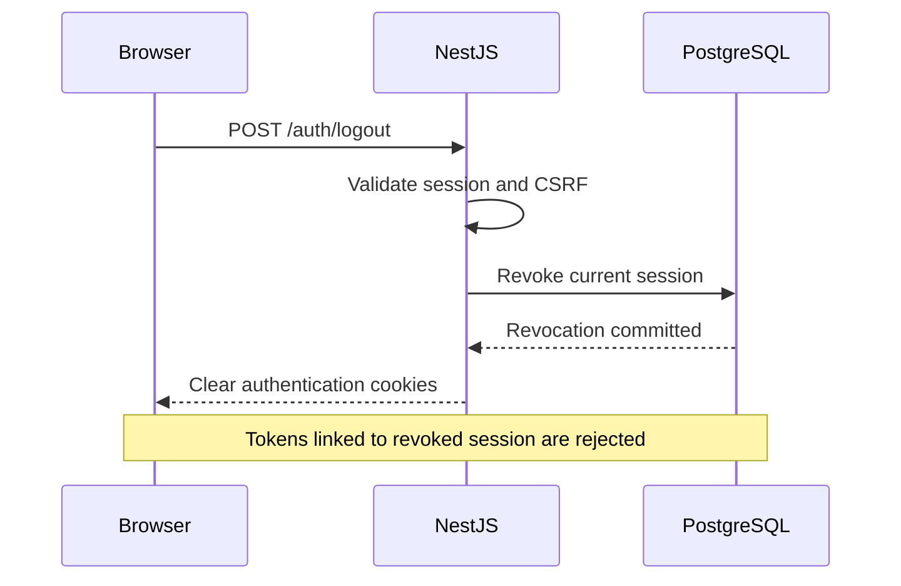

# AI PC Builder — Security Architecture & Control Design

**Document ID:** SEC-002  
**Version:** 1.1  
**Status:** Revised Draft — Awaiting Review  
**Architecture:** Next.js + NestJS + PostgreSQL  
**Related Documents:** SEC-001 v1.1, ARCH-001–004, BA-002, BA-005

---

## 1. Purpose

Define the security controls required to protect AI PC Builder against authentication attacks, authorization bypasses, business-logic abuse, data leakage, and external integration threats.

This revision introduces:

- Explicit JWT and session revocation.
- Standardized structured audit logging.
- CSRF protection for cookie-based authentication.
- Sensitive-data controls for external AI providers.
- Additional security threat traceability.

No controls described in this document are assumed to be implemented.

## 2. Security Principles

1. Deny by default.
2. Apply least privilege.
3. Treat all external input and output as untrusted.
4. Separate authentication from authorization.
5. Maintain server-side authority over business state.
6. Support explicit session termination.
7. Minimize sensitive data transferred to third parties.
8. Never expose secrets through prompts, logs, or API responses.
9. Make sensitive operations auditable.
10. Verify security controls through automated tests.

---

## 3. Authentication and Session Architecture

### 3.1 Proposed Authentication Strategy

Use:

- Short-lived JWT access tokens.
- Opaque refresh tokens.
- Server-side session registry.
- Refresh-token rotation.
- Session revocation.

**Proposed defaults for development:**

| Property | Proposed Value |
|---|---|
| Access token lifetime | 10 minutes |
| Refresh session lifetime | 7 days |
| Access token format | Signed JWT |
| Refresh token format | Cryptographically random opaque token |
| Refresh token storage | Secure HttpOnly cookie |
| Session registry | PostgreSQL |
| Access token revocation | Session status check |
| Refresh token revocation | Database-backed token-family invalidation |

These values are initial design choices, not validated production settings.

### 3.2 JWT Claims

Access tokens should contain only necessary claims.

Example:

```json
{
  "iss": "ai-pc-builder",
  "aud": "ai-pc-builder-api",
  "sub": "user-uuid",
  "sid": "session-uuid",
  "jti": "token-uuid",
  "iat": 1790000000,
  "exp": 1790000600
}
```

Claim values are illustrative.

| Claim | Purpose |
|---|---|
| `iss` | Token issuer |
| `aud` | Intended audience |
| `sub` | Authenticated user identifier |
| `sid` | Server-side session identifier |
| `jti` | Unique access token identifier |
| `iat` | Issued-at timestamp |
| `exp` | Expiration timestamp |

JWT verification must validate the signature, allowed algorithm, issuer, audience and expiration.

The server must not blindly trust mutable permissions embedded in an old token.

### 3.3 Server-Side Session Registry

Proposed PostgreSQL table:

`auth_sessions`

| Column | Purpose |
|---|---|
| `id` | Session UUID |
| `user_id` | Session owner |
| `refresh_token_hash` | Hash of current opaque refresh token |
| `token_family_id` | Refresh rotation family |
| `created_at` | Session creation |
| `expires_at` | Absolute session expiration |
| `revoked_at` | Revocation timestamp |
| `revocation_reason` | Logout, compromised, admin action |
| `last_used_at` | Last successful refresh |

Refresh tokens must never be stored in plaintext.

Use cryptographically secure random tokens and an appropriate keyed hash or secure hash for token lookup and verification.

### 3.4 Access JWT Revocation

A valid JWT signature does not guarantee that its session is still active.

For protected requests, the backend must:

1. Verify JWT signature and claims.
2. Extract `sid` and `sub`.
3. Load the session's active/revoked status.
4. Verify session ownership and expiration.
5. Reject revoked or expired sessions.
6. Continue to authorization only after session validation.

This design uses a **server-side session allowlist with revocation status**, rather than a growing per-JWT blacklist.

The session registry is authoritative. If it is unavailable, protected operations must fail closed.

### 3.5 JWT Blacklist — Optional Alternative

A per-token denylist can store:

- Hash of JWT `jti` or a suitably namespaced token identifier.
- Revocation timestamp.
- Expiration timestamp.

Denylist entries need only remain until the affected access token expires.

This is useful for selectively revoking individual access tokens, but is not required for the initial session-registry design.

**Decision:** Use session-based revocation for MVP; do not maintain both a per-token blacklist and session registry without a demonstrated requirement.

### 3.6 Logout Flow



Logout must be idempotent.

The backend must not report successful revocation before the required server-side state change is committed.

### 3.7 Refresh Token Rotation

Each successful refresh operation must:

1. Validate the current refresh token.
2. Verify the session is active.
3. Atomically replace the stored refresh-token hash.
4. Issue a new refresh token.
5. Issue a new access token.

Concurrent refresh requests must not both successfully rotate the same credential.

Reuse of an invalidated refresh token should trigger a defined security response, such as revoking the affected session/token family and recording an audit event.

The design must distinguish malicious reuse from legitimate concurrent browser requests through explicit client and server handling.

### 3.8 Logout All Devices

Proposed endpoint:

`POST /api/v1/auth/logout-all`

The backend revokes all active sessions belonging to the authenticated user.

Password changes and account suspension should also trigger a defined session-revocation policy.

### 3.9 Access Token Storage

For the browser MVP, prefer access tokens in application memory rather than localStorage.

The refresh token is stored in a Secure, HttpOnly cookie.

An alternative all-cookie design is possible, but requires CSRF protection for every cookie-authenticated state-changing endpoint.

The final choice must be reflected consistently in the Next.js authentication client and NestJS guards.

---

## 4. Authorization Architecture

Authentication proves identity.

Authorization determines whether the authenticated identity may perform a specific action.

### 4.1 Role-Based Authorization

Initial roles:

- `CUSTOMER`
- `ADMIN`

Permissions should be explicit, for example:

- `catalog:read`
- `catalog:update`
- `orders:read_own`
- `orders:manage`
- `inventory:adjust`

### 4.2 Object-Level Authorization

Use cases must verify resource ownership where required.

Examples:

- A customer may read only their own orders.
- A customer may update only their own saved configurations.
- Administrative permissions do not automatically bypass every business invariant.

### 4.3 Enforcement

- NestJS Guards enforce authentication and route-level permissions.
- Application use cases enforce ownership and sensitive business permissions.
- Authorization failures must not expose another user's private resource details.

---

## 5. CSRF Protection

### 5.1 Threat

**THR-015 — Cross-Site Request Forgery**

If a browser automatically sends authentication cookies, an attacker-controlled website may attempt to trigger an authenticated request without the user's intention.

`HttpOnly` protects cookies from direct JavaScript reading but does not prevent CSRF.

### 5.2 Cookie Security

Authentication cookies must use:

- `HttpOnly` for credential cookies.
- `Secure` in HTTPS environments.
- Explicit `SameSite` policy.
- Narrow Path and Domain scope.
- Appropriate expiration.

Prefer host-only cookies where practical.

Use `__Host-` cookie naming requirements where compatible with the deployment.

### 5.3 CSRF Strategy

For cookie-authenticated state-changing requests, use:

1. CSRF token verification.
2. Origin validation.
3. SameSite cookies as defense-in-depth.
4. Strict CORS configuration.
5. Safe HTTP method semantics.

Use a session-bound synchronizer token or properly signed double-submit cookie pattern.

A plain, unsigned cookie value copied into a request header is not sufficient as the primary design.

### 5.4 Request Requirements

State-changing operations include:

- POST
- PUT
- PATCH
- DELETE

Any GET endpoint must remain free of state-changing side effects.

The CSRF token must be bound to the authenticated session or otherwise cryptographically protected against token substitution.

### 5.5 Login and Refresh Endpoints

Login, refresh and logout flows require explicit CSRF consideration because they can create, rotate or invalidate cookie-backed authentication state.

If the selected access-token design uses an Authorization header while refresh uses a cookie, CSRF requirements differ between those endpoints.

### 5.6 Payment Webhook Exception

Payment webhooks do not use browser CSRF tokens.

They must instead use provider-specific signature verification and replay protection.

### 5.7 Required Tests

- Missing CSRF token.
- Invalid CSRF token.
- Token from another session.
- Untrusted Origin.
- Valid same-origin request.
- Cross-origin request with browser cookies.
- Logout and refresh CSRF behavior.

**Primary tool:** Supertest.

**Supporting tool:** Burp Suite Community.

---

## 6. Request Validation and Mass Assignment Prevention

### 6.1 DTO Strategy

Use operation-specific DTOs and strict input validation.

Proposed NestJS ValidationPipe settings:

```ts
{
  whitelist: true,
  forbidNonWhitelisted: true,
  transform: true
}
```

DTO validation must not be confused with authorization.

### 6.2 Explicit Mapping

Map only approved fields from request DTOs to application commands.

Do not spread entire request bodies into ORM create/update operations.

### 6.3 Protected Fields

Examples:

- `role`
- `isAdmin`
- `paymentStatus`
- `stockQuantity`
- `createdBy`
- `orderTotal`

These fields require dedicated, authorized application operations when writable at all.

---

## 7. Checkout and Inventory Security

### 7.1 Checkout

- Calculate prices on the backend.
- Validate product status.
- Use immutable order item snapshots.
- Apply idempotency keys.
- Reject conflicting request fingerprints.
- Do not trust frontend-calculated totals.

### 7.2 Inventory

- Use atomic conditional stock updates.
- Coordinate reservation and order creation transactionally.
- Enforce reservation state transitions.
- Prevent overselling under concurrency.
- Apply consistent lock ordering.

### 7.3 Required Verification

Vitest and Supertest integration tests against PostgreSQL.

---

## 8. Payment Security

### 8.1 Webhook Verification

- Verify provider signatures.
- Preserve raw request bodies where required.
- Validate payment identifiers.
- Validate amount and currency.
- Reject forged callbacks.

### 8.2 Idempotency

- Persist unique provider event identifiers.
- Prevent duplicate business effects.
- Handle out-of-order events.
- Coordinate payment, order and inventory state changes.

### 8.3 Unresolved Policy

Late payment success after reservation expiration remains an explicit business decision.

No payment provider-specific behavior is assumed.

---

## 9. AI Security and Sensitive Data Protection

### 9.1 Threat

**THR-016 — Sensitive Data Leakage to External AI Providers**

AI Advisor requests may inadvertently include:

- Customer email addresses.
- Phone numbers.
- Shipping addresses.
- Authentication tokens.
- Order identifiers.
- Payment metadata.
- Private configuration notes.
- Internal application logs.
- Database connection strings.
- Provider API credentials.

Sending such information to OpenAI, Anthropic, Gemini or another external provider creates a separate third-party data-processing boundary.

Even when the provider offers privacy controls, unnecessary data transfer remains a risk.

### 9.2 Data Classification

| Classification | Examples | External AI Policy |
|---|---|---|
| PUBLIC | Public product names, published specifications | Allowed when relevant |
| INTERNAL | Internal product IDs, operational metadata | Minimize; use only if necessary |
| PERSONAL | Email, phone, shipping address, customer identity | Denied by default |
| SENSITIVE | Tokens, secrets, payment credentials, session data | Prohibited |

Order history and user-entered free text require field-level review because they may contain personal information.

### 9.3 AI Provider Gateway

All external AI requests must pass through a backend-controlled AI Provider Gateway.

Responsibilities:

1. Accept an application-level AI request.
2. Classify requested data.
3. Select only permitted fields.
4. Redact or exclude sensitive values.
5. Construct the provider-specific payload.
6. Apply provider timeout and usage limits.
7. Validate provider responses.
8. Return only approved output to the application.

The frontend must never call an AI provider using a server-side API key.

### 9.4 Data Minimization

For PC recommendations, the provider should receive only relevant information.

Example allowed context:

```json
{
  "budgetVnd": 25000000,
  "purpose": "gaming",
  "resolution": "1440p",
  "preferredBrands": ["AMD", "NVIDIA"],
  "candidateComponents": [
    {
      "category": "CPU",
      "model": "Example CPU",
      "priceVnd": 5000000
    }
  ]
}
```

The provider does not need the customer's email, phone number, shipping address, authentication token or internal payment identifiers to recommend PC components.

### 9.5 Prompt Redaction

Before external transmission:

- Remove fields not explicitly required.
- Detect common credential and personal-data patterns.
- Apply field-level allowlists.
- Reject requests containing prohibited sensitive fields.
- Avoid including raw database records or application logs.

Regex-based redaction alone is not sufficient.

Structured field selection is the primary control; detection and redaction are supplementary controls.

### 9.6 Free-Text Input

Users may voluntarily enter personal information into AI chat messages.

The application should:

- Warn users not to submit sensitive information.
- Define the intended use of free-text content.
- Apply reasonable sensitive-data detection.
- Block or minimize unnecessary personal information.
- Avoid silently forwarding entire user profiles or order histories.

No system can guarantee perfect detection of all sensitive information in arbitrary text.

### 9.7 Provider Data Governance

Before enabling a provider, review and document:

- Provider identity.
- API endpoint and region, if relevant.
- Data retention policy.
- Training/data-use policy.
- Available privacy controls.
- Logging and abuse-monitoring practices.
- Contractual and regulatory requirements.
- Deletion and incident-handling procedures.

Do not assume that OpenAI, Anthropic, Gemini or any other provider has identical data-handling policies.

Provider-specific settings and current terms must be verified before deployment.

### 9.8 Prompt and Response Logging

Default policy:

- Do not log complete prompts.
- Do not log complete model responses.
- Do not log API credentials.
- Record operational metadata only.

Permitted metadata may include:

- Request ID.
- Provider name.
- Model identifier.
- Token usage.
- Latency.
- Validation outcome.
- Error category.

Prompt retention for debugging requires a separate documented policy and appropriate protections.

### 9.9 Prompt Injection Controls

- Treat user input and external product descriptions as untrusted.
- Never interpret model output as an authorization decision.
- Do not expose privileged tools unnecessarily.
- Validate structured responses.
- Recheck component compatibility deterministically.
- Do not allow model-generated content to directly modify orders, prices or payments.

### 9.10 Required Tests

- Email address included in user input.
- Phone number included in free-text notes.
- Secret-like string in input.
- Raw order object passed to the gateway.
- Malicious product description.
- Malformed AI response.
- AI response containing unexpected sensitive fields.
- Excessive provider request attempts.

**Primary tool:** Vitest.

**Supporting method:** Manual review of sanitized provider payloads using mocks.

No real personal information is required for these tests.

---

## 10. Data Ingestion Security

- Allowlist approved seller sources.
- Validate URLs and redirects.
- Block access to internal network resources.
- Limit request duration and response size.
- Validate external records.
- Preserve source provenance.
- Separate seller prices from internal checkout prices.

---

## 11. Standardized Audit Logging

### 11.1 Log Format

Use **structured JSON logs**.

Align common fields with OpenTelemetry Semantic Conventions where practical.

Define a project-specific security event schema for business and authentication events.

This is a schema alignment decision, not a requirement to deploy an OpenTelemetry Collector immediately.

### 11.2 Required Fields

| Field | Type | Purpose |
|---|---|---|
| `timestamp` | ISO 8601 string | Event occurrence time |
| `severity_text` | string | Log severity |
| `event.name` | string | Stable event type |
| `event.category` | string | Event category |
| `event.outcome` | string | Success, failure or unknown |
| `service.name` | string | Emitting service |
| `trace_id` | string/null | Distributed trace correlation |
| `request_id` | string/null | HTTP request correlation |
| `actor.id` | string/null | Acting identity |
| `actor.type` | string | Customer, admin, system |
| `resource.type` | string/null | Affected resource type |
| `resource.id` | string/null | Affected resource identifier |
| `security.reason_code` | string/null | Machine-readable reason |

Custom fields must use a documented namespace and must not be misrepresented as official OpenTelemetry semantic attributes.

### 11.3 Example Audit Event

```json
{
  "timestamp": "2026-10-25T12:00:00.000Z",
  "severity_text": "WARN",
  "event.name": "auth.session.revoked",
  "event.category": "authentication",
  "event.outcome": "success",
  "service.name": "ai-pc-builder-api",
  "trace_id": null,
  "request_id": "req-example-001",
  "actor.id": "user-example-001",
  "actor.type": "customer",
  "resource.type": "auth_session",
  "resource.id": "session-example-001",
  "security.reason_code": "USER_LOGOUT"
}
```

### 11.4 Event Naming Convention

Use:

`domain.resource.action`

Examples:

- `auth.login.failed`
- `auth.session.revoked`
- `auth.refresh.reuse_detected`
- `authorization.access.denied`
- `catalog.product.price_changed`
- `inventory.reservation.rejected`
- `payment.webhook.signature_invalid`
- `payment.webhook.duplicate_detected`
- `ai.request.data_policy_rejected`
- `security.csrf.validation_failed`

Event names must remain stable across versions.

### 11.5 Sensitive Data Policy

Never log:

- Passwords.
- Raw access or refresh tokens.
- Cookie values.
- API keys.
- Complete payment credentials.
- Raw AI prompts containing personal data.

Limit identifiers and metadata to what is necessary for security investigation.

### 11.6 Audit Integrity

Sensitive business audit events should be persisted durably.

Where audit events must be committed together with business changes, use the same database transaction or a transactional outbox pattern.

Ordinary application logs are not a substitute for durable audit records.

### 11.7 Retention and Access

Retention duration remains an open decision.

Audit logs must have:

- Restricted access.
- Documented retention.
- Controlled deletion.
- Protection against unauthorized modification.
- Consistent timestamps.

### 11.8 Implementation Approach

Proposed tools:

- NestJS logging integration.
- Pino for structured application logs.
- PostgreSQL for durable security/business audit events.
- OpenTelemetry instrumentation later, when justified.

Do not introduce a full observability stack solely to satisfy this checkpoint.

---

## 12. Secret Management

- Keep secrets server-side.
- Use environment-based configuration.
- Validate configuration at startup.
- Prevent secrets from entering frontend bundles.
- Redact sensitive values from logs.
- Scan repository changes with Gitleaks when introduced.
- Define key rotation and incident response procedures.

---

## 13. Rate Limiting and Abuse Protection

Apply rate limits to:

- Login.
- Password reset.
- Token refresh.
- AI Advisor.
- Checkout.
- Public search endpoints where necessary.

Use identity-aware limits and carefully configured trusted proxy information.

Limits should be measured and tuned in testing.

---

## 14. Security Control Traceability

| Threat | Control | Primary Verification |
|---|---|---|
| THR-001 — BOLA | Resource ownership policy | Supertest |
| THR-002 — Price tampering | Server-side pricing | Vitest + Supertest |
| THR-003 — Overselling | Atomic reservation | PostgreSQL integration tests |
| THR-004 — Webhook forgery | Provider verification | Supertest |
| THR-005 — Event replay | Idempotency | Integration tests |
| THR-006 — Privilege escalation | RBAC and permissions | Supertest |
| THR-007 — Prompt injection | Gateway + output validation | Vitest |
| THR-008 — SSRF | Restricted outbound client | Integration tests |
| THR-009 — AI cost abuse | Quotas and rate limits | Supertest |
| THR-010 — Secret exposure | Secret management | Gitleaks |
| THR-011 — Unsafe seller data | Input validation | Vitest |
| THR-012 — Missing auditability | Structured audit events | Integration tests |
| THR-013 — Mass assignment | DTO allowlist + explicit mapping | Supertest |
| THR-014 — Broken JWT authentication | Token validation + session revocation | Vitest + Supertest |
| THR-015 — CSRF | CSRF token + Origin validation | Supertest |
| THR-016 — AI data leakage | Classification + minimization + gateway | Vitest |

## 15. Proposed Implementation Priority

### P0 — Implement With Affected Features

- JWT verification.
- Session registry and revocation.
- Resource authorization.
- Strict DTO validation.
- CSRF controls for cookie-authenticated operations.
- Checkout and payment integrity.
- AI data minimization.
- Security regression tests.

### P1 — Add During Stabilization

- Structured audit coverage.
- Gitleaks.
- Dependency auditing.
- Burp Suite manual testing.

### P2 — Before Release, If Justified

- Semgrep.
- OWASP ZAP.
- OpenTelemetry collector.
- Additional infrastructure security scanning.

## 16. Open Architecture Decisions

| Decision | Proposed Direction |
|---|---|
| Access token storage | Browser memory |
| Refresh token storage | Secure HttpOnly cookie |
| Session registry | PostgreSQL |
| Access token revocation | Session status lookup |
| Per-token blacklist | Not required initially |
| CSRF pattern | Session-bound token or signed double-submit |
| Audit format | Structured JSON |
| Audit field conventions | OpenTelemetry-aligned + custom schema |
| Audit durability | PostgreSQL for critical events |
| AI integration | Backend-controlled provider gateway |
| AI prompt data policy | Allowlisted, minimized data |
| AI provider retention | Verify before enabling |
| Audit retention | TBD |
| CSRF token distribution | TBD |
| Authentication signing algorithm | TBD |

## 17. Definition of Done

- [ ] JWT validation strategy reviewed.
- [ ] Session revocation semantics reviewed.
- [ ] Refresh-token rotation and reuse policy reviewed.
- [ ] CSRF design reviewed.
- [ ] Audit schema reviewed.
- [ ] AI data classification approved.
- [ ] Provider data policy requirements approved.
- [ ] Threat traceability updated.
- [ ] Security tests planned.
- [ ] Open decisions recorded.
- [ ] Document approved for API Contract Design.

---

**Status: Revised Draft — Awaiting Review**