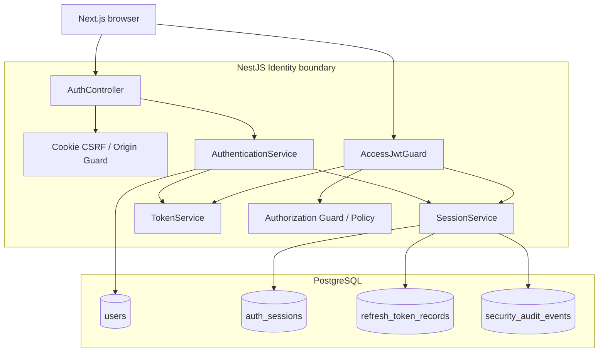
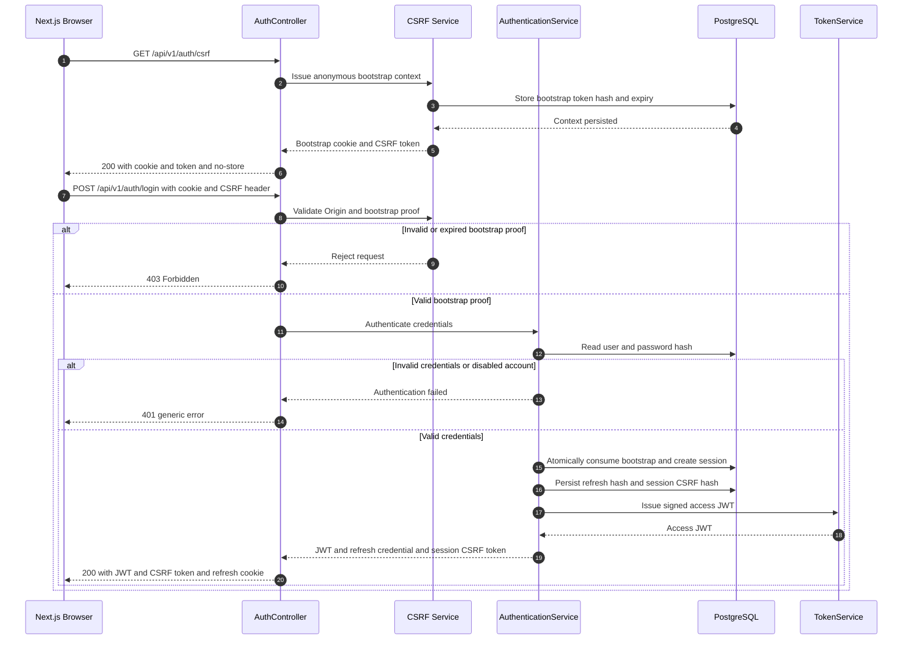
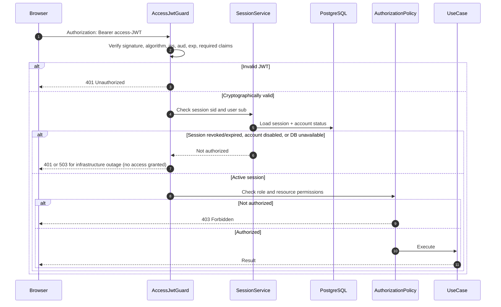
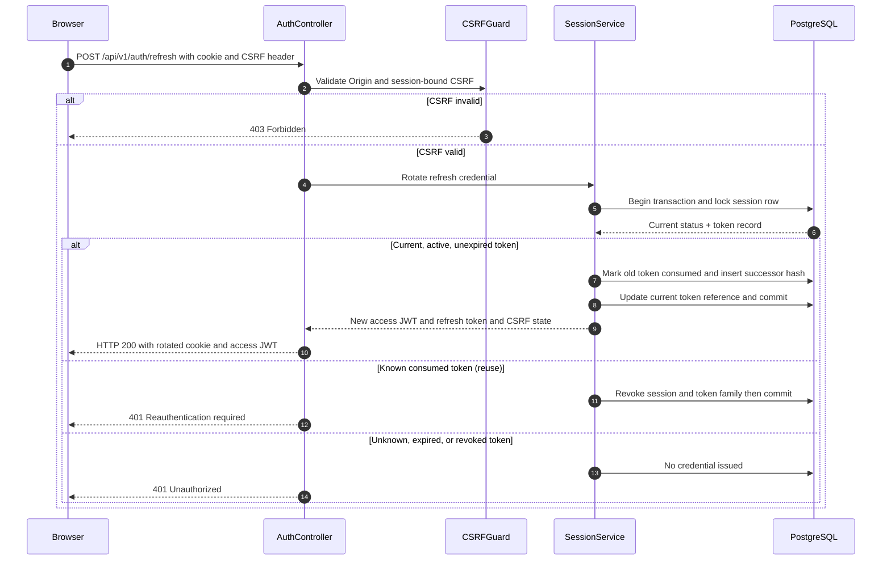
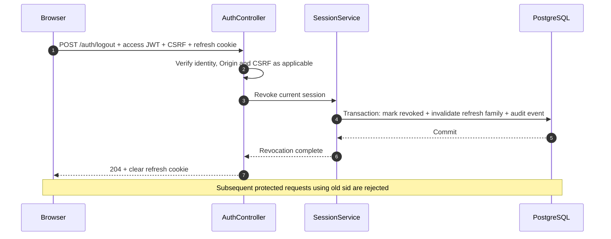
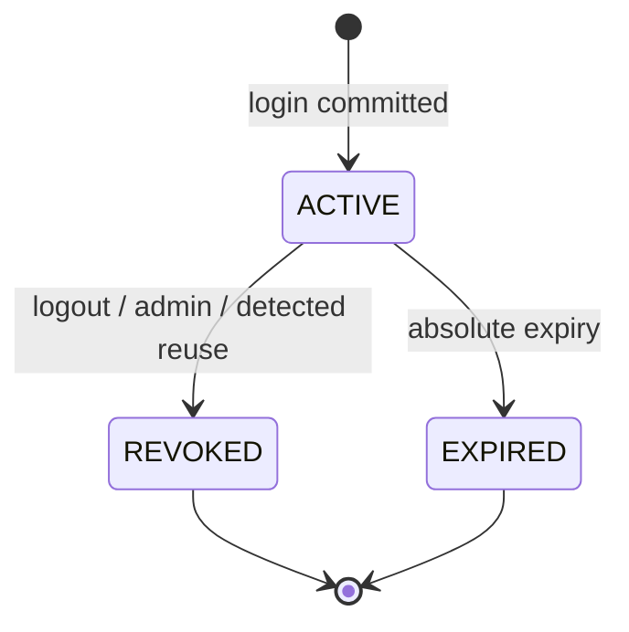
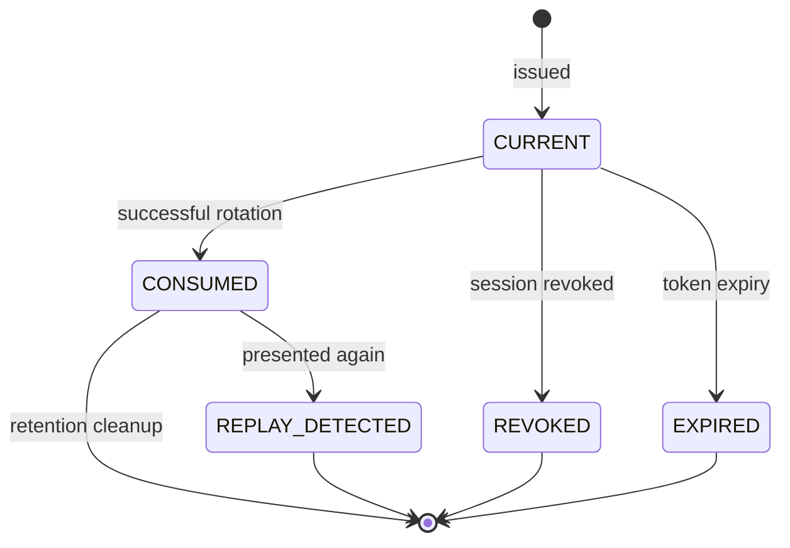
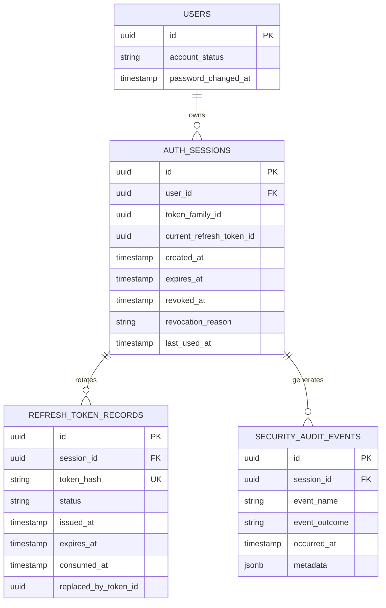
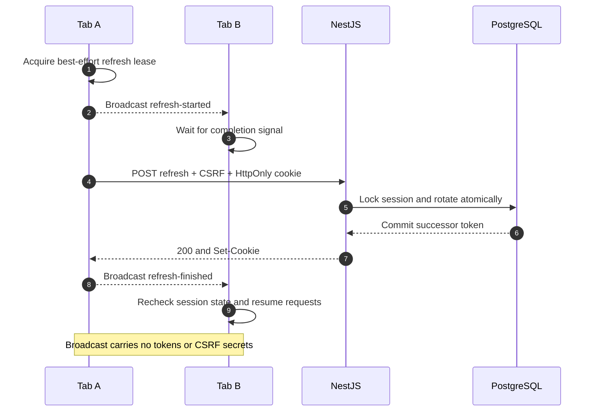
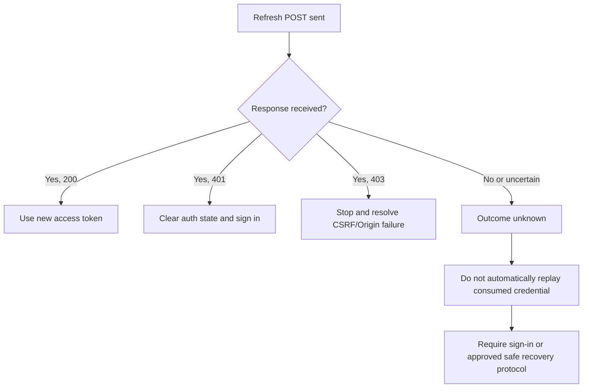

# AI PC Builder — Authentication & Session Technical Design

**Document ID:** SEC-002.1  
**Version:** 1.0.3  
**Status:** Proposed — Awaiting Review  
**Path:** `docs/04-security/designs/01-authentication-session-design.md`  
**Related:** SEC-001, SEC-002, SEC-002-ADR, SEC-002.2, SEC-002.4, ARCH-004, SEC-INT-001  
**Scope:** Identity module and browser authentication; not payment webhooks or service-to-service authentication.

## 1. Goals and security invariants

- Verify JWT signature, allowed algorithm, issuer, audience, expiration and required claims.
- A cryptographically valid JWT must **not** authorize access if its server-side session is revoked, expired or belongs to a disabled user.
- Access JWTs are short-lived (proposed 10 minutes) and kept in browser memory; opaque refresh tokens are kept in Secure, HttpOnly cookies (proposed maximum session lifetime 7 days).
- Refresh credentials are single-use, stored only as hashes, and rotated atomically.
- Logout and administrative revocation invalidate all access JWTs linked to the revoked session, subject to the authoritative session check on every protected request.
- Authentication does not replace RBAC or object-level authorization.
- Never log raw JWTs, refresh tokens, passwords, CSRF tokens or cookie headers.
- If authoritative session status cannot be checked, protected operations fail closed.

## 2. Decisions and assumptions

| Decision | MVP baseline | Rationale / constraint |
|---|---|---|
| Access credential | Signed JWT, 10-minute TTL (proposed) | Short exposure window; verify `iss`, `aud`, `sub`, `sid`, `jti`, `iat`, `exp` |
| Refresh credential | CSPRNG-generated opaque token | Does not expose session data; single use |
| Browser storage | Access JWT in memory; refresh cookie HttpOnly/Secure | Avoid persistent JavaScript-readable credentials |
| Session authority | PostgreSQL | Immediate revocation without a growing JWT denylist |
| Rotation | PostgreSQL transaction and row lock | Prevent simultaneous successful use of one token |
| Reuse response | Revoke affected session family and require re-login | Conservative protection against replay |
| CSRF | Session-bound token + Origin validation on cookie-authenticated mutations | See SEC-002.2 for exact bootstrap and deployment topology |
| Audit | Versioned security audit event persisted in PostgreSQL | See SEC-002.4 |

**Deployment assumption:** Browser and API have a compatible same-site cookie deployment. Cross-site deployment requires a separate cookie/CSRF review. Cookie `Path` must cover refresh, logout and other endpoints that require the cookie; it must not be widened unnecessarily.

## 3. Component diagram



**Responsibilities:** `TokenService` creates/verifies cryptographic credentials; `SessionService` is authoritative for active/revoked status and refresh rotation; `AuthController` handles HTTP and cookie transport; authorization policies protect operations and resources after authentication.

## 4. CSRF bootstrap and login sequence

**Canonical behavior:** SEC-002.2 sections 5–7 define the CSRF bootstrap, Origin validation, cookie attributes, and CSRF token lifecycle. This diagram integrates those requirements with Identity login. The HTTP request/response contract will be finalized in ARCH-005.



**Behavioral requirements:**
- `GET /auth/csrf` is anonymous, rate-limited as appropriate, returns `Cache-Control: no-store`, and issues a short-lived bootstrap context; it is not proof of identity.
- `POST /auth/login` requires an allowed Origin, bootstrap cookie, and matching `X-CSRF-Token`. Missing, expired, or mismatched proof is rejected before credentials can establish a session.
- Successful login consumes the bootstrap context and creates a new authenticated session-bound CSRF token. The bootstrap cookie is cleared or invalidated as specified by SEC-002.2.
- Invalid credentials return a non-enumerating error. The design must explicitly decide whether failed attempts consume bootstrap contexts; this is **open** and must be consistent in SEC-002.2 and ARCH-005.
- Session and refresh-token persistence must commit before a successful login response is returned. CSRF bootstrap consumption and session creation must not permit the same bootstrap context to create multiple sessions concurrently.
- Authentication credentials, cookies, and CSRF tokens must not appear in application or audit logs.

## 5. Protected request and revocation sequence



**Guarantee:** Logout/revoke takes effect for requests whose authoritative session check occurs after the revocation commit. Already-running operations require separate transaction/business controls; do not promise retroactive cancellation.

## 6. Refresh rotation sequence



**Concurrent requests:** The browser must implement single-flight refresh (one refresh request, many waiting callers). The database lock and conditional update ensure only one rotation commits. A duplicate refresh from another tab, a retry after a lost response, or an attacker replay may be indistinguishable from the server's perspective; the conservative MVP policy revokes the family upon confirmed reuse of a consumed token. Cross-tab coordination, network retry UX and false-positive risk require explicit tests. Do **not** silently accept a consumed refresh token during a grace period without a separate threat review.

## 7. Logout, logout-all and administrative revocation



`logout-all` revokes every active session belonging to the authenticated user. Account suspension and credential compromise must also revoke sessions. A logout endpoint should be idempotent and should clear the browser cookie even when the session is already invalid, without leaking session existence. Precise behavior when an access JWT has expired but a refresh cookie remains valid is part of the auth API contract; it must not rely on accepting an expired access JWT.

## 8. Session and refresh credential state machines





`REPLAY_DETECTED` is an audit/processing classification for a consumed credential presented again, not a credential that can become valid. Cleanup must preserve sufficient evidence for the intended detection window.

## 9. Proposed persistence schema

**Schema authority:** The ERD below is illustrative. `docs/03-system-design/04-database-design.md` (ARCH-004) is the canonical consolidated database contract. Use SEC-002.4 for the canonical audit event fields, not the abbreviated audit entity below.




**Persistence requirements:**
- Enforce foreign keys and unique token hashes; token hashes must not reveal the original random credential.
- Use a unique session/token identifier and collision-resistant hash lookup; never store raw refresh tokens.
- Rotation uses one transaction with row locking and a conditional update to ensure a single current token.
- Session expiration is an absolute upper bound; rotation must not silently extend beyond it unless an explicit renewal policy is approved.
- Retention/cleanup for consumed token records and audit events must be documented.
- Audit event schema is governed by SEC-002.4; diagram fields are indicative, not a finalized migration.

## 10. HTTP contract outline

| Operation | Endpoint | Auth / CSRF | Expected behavior |
|---|---|---|---|
| Register | `POST /api/v1/auth/register` | Public; input validation and anti-abuse; registration CSRF policy to be defined | Create customer account |
| CSRF bootstrap | `GET /api/v1/auth/csrf` | Anonymous; allowed Origin and no-store response | Issue bootstrap cookie and anonymous CSRF token |
| Login | `POST /api/v1/auth/login` | Anonymous credentials; allowed Origin, bootstrap cookie and matching CSRF header, rate limit | Consume bootstrap; establish session; return access JWT and session CSRF token; set refresh cookie |
| Refresh | `POST /api/v1/auth/refresh` | Refresh cookie + Origin + CSRF token | Atomic rotation; issue new credentials |
| Logout | `POST /api/v1/auth/logout` | Authenticated session and/or validated refresh-cookie flow; CSRF | Revoke current session; clear cookie |
| Logout all | `POST /api/v1/auth/logout-all` | Valid access JWT + session, CSRF if cookies are used | Revoke all user's sessions |
| Me | `GET /api/v1/auth/me` | Valid access JWT + active session | Return safe profile projection |

Detailed status codes, DTOs, error bodies, cookie Path, CSRF bootstrap, and pre-auth flows belong to ARCH-005 and SEC-002.2. Do not treat this outline as the final OpenAPI contract.

## 11. Failure handling

| Scenario | Required behavior |
|---|---|
| JWT expired/invalid | Reject with 401; no protected operation |
| JWT valid but session revoked | Reject with 401 |
| Session DB unavailable | Fail closed; respond with appropriate service error, never authorize |
| Refresh token unknown/expired | Reject with 401; clear invalid cookie where appropriate |
| Consumed refresh token replayed | Revoke affected session family; audit; require login |
| Two simultaneous refreshes | At most one rotation commits; client single-flight minimizes false replay |
| Network fails after rotation commit | Do not return old token to valid state; require recovery/re-login as policy dictates |
| Missing/invalid CSRF on cookie-authenticated mutation | Reject with 403 before state change |
| Disabled account | Deny protected requests and revoke sessions according to account policy |
| Audit persistence failure for mandatory event | Roll back sensitive state transition when audit must be atomic |

## 12. Security test matrix

| Test ID | Threat | Scenario | Expected result | Tool |
|---|---|---|---|---|
| SEC-AUTH-001 | THR-014 | Revoked session with otherwise valid JWT | Access denied | Supertest |
| SEC-AUTH-002 | THR-014 | Expired or incorrectly signed JWT | 401 | Supertest |
| SEC-AUTH-003 | THR-014 | Wrong issuer, audience, or algorithm | 401 | Vitest + Supertest |
| SEC-AUTH-004 | THR-014 | Two concurrent refreshes | One commit maximum | PostgreSQL integration test |
| SEC-AUTH-005 | THR-014 | Reuse consumed refresh credential | Family revoked, audit emitted | Supertest |
| SEC-AUTH-006 | THR-014 | Logout all devices | All previous sessions denied | Supertest |
| SEC-AUTH-007 | THR-014 | Session registry unavailable | Protected access denied | Integration test |
| SEC-AUTH-008 | THR-014 | Lost refresh response and retry | No silent reuse; documented recovery | Integration test |
| SEC-CSRF-001 | THR-015 | Missing/invalid CSRF token | 403; no mutation | Supertest |
| SEC-CSRF-002 | THR-015 | CSRF token from different session | 403 | Supertest |
| SEC-AUDIT-001 | THR-012 | Logout or replay detection | Durable, redacted event | Integration test |

Use test-only users and tokens. No external service or third-party environment is required.

## 12A. Refresh concurrency and lost-response policy (SEC-INT-003)

**Design status:** Proposed. This section integrates SEC-INT-003 into the canonical Authentication design. It does not assert successful implementation.

### 12.1 Decision

The MVP uses **strict, single-use opaque refresh tokens** with server-side PostgreSQL session authority and atomic rotation. A refresh token previously consumed must never produce new credentials. On a **verified replay of a known consumed token**, revoke its session/token family and require a new login; this conservative policy can log out legitimate users when responses are lost or tabs race. Treat that as an explicit MVP trade-off, not as proof of compromise.

The frontend implements:
- **In-tab single-flight:** all requests awaiting renewal share one in-flight refresh Promise.
- **Cross-tab best-effort coordination:** use `BroadcastChannel` to notify other same-origin tabs of refresh start/end and a short-lived localStorage lease with owner ID and expiry to reduce duplicate refresh. The lease is **not a security boundary**, not a distributed mutex, and does not guarantee exactly-once delivery.
- **No token sharing between tabs:** never broadcast access JWTs, refresh tokens, CSRF secrets, or credential-bearing responses. Broadcast only non-sensitive status (`refresh-started`, `refresh-finished`, `reauth-required`) and a correlation nonce.
- **Cookie and CSRF:** refresh cookie remains HttpOnly; session-bound CSRF token stays in memory and does not rotate on normal refresh. On a full page reload, obtain a session-bound CSRF token via an authenticated, Origin-checked bootstrap/recovery endpoint defined in ARCH-005. The existing anonymous `GET /auth/csrf` is **not** sufficient for recovering an authenticated session CSRF token. This endpoint and proof-of-session mechanism remain a blocking contract decision.
- **Fallback:** if coordination is unavailable or times out, a tab may attempt refresh once. The server remains authoritative and strict.

### 12.2 Server rotation algorithm

1. Validate allowed Origin and session-bound CSRF proof before any mutation; fail 403 without consuming refresh token if invalid.
2. Parse the opaque refresh cookie, compute its keyed hash, and resolve token/session without logging secrets.
3. Begin transaction; lock the session row `FOR UPDATE`; reload the token record under the lock.
4. Reject revoked/expired session or expired credential. For a token marked `CONSUMED`, emit sanitized replay audit, revoke session/family in the same transaction, and return a generic 401.
5. Require `status=CURRENT` **and** `auth_sessions.current_refresh_token_id = presented.id`; otherwise reject without issuing credentials.
6. Mark current token `CONSUMED`, create new `CURRENT` record, set `replaced_by_token_id` and session current pointer; emit critical audit event; commit.
7. Only after successful commit, send new HttpOnly cookie and short-lived access token. Never return a token before commit.

**Concurrency invariant:** exactly one committed successor token per session rotation. Do not treat `SELECT FOR UPDATE` as sufficient without state re-check after acquiring lock.

### 12.3 State and error semantics

| Situation | Server response | Client response |
|---|---|---|
| Current valid refresh + CSRF | 200, rotated cookie + access token | Resolve waiting requests |
| Missing/invalid Origin or CSRF | 403; no rotation | Stop and surface security/session recovery |
| Expired session or invalid unknown token | 401; no credentials | Clear in-memory auth; sign in |
| Known consumed token replay | 401; revoke affected session/family | Sign in; show generic session-expired message |
| Network failure before request reaches server | No mutation | Retry **only** when known not submitted; otherwise treat outcome as unknown |
| Response lost after successful commit | Cookie update may not reach browser | Do not blindly replay old cookie; clear local state and ask user to sign in |
| Another tab already rotated | Old cookie may be invalid or updated | Wait for coordination signal; re-check auth state without assuming a safe retry |
| Database unavailable | 503; no rotation committed | Temporary error; no silent success |

Do not claim a generic automatic retry is safe: a POST may commit even if the client never receives the response. Do not add a server grace window that accepts consumed tokens without a separate design review.

### 12.4 Browser workflow



**Important limitation:** a second tab may lack a usable access JWT or CSRF token. `refresh-finished` is a coordination hint, **not** an authentication proof. The second tab must use a separately designed safe session-recovery flow rather than assuming it can access Tab A's in-memory access token.

### 12.5 Lost-response handling



**Cookie race:** browser `Set-Cookie` from a successful response is not guaranteed to be visible to every tab immediately. Treat cross-tab timing as best-effort only. Tests must include duplicate response ordering, page reload and tab closure.

### 12.6 Frontend design sketch (pseudocode)

```ts
let inFlightRefresh: Promise<void> | null = null;

function refreshOnce(): Promise<void> {
  if (inFlightRefresh) return inFlightRefresh;

  inFlightRefresh = performCoordinatedRefresh()
    .finally(() => {
      inFlightRefresh = null;
    });

  return inFlightRefresh;
}
```

`performCoordinatedRefresh()` must validate local CSRF availability, coordinate tabs without transmitting secrets, issue at most one refresh request for this tab's attempt, and handle unknown outcomes without blind retries. This sketch is **not production-ready code**.

### 12.7 Verification matrix

| ID | Scenario | Expected result |
|---|---|---|
| SEC-REF-001 | 20 same-tab API requests need refresh | One refresh POST |
| SEC-REF-002 | Two concurrent refresh POSTs use same token | At most one rotation commits; replay policy applied to loser |
| SEC-REF-003 | Two tabs coordinate normally | One refresh POST in normal case |
| SEC-REF-004 | Tabs start together without coordination | Server preserves single-use invariant; re-login may be required |
| SEC-REF-005 | Refresh response lost after DB commit | No automatic retry of stale token |
| SEC-REF-006 | Request fails before reaching server | Safe retry only when failure-before-send is certain |
| SEC-REF-007 | CSRF invalid | 403 and no token consumed |
| SEC-REF-008 | Session revoked during refresh | No new valid session credentials |
| SEC-REF-009 | Browser reload loses access JWT and CSRF | Recovery blocked until approved contract implemented |
| SEC-REF-010 | BroadcastChannel unsupported | Security remains intact; degraded UX |
| SEC-REF-011 | Refresh fails mid-transaction | No half-rotated token |
| SEC-REF-012 | Logs/telemetry capture requests | No refresh tokens, CSRF tokens or JWTs logged |

Use Vitest + Supertest with real PostgreSQL transactions for server concurrency and Playwright or equivalent browser tests for multi-tab/cookie behavior. No verification has been executed.


**API contract prerequisite:** The anonymous `GET /auth/csrf` bootstrap is not a way to recover session-bound CSRF after reload. For MVP, require explicit re-login after reload/unknown refresh outcome unless ARCH-005 defines a separate secure authenticated recovery contract.

## 13. Open decisions

1. Signing algorithm and signing-key rotation.
2. Registration CSRF policy and bootstrap consumption behavior after failed credentials (coordinate with SEC-002.2).
3. Deployment topology, cookie Domain/Path and CORS allowlist.
4. Authenticated CSRF/session recovery after reload; MVP defaults to re-login. Cross-tab coordination is best-effort, not a security guarantee.
5. Exact session/refresh expiry, cleanup and audit retention.
6. Logout semantics when access token has expired but refresh cookie is present.
7. Password reset, account lockout and compromised-credential response.

## 14. Definition of Done

- [ ] Architecture, login, protected request, refresh and revoke diagrams reviewed.
- [ ] Session/token state machines reviewed.
- [ ] Persistence model reviewed with ARCH-004.
- [x] CSRF bootstrap/login dependency aligned with SEC-002.2 (design only).
- [x] Concurrency/replay/lost-response policy documented as proposed (SEC-INT-003); acceptance and tests pending.
- [ ] Security test matrix approved.
- [ ] Open decisions tracked in project status.

**Status:** Proposed — Awaiting Review. No implementation or security test execution is claimed.
