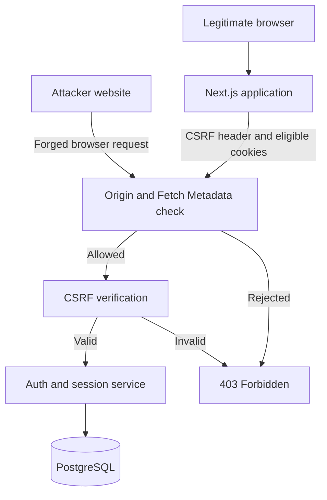
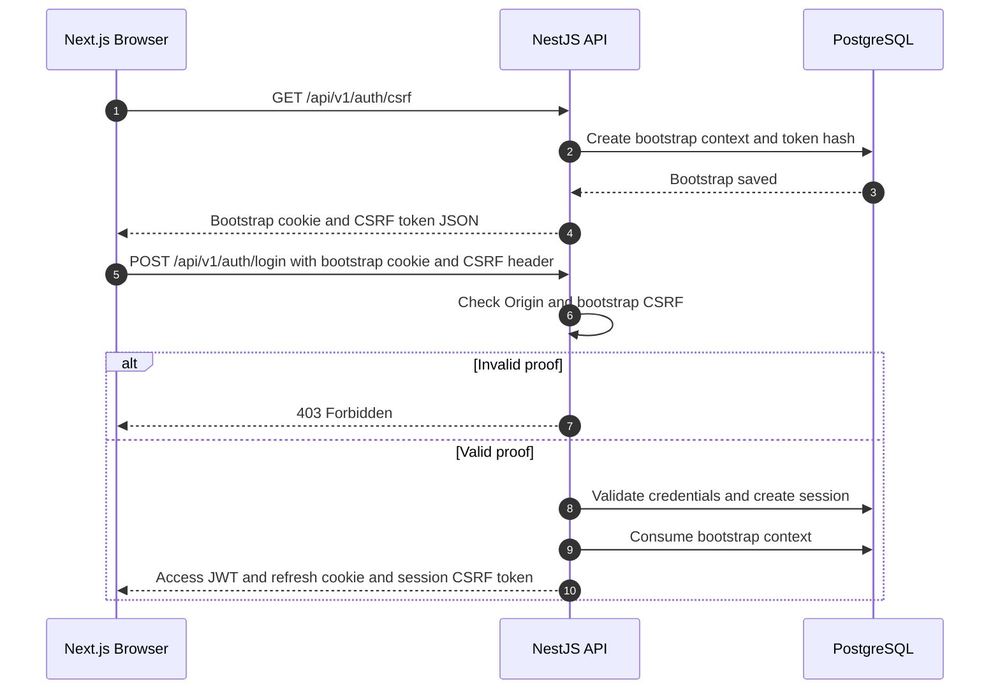
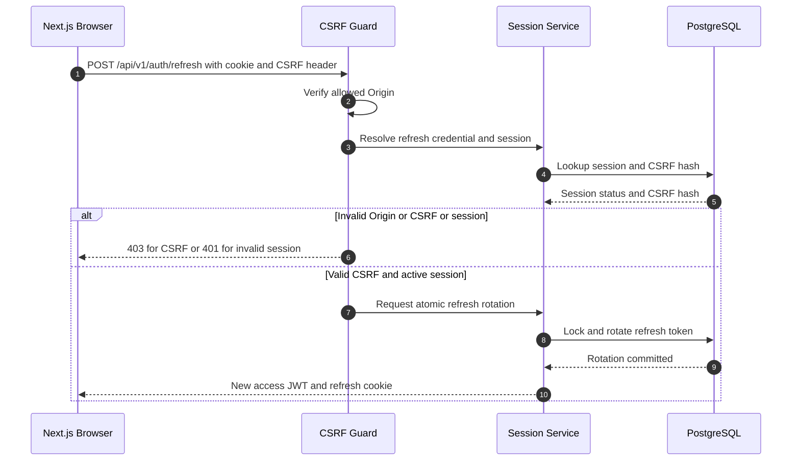
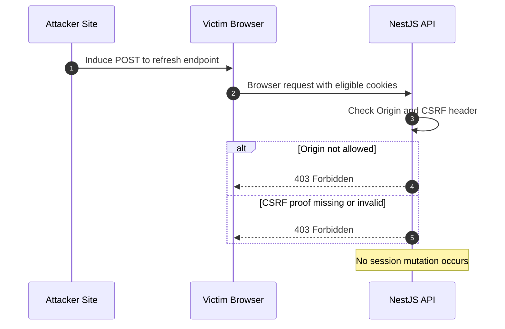
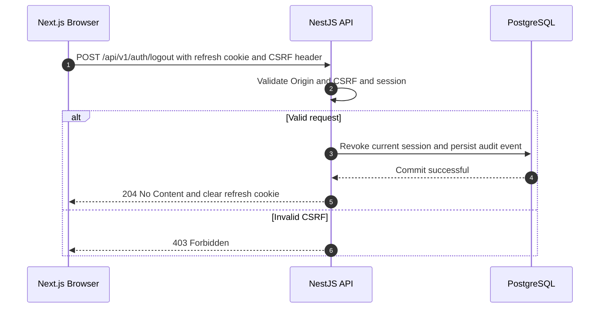

# AI PC Builder — CSRF Protection Technical Design

**Document ID:** SEC-002.2  
**Version:** 1.1.1  
**Status:** Proposed — Awaiting Review  
**Repository path:** `docs/04-security/designs/02-csrf-protection-design.md`  
**Dependencies:** SEC-002.1 Authentication & Session Design; ADR-SEC-002, ADR-SEC-005

## 1. Purpose and scope

Design CSRF protection for Next.js + NestJS with access JWT in browser memory and an opaque refresh credential in a Secure, HttpOnly cookie. Covers anonymous login CSRF, authenticated refresh, logout, logout-all, bootstrap, concurrency, browser topology, and failure handling. It does not assume implementation is complete.

CSRF is relevant where browsers automatically attach credentials (notably cookies). Bearer access-token endpoints do not normally need CSRF tokens when they accept **only** the Authorization header and never silently fall back to cookies; they still require authorization, CORS, and XSS defenses.

## 2. Security invariants

1. A cross-site attacker must not be able to initiate an authenticated state-changing operation merely by causing a browser to send cookies.
2. CSRF tokens must be unpredictable, session-bound (or pre-authentication-bound), and checked server-side.
3. Cookie-backed POST requests must reject missing or invalid CSRF proof **before** modifying session state.
4. Refresh-token rotation and CSRF validation must be coordinated without permitting token replay.
5. Browser CORS settings must not expose CSRF tokens or credentialed responses to untrusted origins.
6. `SameSite` and `HttpOnly` are defense-in-depth, not complete CSRF protection.
7. Never log raw CSRF tokens, refresh tokens, or Cookie headers.

## 3. Deployment assumptions and boundaries

**MVP assumption:** Next.js frontend and NestJS API are served from the same site, preferably same origin behind a reverse proxy (e.g., `/api/v1/...`). This reduces cookie and CORS complexity. If frontend and API are on different origins but same site, use an explicit allowed-origin list and credential configuration. If they are cross-site, re-review cookie `SameSite=None; Secure`, third-party-cookie restrictions, and CSRF bootstrap; do not silently reuse this design.

### 3.1 Trust boundary

The browser automatically attaches eligible cookies. JavaScript on an attacker origin must not be able to obtain a valid CSRF token or send an approved credentialed custom-header request.

## 4. Cookie and browser policy

| Item | Decision |
|---|---|
| Refresh cookie | `HttpOnly`, `Secure`, `SameSite=Lax`, host-only where possible |
| Cookie name | Prefer `__Host-` prefix if `Secure`, `Path=/`, and no `Domain` are satisfied |
| Cookie Path | `/` if using `__Host-`; otherwise narrow path when practical |
| Access token | In memory, passed only through `Authorization: Bearer` |
| CSRF token | Returned to same-origin frontend and stored in memory; not an auth credential |
| CORS | Explicit allowed origins only; never wildcard with credentials |
| HTTP methods | GET/HEAD must not mutate state |
| Request metadata | Reject unexpected `Origin`; use `Sec-Fetch-Site` as supplemental signal |

**Note:** `SameSite` is based on site, not origin. A compromised sibling subdomain may still be same-site; use strict origin checks. Reverse-proxy forwarding headers must be trusted only from configured proxies.

## 5. Token model and storage

### 5.1 Anonymous pre-authentication CSRF

`GET /api/v1/auth/csrf` creates or reuses a short-lived **anonymous bootstrap context**, sets an opaque, Secure, HttpOnly bootstrap cookie, and returns a random CSRF token in JSON. Store only the token hash and bootstrap context metadata server-side, with expiration. The endpoint must use `Cache-Control: no-store` and an exact allowed origin policy. It does not authenticate the caller.

`POST /api/v1/auth/login` requires the bootstrap cookie, CSRF header, and allowed Origin. After successful login, invalidate the bootstrap context and create an authenticated session and a new session-bound CSRF token.

### 5.2 Authenticated CSRF

The server stores a hash of the CSRF token linked to `auth_sessions.id`, not its raw value. The frontend retains the token in memory and sends it in `X-CSRF-Token` for refresh/logout/logout-all requests authenticated by the refresh cookie.

A CSRF token is not a bearer credential and does not replace refresh-token validation. Use cryptographically secure random values (at least 128 bits entropy) and constant-time hash comparison where applicable.

**Refresh policy:** Keep the same CSRF token during normal refresh-token rotation. Rotate the CSRF token on login, explicit reauthentication, session replacement, or security incident. This avoids a response-order race between refresh and subsequent requests. Session revocation invalidates the token.

### 5.3 Data model additions

| Table | Fields | Purpose |
|---|---|---|
| `csrf_bootstrap_contexts` | `id`, `token_hash`, `expires_at`, `consumed_at`, `created_at` | Pre-login anti-CSRF proof |
| `auth_sessions` | `csrf_token_hash`, `csrf_issued_at` | Authenticated session-bound token |

The bootstrap cookie contains an unguessable context identifier; server lookup must not rely on user-supplied session IDs alone. Expired bootstrap records must be cleaned up. Consider storing bootstrap records in PostgreSQL for MVP; no Redis dependency required.

## 6. Sequence diagrams

### 6.1 Anonymous CSRF bootstrap and login

### 6.2 Refresh with session-bound CSRF

**Ordering note:** The CSRF guard must not accept a client-supplied session ID as proof of session ownership. The server resolves the cookie credential and session securely; token validation happens before mutation. Unknown refresh credentials must not expose session existence through detailed errors.

### 6.3 Forged cross-origin request

### 6.4 Logout and logout-all

`logout-all` additionally requires a valid bearer access JWT, the authenticated user's identity, and CSRF validation when the endpoint also uses a refresh cookie. Revocation targets the authenticated user only.

## 7. Endpoint security contract

| Endpoint | Cookie involved | CSRF required | Auth required | Expected outcome |
|---|---|---|---|---|
| `GET /auth/csrf` | Bootstrap issued | No | No | 200, token + bootstrap cookie |
| `POST /auth/login` | Bootstrap consumed | Yes, bootstrap | No | 200 or 401, 403 on CSRF failure |
| `POST /auth/refresh` | Refresh rotated | Yes, session | Valid refresh session | 200 or 401, 403 on CSRF failure |
| `POST /auth/logout` | Refresh cleared | Yes, session | Valid refresh session | 204 or 401, 403 on CSRF failure |
| `POST /auth/logout-all` | Refresh cleared | Yes if cookie-backed | Bearer + session | 204 or 401/403 |
| `GET /auth/me` | No cookie auth | No | Bearer + session | 200 or 401 |
| Protected business POST | No cookie auth | No by this design | Bearer + authorization | As defined by API contract |

For logout, an idempotent user experience is desired, but an unauthenticated cross-site request must not be able to clear a victim's session through a bypass of CSRF validation.

## 8. Failure modes and response rules

| Scenario | Response | Side effects |
|---|---|---|
| Missing or invalid CSRF token | 403 `CSRF_INVALID` | None |
| Disallowed Origin | 403 `ORIGIN_NOT_ALLOWED` | None |
| Missing or invalid refresh credential | 401 `SESSION_INVALID` | None |
| Expired bootstrap context | 403 `CSRF_EXPIRED` | None |
| Concurrent refresh | One successful rotation; other request handled by defined race policy | Never two successful rotations |
| Database unavailable | 503 or controlled server error | Fail closed |
| Valid token but revoked session | 401 `SESSION_REVOKED` | None |

Error bodies must not expose CSRF tokens, session hashes, or refresh credentials. Do not differentiate unknown accounts during login.

## 9. Cross-tab refresh and session recovery (SEC-INT-003)

**Decision:** Keep refresh tokens single-use, rotate atomically, and revoke the affected session/family on confirmed reuse of a consumed token. This may force legitimate re-login after a lost response; it is an explicit MVP trade-off.

**Frontend coordination:** Use same-tab single-flight refresh; optionally coordinate tabs with `BroadcastChannel` and a short-lived best-effort localStorage lease. Neither mechanism is a security boundary. Never broadcast access tokens, refresh tokens, CSRF secrets or credential-bearing responses. Other tabs must independently establish authenticated state.

**Lost response:** A refresh POST may commit even when the response never arrives. Do not blindly retry with the old cookie. On uncertain outcome, require re-login unless a separately reviewed safe recovery protocol exists.

**Reload:** Access JWT and authenticated CSRF token live in memory and disappear on reload. Anonymous `GET /api/v1/auth/csrf` cannot provide a session-bound authenticated CSRF token. MVP defaults to explicit re-login. A future recovery endpoint must prove session ownership, validate Origin, set `Cache-Control: no-store`, and be documented in ARCH-005 before use.

**Server behavior:** Validate Origin/CSRF before mutation; lock the session, re-read refresh token state, commit a single successor. Reject 403 on invalid CSRF without consuming the credential; return generic 401 for expired/revoked/replayed credentials. Never issue credentials before commit.

### 9.1 Additional verification

| ID | Scenario | Expected |
|---|---|---|
| SEC-CSRF-015 | Multi-tab simultaneous refresh | At most one rotation commits |
| SEC-CSRF-016 | Lost response after refresh commit | No blind automatic retry |
| SEC-CSRF-017 | Page reload without session CSRF in memory | Explicit re-login unless secure recovery contract exists |
| SEC-CSRF-018 | BroadcastChannel unavailable | Server security unchanged |
| SEC-CSRF-019 | Broadcast messages inspected | No JWT, cookie, refresh or CSRF secret |
| SEC-CSRF-020 | Invalid CSRF and valid refresh cookie | 403, token unchanged |

## 10. Implementation ownership

- **Next.js auth client:** fetch bootstrap token, hold CSRF token in memory, send `X-CSRF-Token`, single-flight refresh, clear local state on logout.
- **NestJS AuthController:** declare cookie-backed endpoints and security requirements.
- **OriginGuard:** exact allowed-origin comparison, configured reverse-proxy trust.
- **CsrfService/Guard:** issue, hash, verify, expire, and bind tokens to contexts/sessions.
- **SessionService:** resolve cookie credential, check session, atomically rotate or revoke.
- **PostgreSQL repositories:** persist bootstrap contexts and session CSRF hashes.
- **Audit service:** emit `security.csrf.validation_failed` without secret values.

## 11. Verification matrix

| Test ID | Scenario | Expected |
|---|---|---|
| SEC-CSRF-001 | Login missing bootstrap token | 403, no session |
| SEC-CSRF-002 | Login bootstrap token from another context | 403 |
| SEC-CSRF-003 | Login valid bootstrap token | Session created, bootstrap consumed |
| SEC-CSRF-004 | Refresh without CSRF header | 403, refresh credential unchanged |
| SEC-CSRF-005 | Refresh with token from another session | 403 |
| SEC-CSRF-006 | Refresh with untrusted Origin | 403 |
| SEC-CSRF-007 | Valid refresh | 200, one atomic rotation |
| SEC-CSRF-008 | Two concurrent refreshes | At most one rotation succeeds |
| SEC-CSRF-009 | Forged logout | 403, session remains active |
| SEC-CSRF-010 | Valid logout | Session revoked, cookie cleared |
| SEC-CSRF-011 | Cross-origin CORS preflight from untrusted origin | No credentialed CORS authorization |
| SEC-CSRF-012 | Token or cookie appears in application/audit logs | Test fails |
| SEC-CSRF-013 | SameSite sibling subdomain request with untrusted Origin | 403 |
| SEC-CSRF-014 | CSRF bootstrap response caching | `Cache-Control: no-store` |

Primary tests: Vitest + Supertest with a real PostgreSQL test database for session/rotation cases. Use browser-level tests for actual cookie, SameSite, and CORS behavior; Supertest alone does not emulate browser cookie rules. Manual Burp Suite Community checks are optional during stabilization.

## 12. Threat traceability

- **THR-015:** CSRF against cookie-authenticated APIs.
- **THR-014:** Broken authentication/session management.
- **THR-001:** Object-level authorization is still required after CSRF checks.
- **THR-012:** Missing auditability; rejected CSRF requests generate safe audit metadata.

## 13. Open decisions

1. Confirm production origin topology and cookie host/path.
2. Confirm exact CSRF token TTL and bootstrap cleanup schedule.
3. Decide whether to include Fetch Metadata rejection as an enforced or observe-only control.
4. SEC-INT-003 policy defined: no blind retry; session-bound CSRF recovery contract remains unresolved and MVP defaults to re-login.
5. Determine whether session-bound CSRF hashes are stored directly in `auth_sessions` or a separate table.
6. Align API response envelope and error-code naming with ARCH-005.

## 14. Definition of done

- [ ] Origin and cookie deployment topology confirmed.
- [ ] Bootstrap and authenticated CSRF flows approved.
- [ ] All four sequence diagrams render in GitHub Mermaid.
- [ ] Endpoint security contract reviewed.
- [ ] Session and refresh concurrency behavior reconciled with SEC-002.1.
- [ ] Verification matrix approved.
- [ ] Database changes reconciled with ARCH-004.

**Status: Proposed — Awaiting Review.**
