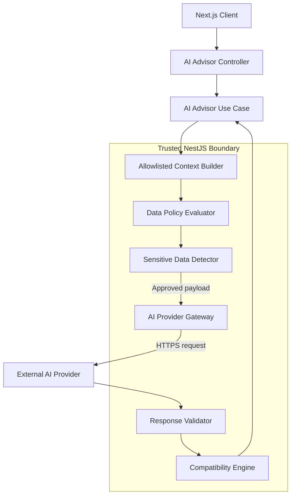
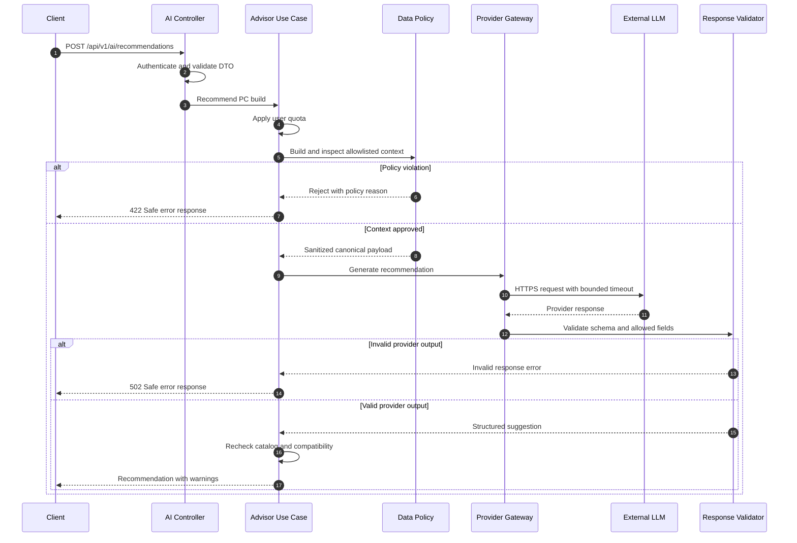
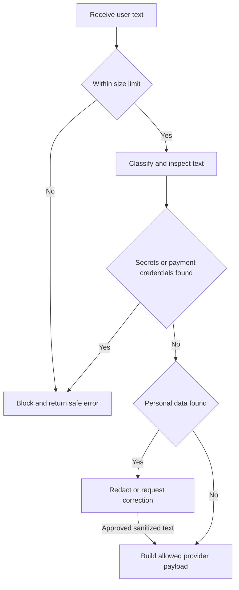
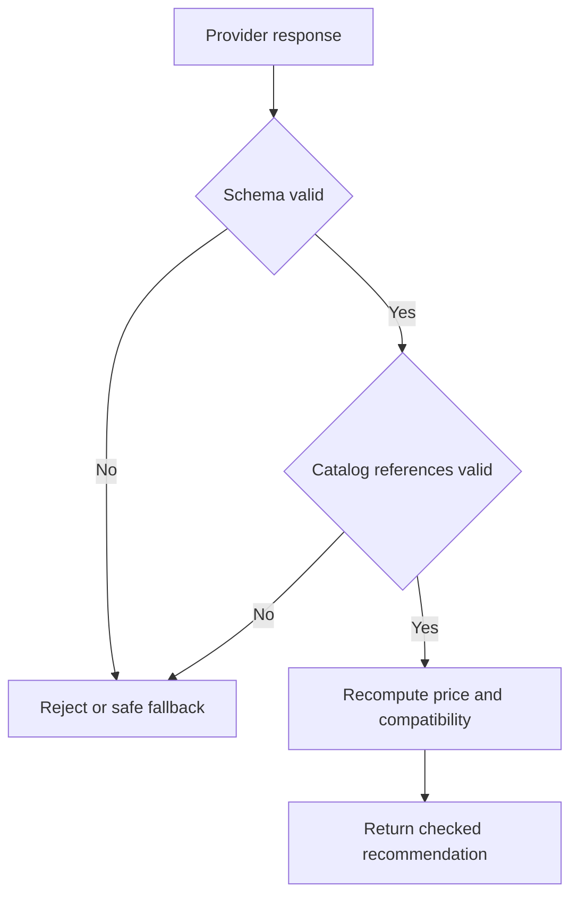

# AI PC Builder — AI Data Protection Technical Design

| Metadata | Value |
|---|---|
| Document ID | SEC-002.3 |
| Version | 1.0 |
| Status | Proposed — Awaiting Review |
| Target path | `docs/04-security/designs/03-ai-data-protection-design.md` |
| Stack | Next.js, NestJS, PostgreSQL, external LLM provider adapter |
| Related | SEC-001 THR-007 / THR-016, SEC-002 v1.1, ADR-SEC-007 / 008 |

## 1. Purpose and Scope

Specify what data may cross the external AI trust boundary, who enforces that policy, how requests and responses are validated, and how the controls will be tested. This document is an implementation design, **not evidence of implementation or provider compliance**.

**In scope:** PC configuration recommendations, free-text user requests, catalog context, provider request construction, provider response validation, operational telemetry, and privacy governance.

**Out of scope:** Provider-specific contractual claims, training a custom model, payment processing, autonomous purchasing, and production deployment approval.

## 2. Assets, Threats, and Security Invariants

| Asset | Examples | Protection goal |
|---|---|---|
| User personal data | Email, phone, delivery address | Never send by default |
| Credentials | JWTs, cookies, API keys, passwords | Never send |
| Commerce data | Orders, payment metadata, internal margin | Do not send raw records |
| Public catalog | Published component specifications and prices | Send selected relevant fields only |
| User free text | Build preferences and arbitrary user-provided text | Inspect and limit before forwarding |
| Provider output | Suggestions, component identifiers, generated prose | Treat as untrusted |

- **THR-016:** Sensitive data leakage to an external AI provider.
- **THR-007:** Prompt injection via user text or external product descriptions.
- Related: THR-009 resource exhaustion, THR-010 secret exposure, THR-011 unsafe external data.

**Invariants:**

1. External provider payloads are constructed from explicit allowlisted schemas, not raw request bodies, ORM entities, or logs.
2. No access token, refresh token, password, provider secret, or payment credential may be sent to an AI provider.
3. Identity, contact, shipping, and payment fields are excluded from PC advice by default.
4. Model output cannot authorize purchases, alter prices, change inventory, or override deterministic compatibility rules.
5. Raw prompts and raw responses are not included in routine application logs.
6. Any provider call must have a bounded timeout, output size, and usage budget.
7. A rejected data-policy check prevents the outbound provider request.

## 3. Trust Boundaries and Component Ownership



**Controller:** authenticates and validates request size and DTO. **Use case:** defines permitted AI task and enforces quotas. **Context builder:** queries only necessary catalog fields. **Policy evaluator:** applies field classification and explicit allowlists. **Sensitive data detector:** blocks or redacts detectable prohibited content, especially in free text. **Gateway:** sole owner of provider credentials, timeouts, adapter selection, and outbound requests. **Response validator:** validates structured response schema and strips unapproved fields. **Compatibility engine:** independently verifies compatibility and authoritative product data.

No other application module may call external LLM SDKs directly.

## 4. Data Classification and Transfer Policy

| Class | Example | External transfer policy |
|---|---|---|
| PUBLIC | Public CPU model, published TDP, listed retail price | Allowed if task-relevant |
| INTERNAL | Database row IDs, unpublished prices, operational notes | Denied by default; use opaque task IDs only if needed |
| PERSONAL | Email, name, phone, shipping address, order history | Denied by default; explicit future feature review required |
| SECRET | Tokens, cookies, credentials, payment secrets | Prohibited |

User-supplied chat text is **untrusted and potentially personal**, even when its intended purpose is PC advice. Classify its contents rather than labeling all chat text PUBLIC.

**Default allowed fields:** budgetVnd, workload category, target resolution, preferred brands, non-identifying preferences, and selected public component attributes such as category, model, socket, form factor, memory type, power requirements, and public price.

**Default forbidden fields:** `email`, `phone`, `shippingAddress`, `userId`, `sessionId`, `accessToken`, `refreshToken`, `apiKey`, `paymentDetails`, `orderHistory`, internal cost/margin, and raw database objects.

## 5. Canonical Provider Request Schema

Application code constructs a versioned internal DTO before selecting a provider adapter:

```json
{
  "schemaVersion": "1.0",
  "task": "pc_build_recommendation",
  "preferences": {
    "budgetVnd": 25000000,
    "workload": "gaming",
    "resolution": "1440p",
    "preferredBrands": ["AMD", "NVIDIA"]
  },
  "candidateComponents": [
    {
      "category": "CPU",
      "model": "Example CPU",
      "publicPriceVnd": 5000000,
      "socket": "AM5"
    }
  ],
  "userRequest": "Prioritize quiet cooling"
}
```

Values are illustrative. Do not send the whole `User`, `Order`, `Cart`, or `Product` ORM object. Explicit mapping is mandatory. The provider adapter may transform the canonical DTO into a provider-specific format but may not add disallowed fields.

### Data minimization rule

If a task can be completed without a field, exclude it. When possible, replace internal identifiers with ephemeral task-local identifiers that cannot be used to retrieve customer data.

## 6. Outbound Request Sequence



**Note:** HTTP statuses are proposed contract values for ARCH-005, not finalized API behavior. Provider errors must not expose raw request or response bodies.

## 7. Free-Text Handling and Sensitive Data Detection

Free-text messages may contain names, addresses, credentials, or details the user did not intend to share externally. Controls must be layered:

1. Show a concise notice before AI input that users should not enter passwords, payment details, or sensitive personal information.
2. Enforce size and token limits on the request.
3. Use an allowlisted structured context builder for all server-sourced fields.
4. Inspect user-supplied free text for common secrets and personal-data patterns.
5. **Block** messages containing credentials or payment secrets; **redact or request correction** for detectable personal contact details, according to a documented policy.
6. Never silently claim all sensitive data has been detected. Automated detection is fallible.
7. Log only policy decision metadata, not the rejected text itself.

### Policy decision diagram



The implementation must define how redaction preserves useful intent without leaking original content. For ambiguous or high-risk content, reject and request reformulation rather than forwarding it.

## 8. Prompt Injection and Provider Output Security

**Sources of untrusted instructions:** user messages, seller descriptions, imported product titles, search snippets, and model responses.

- Separate application instructions from untrusted content in the provider request.
- Never include credentials or privileged tools in model context.
- Treat all model output as data, not instructions to the application.
- Require a versioned output schema and reject unexpected fields.
- Validate recommended component IDs against the authoritative catalog.
- Recompute total prices from the catalog and compatibility with deterministic rules.
- Do not let model output directly create orders, change inventory, or issue payments.



## 9. Logging, Audit, and Retention

**Operational logs:** structured JSON using the SEC-002 audit/logging conventions. Allowed fields include request ID, model/provider identifier, elapsed time, token counts, status category, schema validation outcome, and policy decision code.

**Never log by default:** raw prompts, raw model outputs, credentials, session cookies, personal contact details, payment data, or unredacted provider errors.

**Audit event examples:** `ai.request.data_policy_rejected`, `ai.request.quota_exceeded`, `ai.response.schema_invalid`. Use request correlation IDs and non-sensitive actor references. Store security-critical events in the designated audit store; do not assume all application logs are durable audit records.

**Retention:** prompt/response retention is disabled at the application logging layer by default. Provider-side retention, abuse monitoring, training use, and deletion are separate matters that must be verified for the selected provider and API plan. A no-training claim must not be inferred from using an API.

## 10. Provider Governance Gate

Before enabling OpenAI, Anthropic, Gemini, or any other provider in a production-like deployment, record:

| Check | Evidence required |
|---|---|
| Provider and API product | Exact provider, API, and model |
| Data use | Current training and secondary-use terms for the selected service |
| Retention | Current default retention and available configuration |
| Region | Relevant processing region and cross-border transfers |
| Access | Provider-side staff/subprocessor access and safeguards |
| Deletion | Available deletion process and limitations |
| Legal | Privacy notice, lawful basis/consent where applicable |
| Controls | Organization settings and contractual privacy controls |
| Approval | Reviewer, date, evidence links, and decision |

Do not assume policies are identical across providers or remain unchanged. This checkpoint does not approve a provider or make claims about its current terms.

## 11. Failure Scenarios

| Scenario | Expected behavior |
|---|---|
| Disallowed field in server context | Do not call provider; return safe internal/policy error |
| Credential detected in free text | Block outbound request; ask for reformulation |
| Personal contact data detected | Sanitize or reject based on documented rule |
| Detector unavailable | Fail closed for content requiring inspection |
| Provider timeout | Abort waiting; return safe timeout error; avoid raw payload logs |
| Provider returns unexpected fields | Reject schema; do not persist or expose extra fields |
| Provider recommends nonexistent SKU | Reject or remove suggestion after catalog verification |
| Provider suggests incompatible parts | Flag via deterministic compatibility engine |
| Quota exceeded | Reject before provider call |
| Provider terms not reviewed | Do not enable production integration |

## 12. Security Verification Matrix

| Test ID | Scenario | Expected result | Tool |
|---|---|---|---|
| SEC-AI-001 | Raw User entity passed to context builder | Forbidden fields excluded or rejected | Vitest |
| SEC-AI-002 | Email in free text | Email absent from provider payload | Vitest |
| SEC-AI-003 | Phone number in free text | Sanitized or blocked | Vitest |
| SEC-AI-004 | API key in free text | Provider not called | Vitest |
| SEC-AI-005 | JWT in free text | Provider not called | Vitest |
| SEC-AI-006 | Payment card-like details | Provider not called | Vitest |
| SEC-AI-007 | Malicious seller description | No privileged action | Vitest |
| SEC-AI-008 | Model returns unrecognized fields | Schema validation fails | Vitest |
| SEC-AI-009 | Model returns invalid component ID | Catalog validation fails | Vitest |
| SEC-AI-010 | Model invents total price | Backend recomputes authoritative total | Vitest |
| SEC-AI-011 | Provider timeout | Safe timeout response and no raw logging | Vitest + Supertest |
| SEC-AI-012 | User quota exhausted | Provider not called | Supertest |
| SEC-AI-013 | Policy rejection audit | Structured event without raw text | Integration test |
| SEC-AI-014 | Provider adapter swap | Same canonical data policy enforced | Vitest |
| SEC-AI-015 | Sensitive detector unavailable | Request fails closed as specified | Vitest |
| SEC-AI-016 | Prompt/response logging disabled | No raw prompt or output in logs | Integration test |

**Test setup:** Use a mock provider that captures outbound payloads. Use synthetic personal-data examples, never real customer data. Assert both the returned result and the exact payload or absence of a provider call.

## 13. Implementation Boundaries

Suggested NestJS module organization (adapt to existing ARCH-002 conventions):

```text
ai-advisor/
  application/
    use-cases/
    dto/
    policies/
  domain/
    services/
  infrastructure/
    providers/
    logging/
  presentation/
    controllers/
```

Keep provider SDK details behind a port/interface. Context allowlisting and policy evaluation belong to application-level logic and must not be bypassed by provider adapters. The compatibility engine remains authoritative for deterministic compatibility checks.

## 14. Open Decisions and Dependencies

- [ ] Confirm initial AI provider and review its current API privacy terms.
- [ ] Decide whether any AI chat text is stored and for how long.
- [ ] Define the precise policy for detected contact details: redact or reject.
- [ ] Define maximum prompt size, output size, token budget, and user quota.
- [ ] Confirm the versioned canonical request and response schemas in ARCH-005.
- [ ] Determine privacy notice and consent requirements for intended deployment.
- [ ] Update SEC-001 with THR-016 and its risk score if not already committed.

## 15. Definition of Done

- [ ] Trust boundaries and component ownership reviewed.
- [ ] Allowed and prohibited fields explicitly documented.
- [ ] All outbound AI requests pass through one policy-enforcing gateway.
- [ ] Free-text handling and failure behavior specified.
- [ ] Response validation and deterministic checks specified.
- [ ] Logging and provider governance requirements specified.
- [ ] Security tests trace to THR-016 and THR-007.
- [ ] Mermaid diagrams render in GitHub or Mermaid CLI.
- [ ] Reviewer approves the document before implementation.

**Checkpoint status:** Proposed — Awaiting Review. No production provider policy is asserted or verified here.
