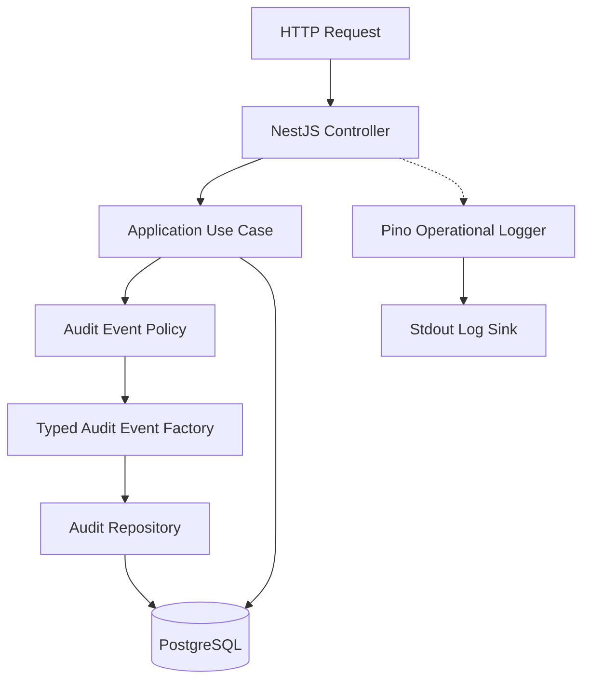
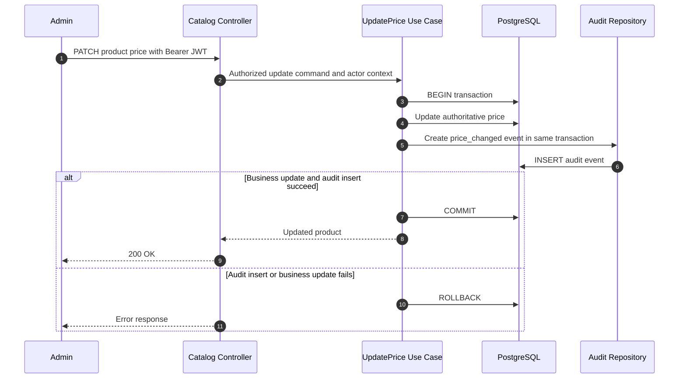
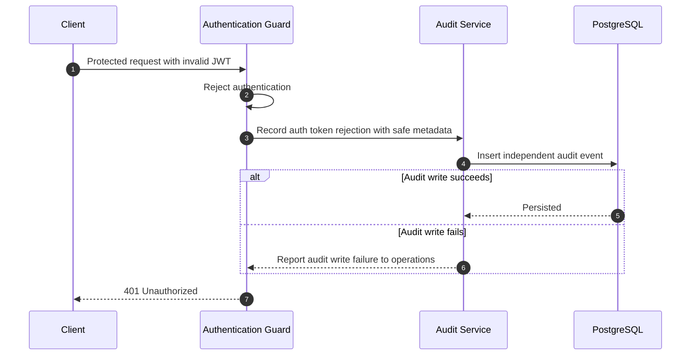
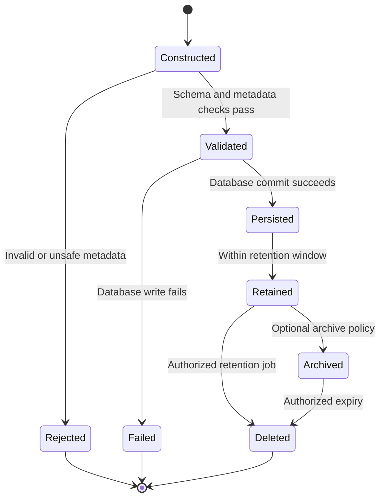
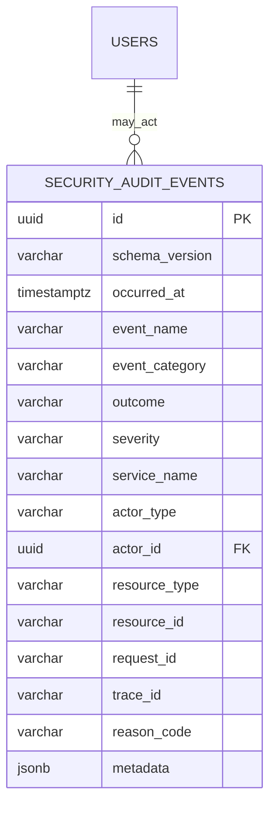

# AI PC Builder — Audit Logging Technical Design

**Document ID:** SEC-002.4  
**Version:** 1.0  
**Status:** Proposed — Awaiting Review  
**Target path:** `docs/04-security/designs/04-audit-logging-design.md`  
**Stack:** NestJS, TypeScript, PostgreSQL, Pino  
**References:** SEC-001, SEC-002, SEC-002-ADR, ARCH-004, SEC-002.1–002.3

## 1. Purpose and Scope

Specify durable security audit events, structured operational logging, integrity guarantees, data minimization, authorization to read audit records, retention and verification. This is a **design**, not an implementation claim.

**In scope:** authentication/session activity, authorization denials, catalog price changes, inventory adjustments, payment webhook handling, AI data-policy rejections, administrative actions.  
**Out of scope for MVP:** centralized SIEM, tamper-proof external ledger, distributed tracing collector, automatic regulatory compliance claims.

## 2. Decisions and Invariants

- **ADR-AUD-001:** Pino emits operational structured JSON to stdout; PostgreSQL stores durable security audit events.
- **ADR-AUD-002:** Versioned project-specific audit schema, inspired by relevant OpenTelemetry conventions. Custom field names are **not** asserted to be official OTel semantic attributes.
- **ADR-AUD-003:** Critical business mutations and their audit event are committed in **the same PostgreSQL transaction**. If the audit insert fails, the business mutation rolls back.
- **ADR-AUD-004:** Authentication failures and other rejected requests are recorded independently, with bounded best-effort logging. Audit storage failures must not grant access; security-critical failures are surfaced operationally.
- **ADR-AUD-005:** Audit payloads use explicit field allowlists. Never store raw JWTs, cookies, passwords, provider secrets, complete prompts, full payment details or unredacted request bodies.
- **ADR-AUD-006:** Audit read access is restricted to designated administrators with a separate `audit:read` permission; access to audit records is itself audited.
- **ADR-AUD-007:** Retention is a deployment decision, not a guessed legal requirement. The MVP must implement a documented configurable retention policy before production release.

**Invariants:**
1. A critical mutation must not commit without its corresponding durable audit event.
2. Audit events cannot be created or modified by ordinary API clients.
3. An audit event must have an event type, timestamp, outcome, service and schema version.
4. Secrets and raw personal payloads must not appear in audit event metadata.
5. Audit failures never cause an authentication or authorization bypass.
6. Audit history must not be silently rewritten through application APIs.

## 3. Component Architecture



**Responsibilities:** Controller attaches authenticated actor and request correlation context; Use Case decides whether an action requires audit; Event Factory validates schema and applies metadata allowlist; Repository inserts into PostgreSQL using the caller's transaction where required; Pino logs operational diagnostics separately.

## 4. Critical Mutation Sequence — Price Change



**Important:** The Audit Repository must receive the same database transaction/connection as the price update. Two independent database commits do **not** provide this guarantee.

## 5. Rejected Request Sequence — Invalid JWT



A failure to record a rejected request must **not** change the 401 into successful access. Avoid unbounded retries or logging raw tokens when audit storage is unavailable.

## 6. Audit Event Lifecycle



This state diagram describes event processing and retention, not a required `status` column in the audit table. Events are append-only through application interfaces; deletion is restricted to the controlled retention process.

## 7. Canonical Event Schema

Store events in a versioned JSON-compatible contract. Persist high-value searchable fields in typed columns; store only allowlisted, non-sensitive details in `metadata` JSONB.

| Field | Type | Required | Notes |
|---|---|---|---|
| `id` | UUID | Yes | Server-generated event ID |
| `schema_version` | string | Yes | Initially `1.0` |
| `occurred_at` | ISO 8601 UTC timestamp | Yes | Server-side timestamp |
| `event_name` | string | Yes | Stable `domain.resource.action` |
| `event_category` | enum/string | Yes | authentication, authorization, catalog, inventory, payment, ai, audit |
| `outcome` | enum | Yes | success, failure, denied, unknown |
| `severity` | enum | Yes | DEBUG, INFO, WARN, ERROR |
| `service_name` | string | Yes | `ai-pc-builder-api` |
| `actor_type` | enum | Yes | customer, admin, system, anonymous, provider |
| `actor_id` | UUID/null | No | Only when verified/known |
| `resource_type` | string/null | No | Resource type |
| `resource_id` | string/null | No | Resource reference, not secret |
| `request_id` | string/null | No | Request correlation |
| `trace_id` | string/null | No | Only if tracing is enabled |
| `reason_code` | string/null | No | Controlled vocabulary |
| `metadata` | JSON object | Yes | Explicit allowlist; default `{}` |

Example:

```json
{
  "id": "6a731d6d-c9ad-4e42-8d4c-7f26b9f7866a",
  "schema_version": "1.0",
  "occurred_at": "2026-10-25T12:00:00.000Z",
  "event_name": "catalog.product.price_changed",
  "event_category": "catalog",
  "outcome": "success",
  "severity": "INFO",
  "service_name": "ai-pc-builder-api",
  "actor_type": "admin",
  "actor_id": "c91a188d-57d1-4aa9-932a-0dca8d0a0c43",
  "resource_type": "product",
  "resource_id": "product-123",
  "request_id": "req-123",
  "trace_id": null,
  "reason_code": null,
  "metadata": {
    "currency": "VND",
    "old_price_minor": 22000000,
    "new_price_minor": 21000000
  }
}
```

All identifiers and amounts are illustrative. VND uses integer monetary units; `*_minor` is an internal naming convention to be aligned with the Money model before implementation.

### 7.1 Event Naming

Use `domain.resource.action`, lowercase snake_case segments. Initial registry:

| Event name | Trigger | Severity |
|---|---|---|
| `auth.login.failed` | Credential rejection | WARN |
| `auth.session.revoked` | Logout/admin revoke | INFO |
| `auth.refresh.reuse_detected` | Reused rotated credential | WARN |
| `authorization.access.denied` | Permission or ownership denial | WARN |
| `security.csrf.validation_failed` | CSRF rejection | WARN |
| `catalog.product.price_changed` | Successful price update | INFO |
| `inventory.stock.adjusted` | Authorized stock adjustment | INFO |
| `payment.webhook.signature_invalid` | Invalid provider signature | WARN |
| `payment.webhook.duplicate_detected` | Duplicate event | INFO |
| `ai.request.data_policy_rejected` | Outbound data policy denial | WARN |
| `audit.events.accessed` | Authorized audit search/export | INFO |

Avoid recording every routine read request as a durable audit event unless a concrete requirement exists.

## 8. PostgreSQL Data Model



The actor foreign key is **optional** and must not block audit records for anonymous, deleted, or external actors. A nullable logical reference without an enforced FK may be preferable if user deletion and retention requirements conflict; decide this before migrations.

Suggested indexes:

- `(occurred_at DESC)` for retention and chronological search.
- `(event_name, occurred_at DESC)` for event investigations.
- `(actor_id, occurred_at DESC)` for actor activity.
- `(resource_type, resource_id, occurred_at DESC)` for resource history.
- `(request_id)` for request correlation.

Do not index every metadata field. Add indexes only for demonstrated queries. Partitioning is deferred until volume justifies it.

## 9. Data Minimization and Redaction

**Prohibited fields:** password, password hash, JWT, refresh token, session cookie, CSRF secret, API key, payment card data, raw webhook signing secret, raw AI prompt, full model response, raw request/response body, database URL, full shipping address.

**Permitted with purpose:** stable actor/resource IDs, reason codes, operation names, sanitized error category, monetary before/after values for authorized administrative price changes, correlation IDs.

Use typed event constructors and allowlisted metadata per event name. Generic `metadata: req.body` or `metadata: error` is forbidden. Operational Pino configuration must redact sensitive request headers and fields and avoid default request-body capture.

## 10. Access Control and Integrity

- Only application service credentials with the necessary insert permission may write audit events.
- Audit search/export requires `audit:read`; ordinary admins do not automatically receive it.
- Audit read and export actions generate their own audit event, without recursive audit loops.
- Application code has no ordinary update/delete API for audit events.
- Database access and backups must be access-controlled; PostgreSQL audit tables alone are **not tamper-proof** against a database superuser.
- Restrict direct database administration and track privileged operations through deployment/platform controls.
- Use pagination, bounded date ranges, and safe filters on audit read APIs.

## 11. Failure Handling

| Failure | Expected behavior |
|---|---|
| Audit insert fails during critical mutation | Roll back mutation; return appropriate server error |
| PostgreSQL unavailable during protected session check | Fail closed; do not authorize |
| Audit insert fails for rejected login | Keep login rejected; emit sanitized operational error |
| Pino stdout unavailable | Do not expose secrets or bypass authorization; report via deployment monitoring when available |
| Event schema invalid | Reject event creation; fail critical transaction if coupled |
| Duplicate request/event | Apply business idempotency; record meaningful outcome without duplicate business effects |
| Retention job fails | Alert/retry under operations policy; do not silently discard records |
| Audit query unauthorized | Return 403 and attempt safe access-denied audit event |

## 12. Retention, Deletion and Privacy

- Set retention by documented operational, contractual and applicable legal needs; **TBD** for MVP deployment.
- Retention worker must be privileged, observable and auditable.
- Avoid storing unnecessary personal information to reduce deletion conflicts.
- Define whether archived audit records and backups follow the same retention and deletion policy.
- Support requests to investigate and correct inaccurate metadata through supplementary events rather than silently editing history, subject to applicable privacy obligations.

## 13. Verification Matrix

| Test ID | Scenario | Expected result | Tool |
|---|---|---|---|
| AUD-001 | Admin changes product price | Business update and audit row commit together | Vitest + PostgreSQL |
| AUD-002 | Audit insert fails during price update | Price change rolls back | Vitest + PostgreSQL |
| AUD-003 | Login fails | `auth.login.failed` event; no password/token logged | Supertest |
| AUD-004 | Revoked session is used | 401 and safe audit event where configured | Supertest |
| AUD-005 | CSRF validation fails | 403 and `security.csrf.validation_failed` | Supertest |
| AUD-006 | Invalid payment webhook signature | Rejected; safe audit event; no signing secret | Supertest |
| AUD-007 | AI payload violates data policy | Provider not called; policy rejection event | Vitest |
| AUD-008 | Request contains JWT and cookies | Neither appears in application or audit logs | Vitest |
| AUD-009 | Unauthorized audit read | 403; no audit data returned | Supertest |
| AUD-010 | Authorized audit read | Paginated results and access audit event | Supertest |
| AUD-011 | Event factory receives unknown metadata field | Reject or omit according to explicit schema | Vitest |
| AUD-012 | Event schema missing required field | Validation fails | Vitest |
| AUD-013 | Audit storage unavailable during rejected login | Authentication still denied | Supertest |
| AUD-014 | Duplicate payment callback | No duplicate business effect; consistent event policy | Integration |
| AUD-015 | Retention worker selects expired records | Only authorized records selected and operation audited | Integration |
| AUD-016 | Correlation ID passed through request | Correct request ID stored | Supertest |

**Test data:** Synthetic identities and secrets only; never use real user data or live provider credentials.

## 14. Implementation Sequence

1. Define typed event names, schema and event-specific metadata allowlists.
2. Create `security_audit_events` migration and repository.
3. Add request correlation and Pino redaction configuration.
4. Integrate critical mutation audit writes using the existing transaction.
5. Add independent security rejection events.
6. Add `audit:read` policy and bounded admin query API when required.
7. Implement automated security tests.
8. Document retention, backup and operational ownership before release.

**Avoid overengineering:** no Kafka, Redis queue, Elasticsearch or SIEM required for the MVP.

## 15. Open Decisions

- AUD-DEC-001: Audit retention period and backup retention.
- AUD-DEC-002: Whether `actor_id` uses an enforced foreign key or logical reference.
- AUD-DEC-003: Exact schema for monetary before/after values, consistent with ARCH-003/004.
- AUD-DEC-004: Which administrative roles receive `audit:read`.
- AUD-DEC-005: Whether production deployment requires external immutable log shipping.
- AUD-DEC-006: Whether audit search/export is included in MVP or deferred.

## 16. Definition of Done

- [x] Component and transaction flows documented.
- [x] Audit event lifecycle documented.
- [x] Canonical schema and event registry proposed.
- [x] PostgreSQL ERD and index strategy proposed.
- [x] Redaction, access control and failure policy specified.
- [x] Verification matrix drafted.
- [ ] Mermaid diagrams rendered and reviewed.
- [ ] Open decisions accepted.
- [ ] ARCH-004 and SEC-002 references synchronized.
- [ ] Implementation completed and tests passing.

**Checkpoint status:** Proposed — Awaiting Review.
